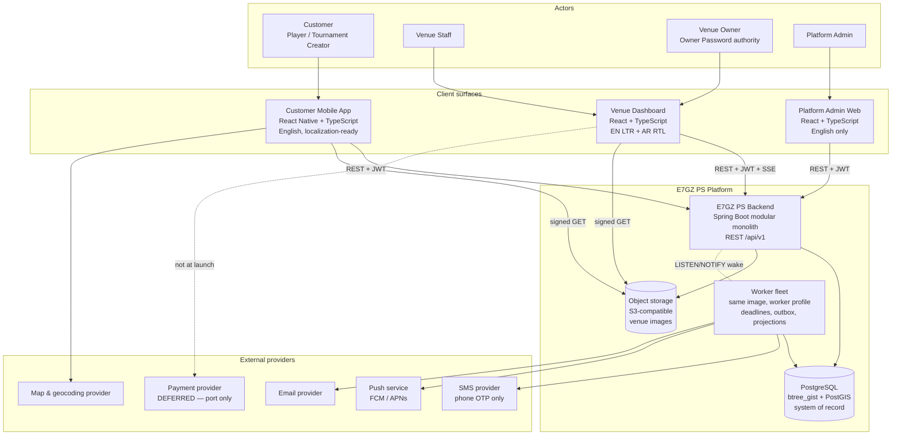
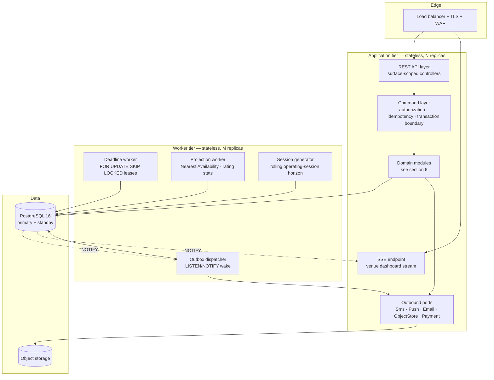
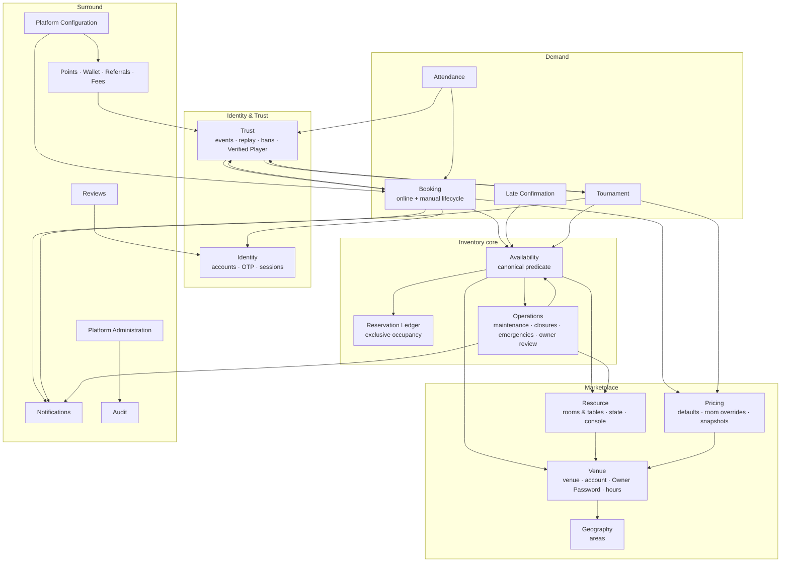
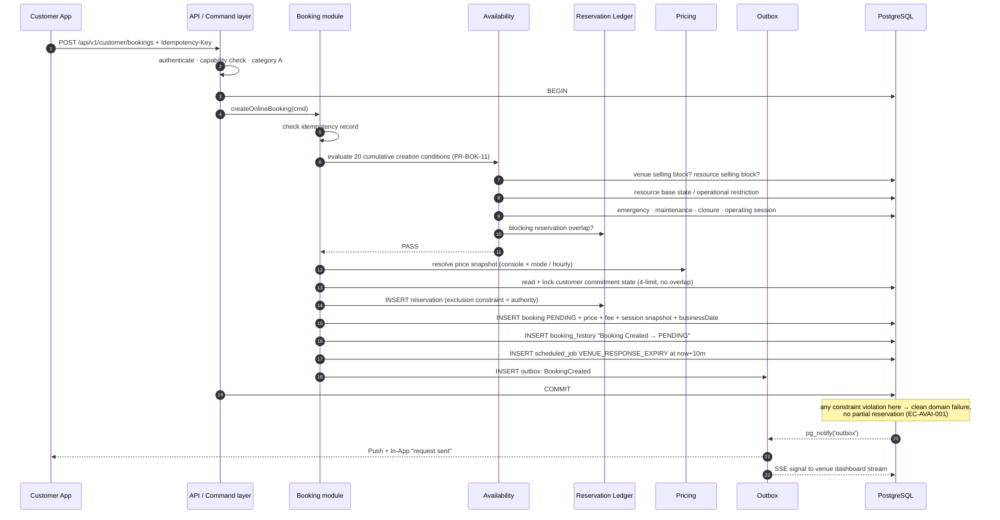
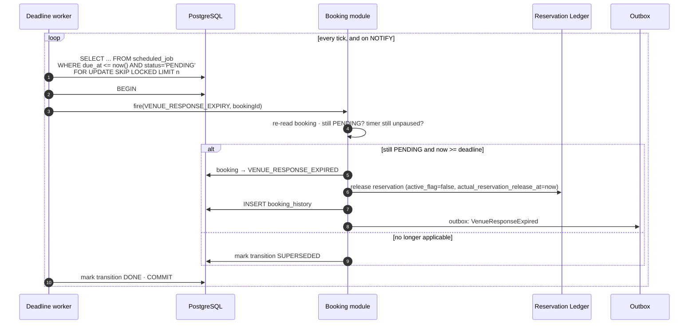
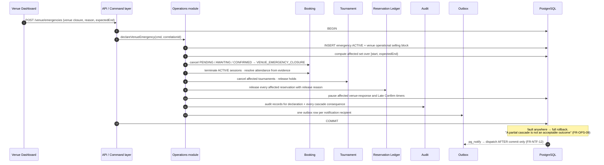
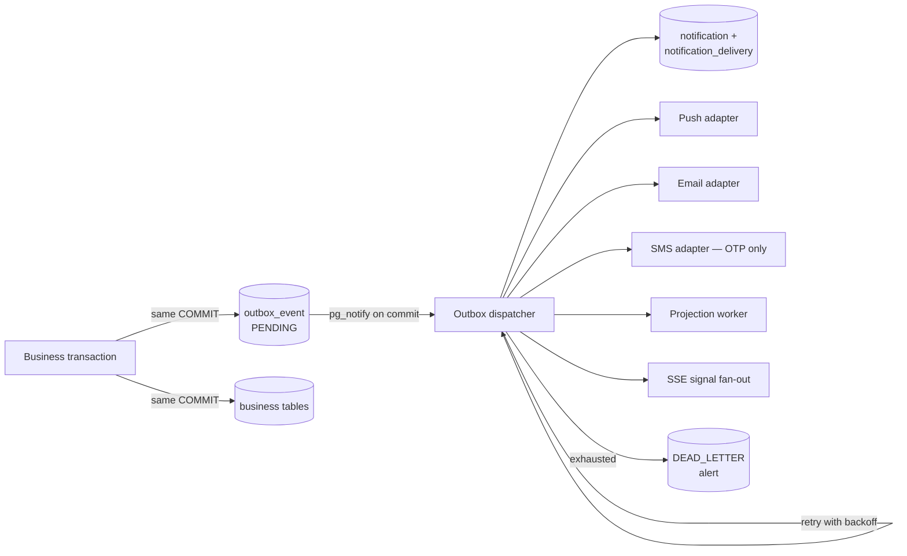
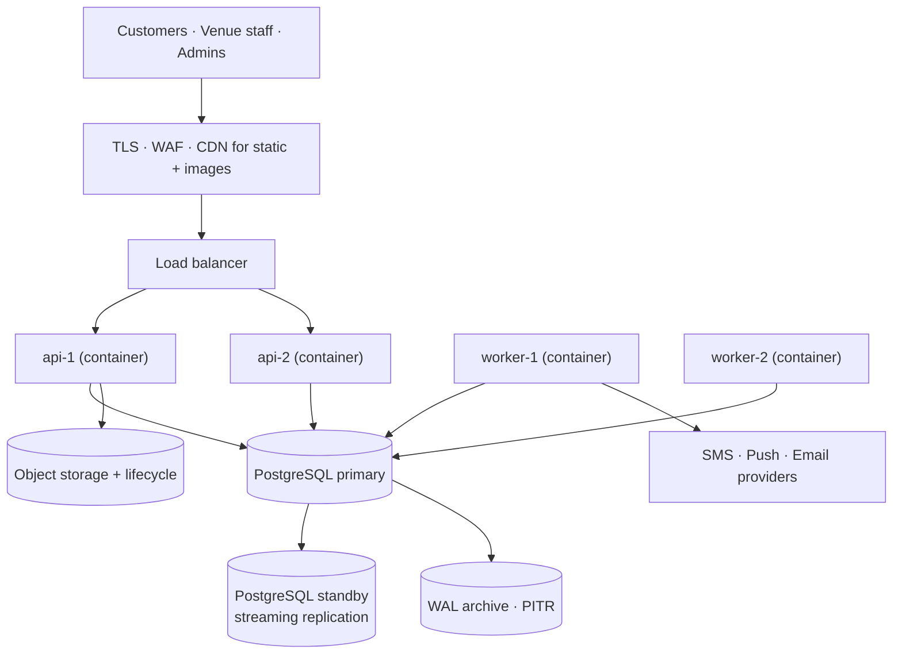

# E7GZ PS
# TECHNICAL ARCHITECTURE v1.1

**Status:** Aligned to physical model v1.1.27
**Date:** 25 September 2026
**Derived from:** FRS v1.1 (357/357) · PRD v1.1 · Product Specification v5.0
**Supersedes:** all v4.x-era technical material, in full
**Tournament participant-cause alignment:** 25 September 2026 — implemented as a cause-aware Participant lifecycle and two separate counts (checkpoint activity vs pre-start capacity occupancy), without adding a Product status or changing the established security architecture.

---

# 1. PURPOSE AND METHOD

## 1.1 Purpose

This document decides **how E7GZ PS is structured** and **what technology implements it**, so that Backend, Mobile, Dashboard, Admin, QA and DevOps can begin building without making undocumented Product decisions.

## 1.2 Method — requirements first

The architecture was derived in this order, and not in any other:

1. Read the 357 approved functional requirements and the 38 non-functional requirements.
2. Extract every statement that constrains structure — atomicity, concurrency, ordering, immutability, timing, authorization, scale, language.
3. Group the requirements into bounded modules by *what owns the data and the rules*, not by screen or by team.
4. Decide communication style between modules from the atomicity the requirements demand.
5. Admit infrastructure **only** where a requirement earns it, and record what was rejected.
6. Write the decisions down with alternatives, so they are not casually revisited.

§2 below is the output of steps 1–2 and is the justification for everything that follows.

## 1.3 Scope of the system

Three client surfaces against **one shared inventory and one backend**:

| Surface | Users | Platform | Language at launch |
|---|---|---|---|
| Customer Mobile App | Player, Tournament Creator | iOS + Android | English, localization-ready (`NFR-34`) |
| Venue Dashboard | Venue Staff, Venue Owner | Web | English LTR + العربية full RTL (`FR-VEN-40`, `NFR-33`) |
| Platform Admin | Platform Admin | Web | English only (`FR-ADM-01`) |

---

# 2. ARCHITECTURE DRIVERS — WHAT THE REQUIREMENTS FORCE

This is the bridge from the functional baseline to every decision in this pack. Each row is a requirement-level constraint and the structural consequence it forces.

## 2.1 Correctness drivers

| # | Requirement constraint | Source | Architectural consequence |
|---|---|---|---|
| D1 | Two active reservations must never overlap on one resource; a single canonical predicate governs online booking, manual booking, Late Confirm, tournament creation, tournament holds and Nearest Availability | `FR-AVL-01`, `FR-AVL-08` | **One reservation ledger table with a database exclusion constraint.** One availability service, no second code path, no per-flow copy of the predicate |
| D2 | Revalidation and the state transition commit in one atomic transaction; the first successfully committed valid transition wins | `FR-AVL-09`, `FR-AVL-10`, `NFR-01`, `NFR-02` | **Single relational database, single transaction boundary per command.** Rules out cross-service distributed transactions for the booking path |
| D3 | Cascades spanning bookings + tournaments + reservations + history + notifications are all-or-nothing | `FR-OPS-09`, `FR-OPS-29`, `NFR-03` | **Modular monolith.** A cascade that must be atomic across five aggregates cannot be a saga at launch |
| D4 | Notifications dispatch after commit, never before; no notification for a rolled-back transaction | `FR-NTF-12`, `NFR-03` | **Transactional outbox** written in the business transaction, dispatched by a separate worker |
| D5 | Scheduled transitions must fire reliably and idempotently; a retried run must not double-apply | `NFR-04` | **Durable database-backed deadline table with leases**, not in-memory timers, not client timers |
| D6 | Timers pause and resume preserving remaining duration, with separate cumulative 30-minute caps | `FR-OPS-36`, `FR-OPS-37` | Deadlines must be **recomputable state**, not fire-and-forget messages. Rules out broker delayed-delivery as the authority |
| D7 | Trust is derived by deterministic replay from an immutable ordered stream; as-of replay at any past instant must reproduce | `FR-TRS-01`, `FR-TRS-06`, `FR-TRS-10`, `NFR-05` | **Event-sourced Trust module** with `(effectiveAt, eventSequence)` ordering; derived state is a rebuildable projection, never authoritative |
| D8 | Each cascade executes once — `banInstanceId`, `verifiedPlayerTransitionId`, one protection event per booking | `FR-TRS-21`, `FR-TRN-20`, `FR-ATT-22`, `NFR-06` | **Natural idempotency keys as unique constraints**, so replay cannot repeat side effects |
| D9 | Historical prices, fees, rewards, attendance and session snapshots are never rewritten | `FR-AUD-01`, `FR-AUD-04`, `NFR-22` | **Append-only tables with data-layer enforcement**; corrections are compensating rows |
| D10 | Closed enums are validated at write time; unknown values rejected | `NFR-23`, `NFR-24` | Enum values are **`text` with a closed `CHECK` list**, spelled exactly as the FRS spells them, never free strings (`ADR-027`) |
| D11 | Every terminal booking and tournament carries exactly one reason code | `NFR-26` | **NOT NULL + CHECK on terminal rows**, plus a reachability test over the closed enum in CI |

## 2.2 Time and scheduling drivers

| # | Requirement constraint | Source | Architectural consequence |
|---|---|---|---|
| D12 | All scheduling uses absolute instants; Africa/Cairo with full DST rules governs sessions, intake windows and timers | `NFR-07`, `NFR-08`, `FR-VEN-21` | Store `timestamptz`; **materialize operating sessions into concrete instants** so DST is resolved once, at generation, not per query |
| D13 | Each operating day yields at most one session; sessions may touch but not overlap; validation is cyclical across the week including the Sunday→Monday wrap | `FR-VEN-18`, `FR-VEN-19` | Session generation is a **dedicated engine with its own validation**, not ad-hoc date maths in the booking service |
| D14 | Price uses nominal duration; inventory uses real elapsed time; a DST transition must never change the price | `FR-BOK-07`, `NFR-09` | Booking stores **both** `nominalBookedMinutes` (money) and `startAt`/`endAt` instants (inventory) |
| D15 | Boundaries are strict: `now < deadline` permits, `now >= deadline` expires; client countdowns are display only | `FR-AVL-15`, `NFR-10` | **Server-authoritative deadlines** returned as instants; no client-side decisioning |
| D16 | Late Confirm windows may be as short as 60 seconds; push must dispatch within seconds of commit | `FR-LCF-09`, `NFR-13`, `R9` | Outbox dispatch must be **wake-driven, not long-poll** — `LISTEN/NOTIFY` wake-up on insert |
| D17 | A paused response timer resumes only inside a valid future intake window; early cancellation uses an optimistic feasibility test | `FR-OPS-39`, `FR-OPS-40` | The deadline engine must be able to **re-derive a due instant from venue session data**, so sessions must be queryable as data |

## 2.3 Scale, performance and surface drivers

| # | Requirement constraint | Source | Architectural consequence |
|---|---|---|---|
| D18 | Venue list with Nearest Availability per venue per activity, p95 < 1s on mobile | `FR-DIS-04`, `NFR-11` | Nearest Availability is **precomputed into a projection**, refreshed on inventory events; it is explicitly a snapshot, not a guarantee (`FR-AVL-11`) |
| D19 | Booking create / accept / Late Confirm complete p95 < 2s | `NFR-12` | Commit path must stay **single-database, single-round-trip-per-aggregate**; no synchronous third-party call inside the transaction |
| D20 | Distance sorting and map markers by coordinates | `FR-DIS-01`, `FR-DIS-10` | **PostGIS** geography column and KNN index — a Postgres extension, not new infrastructure |
| D21 | Venue must answer a request inside 10 minutes; the Dashboard must surface new requests immediately | `FR-BOK-13`, `FR-NTF-09`, `R2` | Dashboard needs a **server-push channel**; chosen as SSE fanned out through Postgres `LISTEN/NOTIFY`, plus Web Push for background |
| D22 | One launch city, low venue count, manual Platform-Admin onboarding, headroom for 10× | `PRD §27.2`, `NFR-15` | **No horizontal-scale infrastructure at launch.** Two stateless app replicas and one managed Postgres carry 10× |
| D23 | Dashboard is full Arabic RTL; backend stores language-neutral codes | `FR-VEN-40`, `NFR-33`, `FR-NTF-06` | **No user-facing prose in the backend.** API returns codes; surfaces translate. Free-text stored data is never transformed |

## 2.4 Security and privacy drivers

| # | Requirement constraint | Source | Architectural consequence |
|---|---|---|---|
| D24 | Owner Password validated per action, never cached into a session or unlock window; successes and failures audited and rate-limited | `FR-VEN-02`, `NFR-16` | Owner Password is a **per-request credential in the command body**, verified against an Argon2id hash, never exchanged for a token |
| D25 | Counterpart phone visibility enforced server-side by retention rules, never merely hidden in the UI | `FR-PTS-20`, `NFR-18` | A **contact-visibility resolver** in the booking projection layer; the field is absent from the response, not masked in the client |
| D26 | A venue must never learn why a customer is ineligible for Late Confirmation | `FR-LCF-05`, `FR-LCF-15`, `NFR-19` | **Surface-scoped response shaping**: the venue-facing error is a single neutral code while the internal booking event records the real cause |
| D27 | Backend authorization is authoritative; frontend hiding is not a control | `FR-ACC-17`, `FR-VEN-08` | Every endpoint carries an explicit capability check derived from `FRS §2.10` / `§2.11`, enforced at the command layer |
| D28 | Credentials are never logged; audit records never contain secrets | `NFR-21` | Structured logging with a **field redaction allowlist**, verified by a test |

## 2.5 Money-readiness driver

| # | Requirement constraint | Source | Architectural consequence |
|---|---|---|---|
| D29 | Booking fee is EGP 0 at launch; enabling a non-zero fee must require no schema or logic redesign | `FR-PTS-13`, `NFR-38` | Fee fields, refund classification, wallet ledger and points ledger are **built and correct on day one**; only a `PaymentProvider` port is missing, and nothing in the booking path references it |

---

## 2.6 Tournament participant-cause driver

| # | Requirement constraint | Source | Architectural consequence |
|---|---|---|---|
| D30 | `INELIGIBLE` has an explicit `BAN` or `ACCOUNT_DELETED` cause; deletion permanently defeats BAN-only restoration; a temporary Ban before Start removes the participant from the checkpoint count but may reserve one capacity slot until `startAt`; Ban expiry/lift before Start restores automatically, using the authoritative checkpoint/start instant even if a worker runs late | `FR-TRN-13`, `FR-TRN-26` | Keep **one Participant Status plus a cause field**; define two named queries, `activeParticipantCount(at)` and `capacityOccupiedCount(at)`; account anonymisation reclassifies `BAN → ACCOUNT_DELETED` atomically; Ban-end reconciliation is boundary-time aware and never restores at/after `startAt` |
| D31 | Account deletion is initiated by the Customer but completed by the existing audited anonymisation orchestration | `FR-ACC-10`, PCR-002 | Persist `account_deletion_request`; initiation is idempotent per unresolved User request and never hard-deletes retained history; O19 completion links the request to `account_anonymisation` |
| D32 | Review reporting is a separate abuse signal and never a moderation transition by itself | `FR-REV-11`, PCR-003 | Persist `review_report`; report submission leaves Review state unchanged; Platform Admin resolution may reference an existing moderation event |

The two counts must never be substituted for one another. Capacity admission protects a BAN-only participant's temporary restoration right; the checkpoint minimum deliberately ignores that reserved slot.

---

# 3. ARCHITECTURAL STYLE

## 3.1 Decision

`[DECIDED]` **A modular monolith** — one deployable Spring Boot application with strongly separated domain modules, internal domain events, and one PostgreSQL database — plus a **separate worker deployment of the same image** for schedulers and outbox dispatch.

See `ADR-001` for the full record.

## 3.2 Why the requirements force it

The decisive requirements are `NFR-01`, `NFR-03` and `FR-OPS-29`. A venue emergency closure must, in one all-or-nothing commit, cancel PENDING, AWAITING and CONFIRMED bookings across customers, terminate ACTIVE sessions, cancel tournaments, release reservations and tournament holds, write booking history, write audit records and enqueue every notification — *before any notification dispatches*. The owner-review cascade adds manual bookings and tournament resource removal to the same atomic set, and states plainly that **"a partial cascade is not a valid outcome."**

Splitting Bookings, Tournaments, Inventory and Notifications into separate services would turn that single commit into a distributed saga with compensations — and a compensation is exactly the partial state the requirement forbids. The same applies to `FR-AVL-09`/`FR-AVL-10`: revalidation and transition must commit atomically, across the customer's commitment count, the resource reservation and the booking row.

The monolith is therefore not a shortcut. It is the only structure that satisfies the stated atomicity without inventing behaviour the Product does not have.

## 3.3 Why it is still modular

`PRD §3.4` excludes multi-branch venues, cashier accounts, payments and several other extensions, but records them as future candidates. Module boundaries are drawn so that a later extraction is a refactor, not a rewrite:

- Each module owns its tables. **No module reads another module's tables directly.**
- Cross-module reads go through a published Java interface in the owning module's `api` package.
- Cross-module writes that need not be atomic go through internal domain events.
- Cross-module writes that **must** be atomic — the cascades above — go through an explicitly documented orchestration service, and the list of those is closed (`03 — Domain Module Specification §2.4`).

A module that never participates in an atomic cascade — Notifications, Reviews, Points/Wallet, Audit — is already extraction-ready today.

---

# 4. SYSTEM CONTEXT

## 4.1 Context diagram

## 4.2 External integration contracts

| Integration | Used for | Criticality | Architectural treatment |
|---|---|---|---|
| **SMS provider** | Mandatory phone OTP **only** (`FR-NTF-01`) | **Blocking** — no verified account, no booking (`PRD §27.1`) | Behind an `SmsSender` port with a **configured fallback provider** (Risk `R8`). Send is asynchronous through the outbox; delivery status recorded in `notification_delivery`. Never called inside a business transaction |
| **Push service** | Every timer-critical customer event; Late Confirm windows as short as 60s (`NFR-13`, `R9`) | **High** | FCM for Android and, via APNs, iOS. Dispatch is wake-driven from the outbox. Payload carries **the Booking ID** for exact deep-link (`FR-NTF-04`) |
| **Email provider** | Account, security and moderation events (`FR-NTF-03`) | Medium — degraded, not blocking | Behind an `EmailSender` port, outbox-dispatched |
| **Map & geocoding** | Map view and distance sorting (`FR-DIS-10`, `FR-DIS-01`) | Medium — list view and area filter survive an outage | Rendering and tiles are a **client-side** concern. Distance and eligibility are computed **server-side** from stored coordinates via PostGIS, so map-provider failure never changes what is bookable |
| **Payment provider** | Deferred (`FR-PTS-13`, `PRD §3.4`) | None at launch | A `PaymentProvider` port is defined in `03 §17` and **no booking, fee, refund-classification or ledger code references it**. Enabling a non-zero fee is configuration plus an adapter (`NFR-38`) |

**Rule.** No external provider is called inside a business transaction, and no external provider's availability can block a commit. Every one of them sits behind the outbox (`D4`).

---

# 5. COMPONENT ARCHITECTURE

## 5.1 Component diagram

## 5.2 Component responsibilities

| Component | Owns | Explicitly does not |
|---|---|---|
| **REST API layer** | HTTP shape, surface scoping, request validation of *syntax*, response projection including contact-visibility redaction (`D25`) and neutral-error shaping (`D26`) | Business rules; it never decides eligibility |
| **SSE endpoint** | A per-venue-account event stream carrying *change signals only*, never business payloads | Authoritative state; the client refetches on signal |
| **Command layer** | The transaction boundary, actor authorization (`FRS §2.10`), Owner Password verification (`I7`), idempotency-key handling, correlation ID propagation | Domain rules; it delegates |
| **Domain modules** | All Product rules, all state transitions, all invariants, all domain events | HTTP, scheduling, provider protocols |
| **Deadline worker** | Firing every scheduled transition exactly once per due instant, with lease-based safety and recomputation after pause/resume | Deciding outcomes — the **boundary rule** decides, not execution time (`NFR-14`) |
| **Outbox dispatcher** | At-least-once delivery of committed events to notification channels, with retry and backoff | Writing business state |
| **Projection worker** | Nearest Availability, venue rating statistics, revenue aggregates | Being a source of truth — every projection is rebuildable from the system of record |
| **Session generator** | Materializing the weekly opening-hours template into concrete, DST-resolved operating sessions over a rolling horizon | Opening-hours validation, which belongs to the Venue module |
| **PostgreSQL** | System of record, and the **enforcement point** for I1, I6, D10, D11 | — |
| **Object storage** | Venue images only (`FR-ADM-02`) | Any data that participates in a transaction |

## 5.3 Why worker and API are separate deployments of the same image

- A slow SMS provider must never consume request threads needed for a 10-minute venue response.
- Deadline firing must keep running while the API is being deployed.
- They share one codebase and one data model, so there is no contract drift; the Spring profile selects which schedulers start.

---

# 6. BOUNDARIES

## 6.1 Frontend / backend boundary

| Rule | Consequence | Source |
|---|---|---|
| The backend returns **codes**, never user-facing prose | One backend serves English, Arabic RTL and English-only surfaces with no branching | `FR-VEN-40`, `NFR-33`, `NFR-34` |
| The backend returns **deadline instants**, never remaining seconds | Client countdowns are display; a clock-skewed device cannot change an outcome | `NFR-10`, `D15` |
| The backend returns **only what the caller may see** | Contact visibility and neutral errors are server-enforced, never client-hidden | `NFR-18`, `NFR-19` |
| The backend never trusts a client-supplied availability claim | Every commitment revalidates against authoritative inventory | `FR-AVL-11`, `VR-X-005` |
| Every commitment-strengthening write carries an `Idempotency-Key` | A network retry cannot create a second commitment | `NFR-04`, `D8` |

## 6.2 Backend / database boundary

| Rule | Consequence |
|---|---|
| The database enforces **I1** via an exclusion constraint | Application bugs cannot produce a double booking |
| The database enforces **I6** via append-only triggers and revoked privileges | Application bugs cannot rewrite history |
| The database enforces **D10/D11** via closed `CHECK` lists and NOT NULLs | An unknown reason code cannot be stored |
| The database owns **invariants**: exclusion constraints, state-machine graphs and terminal immutability, snapshot immutability, append-only history, Product-fixed deadline arithmetic, anonymisation completeness. The application owns **decisions**: the canonical predicate, which transition and which reason, cascade orchestration, notifications (`ADR-026`, `04 §2`) | A code path that forgets a rule is refused at commit; flows stay testable in Java |
| Every business write opens a command context (`tournament.begin_command` / `admin.begin_command` …) in one `READ COMMITTED` transaction; producer-only tables are written only through their producer functions (`04 §2.1`) | One lock order across modules; no deadlock between cascades |
| One database, one schema per owning module (`04 §3`) | Extraction later means moving a schema, not untangling joins |

## 6.3 Module boundaries

| Rule |
|---|
| A module owns its tables and is the only writer to them |
| Cross-module **reads** go through the owning module's published interface, never through a foreign-table join in application code |
| Cross-module **writes** are either an internal domain event (eventually consistent, allowed) or an explicit orchestration inside one transaction (atomic, allowed only for the closed list in `03 §2.4`) |
| Foreign keys across module boundaries are permitted — they are integrity, not coupling — but joins across them in application queries are not |
| A module never imports another module's `domain` or `infrastructure` package |

## 6.4 Infrastructure boundary

Everything that is not PostgreSQL, the application image or object storage is **outside the correctness boundary**. No invariant, no state transition and no eligibility decision may depend on a cache, a broker, a provider or a client. This rule is what makes the launch infrastructure small.

---

# 7. DOMAIN MODULES

## 7.1 Module map

## 7.2 Ownership — which component owns which responsibility

Every FR domain has exactly one owning module. Full per-module detail is in `03 — Domain Module Specification`; the traceability of all 357 IDs is in `13`.

| Module | Owns | FRS domains | Key invariants |
|---|---|---|---|
| **Identity** | User accounts, username/phone uniqueness and cooldown, OTP lifecycle and limits, password reset, auth sessions and refresh tokens, Customer deletion requests and admin-completed anonymisation | 4.1 Accounts (18) | Phone verification is the only marketplace activation gate (`FR-ACC-02`) |
| **Geography** | Areas and their status; deactivation guard | part of 4.8 | Area status governs discovery only, never manual booking (`FR-VEN-12`) |
| **Venue** | Venue record, marketplace status, account status, Owner Password hash, opening-hours template, operating-session generation, venue-level operational selling block | 4.8 Venue (47) | Marketplace status and account status are independent (`FR-VEN-06`) |
| **Resource** | Rooms and tables, base state, operational restriction, console type, activity compatibility, resource-level selling block | part of 4.8 | Base state and operational restriction are independent (`FR-VEN-13`) |
| **Pricing** | Venue console×mode defaults, room overrides, billiards/ping-pong hourly rates, price resolution and snapshotting | part of 4.8 | Historical prices never rewritten (`FR-AUD-01`); console change clears overrides (`FR-VEN-15`) |
| **Reservation Ledger** | The single table of exclusive resource occupancy and its release history | part of 4.3 | I1 — database-enforced non-overlap |
| **Availability** | **The one canonical predicate** and the Nearest Availability projection | 4.3 Availability (15) | One predicate, eight ordered checks, no second path (`FR-AVL-02`) |
| **Operations** | Maintenance windows and the rolling threshold, venue closures, venue and resource emergencies, the emergency status lifecycle, `OWNER_REVIEW_REQUIRED` and its cascade, timer pause/resume | 4.9 Operations (44) | No sellable gap (`FR-OPS-21`); all-or-nothing cascades (`FR-OPS-09`) |
| **Booking** | Online and manual booking lifecycle, the 20-condition creation predicate, reason codes, booking events, commitment counting, booking history | 4.4 Booking (32), 4.7 Manual (11) | Exactly one reason code per terminal booking (`NFR-26`) |
| **Late Confirmation** | Revival of `VENUE_RESPONSE_EXPIRED` bookings under the same Booking ID, temporary holds, per-booking windows | 4.5 Late Confirm (18) | Same Booking ID (`FR-LCF-08`); per-booking state (`FR-LCF-10`) |
| **Attendance** | Check-in, Mark Present — Late, no-show, attendance result derivation and correction, Platform Attendance Protection | 4.6 Attendance (28) | Attendance Result is an independent stored field (`FR-ATT-07`) |
| **Tournament** | Tournament entity, approval, holds, participants, cause-aware ineligibility, checkpoint, lifecycle, cost snapshot | 4.10 Tournaments (33) | A tournament is never modelled as a booking (`FR-TRN-01`); Active Participant count and Capacity Occupancy are separate (`FR-TRN-13`, `FR-TRN-26`) |
| **Trust** | Immutable trust input events, deterministic replay, consecutive counter, penalty stage, ban qualification and ban instances, Verified Player qualification and operational status | 4.11 Trust (27) | I5 — derived, never authoritative |
| **Loyalty** | Points ledger and balance, referral lifecycle, wallet ledger, global fee and refund classification | 4.12 Points/Fees (21) | Append-only; balance never negative (`FR-PTS-03`) |
| **Reviews** | Review lifecycle, moderation states, Customer reporting, cooldown, venue rating statistics | 4.13 Reviews (11) | Only ACTIVE reviews count toward rating (`FR-REV-04`) |
| **Notifications** | Notification records, per-channel delivery attempts, channel routing | 4.15 Notifications (12) | Dispatch after commit only (`FR-NTF-12`) |
| **Platform Configuration** | Global configurable values with effective-from semantics | part of 4.14 | Future events only (`FR-ADM-11`) |
| **Audit** | Immutable audit records, actor, reason, correlation ID, historical snapshots | 4.16 Audit (15) | Append-only, never contains secrets (`NFR-21`) |
| **Platform Administration** | Admin identity, onboarding orchestration, moderation and remediation commands, operational alerting | 4.14 Admin (11) | Admin never bypasses a Product invariant (`FR-TRS-26`) |

## 7.3 Communication style between components

| Interaction | Style | Why |
|---|---|---|
| Client → backend | **Synchronous REST + JSON over HTTPS** | `FR-*` are request/response; OpenAPI generates typed clients for all three surfaces |
| Backend → client push | **SSE** for the Venue Dashboard, **Web/mobile Push** for the Customer App | `D21`, `NFR-13` |
| Booking → Availability → Ledger | **Synchronous, in-process, same transaction** | `FR-AVL-10` requires atomic revalidate-and-commit |
| Emergency / owner-review / hours-change cascades | **Synchronous orchestration, one transaction** | `NFR-03` forbids partial cascades |
| Attendance → Trust | **Synchronous, same transaction** — the trust input event is written with the attendance outcome | `FR-TRS-05` fixes `effectiveAt` from the booking; the event must not be lost |
| Trust → Booking cancellation cascade (ban) | **Synchronous, same transaction**, guarded by `banInstanceId` | `FR-TRS-21` — once only |
| Anything → Notifications | **Asynchronous via transactional outbox** | `FR-NTF-12` — after commit, never before |
| Anything → Audit | **Synchronous, same transaction** | An audited action that commits without its audit record is a defect (`FR-AUD-03`) |
| Inventory change → Nearest Availability projection | **Asynchronous via outbox**, projection is advisory | `FR-AVL-11` — displayed availability is a snapshot, not a guarantee |
| Scheduled transitions | **Deadline worker polls the deadline table** | `NFR-04` — durable and idempotent |

**The rule behind the table:** if a requirement says *atomic*, *all-or-nothing* or *once only*, it is synchronous and in the same transaction. Everything else is an event.

---

# 8. TECHNOLOGY DECISIONS

## 8.1 Summary

| Layer | Decision | Earned by | Rejected alternatives |
|---|---|---|---|
| Backend runtime | **Java 21 LTS + Spring Boot 3.x** | `D2`, `D3` — strong transaction semantics, mature JDBC; the team already has Spring Boot experience | Node/NestJS *(weaker transactional ergonomics for D3 cascades)*; .NET *(no team experience)*; Go *(no team experience, more hand-rolled persistence)* |
| Persistence | **Spring Data JDBC + explicit SQL for inventory paths; JPA only for simple CRUD aggregates** | `D1`, `D2` — the reservation path needs exact, reviewable SQL and predictable locking | Full JPA/Hibernate everywhere *(implicit flush ordering and lazy loading obscure exactly the commit that I1 and I2 depend on)* |
| Database | **PostgreSQL 16** with `btree_gist` and `postgis` | `D1` exclusion constraints on ranges, `D20` geospatial, `D9` triggers, `D16` `LISTEN/NOTIFY` — **four separate requirements, one engine** | MySQL *(no range exclusion constraints — I1 would become application-only)*; MongoDB *(no multi-document guarantees for D3 as required)* |
| Scheduling | **Deadline table + `FOR UPDATE SKIP LOCKED` lease workers** | `D5`, `D6`, `D17` — deadlines must be pausable, recomputable and idempotent | Quartz clustered *(extra schema and semantics for no gain; poor fit for recomputed due instants)*; broker delayed delivery *(a scheduled message cannot be paused and re-derived)*; in-memory `@Scheduled` *(lost on restart, unsafe across replicas)* |
| Async messaging | **Transactional outbox in PostgreSQL + `LISTEN/NOTIFY` wake + worker dispatch.** No broker at launch | `D4`, `D16`, `D22` | **RabbitMQ / Kafka — `[DEFERRED]`**, see `ADR-004`. No launch requirement needs cross-service routing, replay or fan-out beyond what one table and one worker give |
| Cache | **`[DEFERRED]`** — Nearest Availability is a PostgreSQL projection table; rate limits are PostgreSQL counters | `D18`, `D22` | **Redis — `[DEFERRED]`**, see `ADR-005`, with a stated adoption trigger |
| Object storage | **S3-compatible bucket** with signed GET URLs | `FR-ADM-02` venue images | Storing images in PostgreSQL *(bloats backups and PITR for no benefit)*; serving from the app *(wastes request threads)* |
| API style | **REST + JSON, `/api/v1`, OpenAPI 3.1 generated from code** | `FR-ADM-01`/`FR-VEN-34` surface shapes are resource-oriented; three clients need typed SDKs | GraphQL *(the hard problems here are write-path atomicity and authorization, which GraphQL does not help and whose field-level exposure rules — `NFR-18`, `NFR-19` — it makes harder)* |
| Customer app | **React Native + TypeScript** | Two stores, one small team; `NFR-34` localization-readiness | Flutter *(no team Dart experience)*; two native apps *(roughly double the build for a launch MVP)* |
| Venue Dashboard | **React + TypeScript + Vite**, RTL via CSS logical properties and `dir="rtl"` | `FR-VEN-40`, `NFR-33`; the supplied Design System prototype is React and already carries `dir` handling | Server-rendered templates *(the dashboard is a live operational console with an SSE stream)* |
| Platform Admin | **React + TypeScript + Vite**, English only | `FR-ADM-01` | — |
| Containers | **Docker**; Compose for dev, a managed container host for staging/production | `D22` | Kubernetes at launch *(operational weight unjustified at one-city scale; the design stays K8s-ready)* |

## 8.2 Caching, messaging and storage — the explicit position

The roadmap instruction was to choose only infrastructure justified by actual requirements. Applying that honestly to this baseline:

**Caching.** The only performance requirement that needs help is `NFR-11` — a venue list with Nearest Availability per venue per activity, p95 under one second. Nearest Availability is expensive because it walks opening hours, eligible resources and the canonical predicate for every venue (`FR-DIS-04`). But `FR-AVL-11` states plainly that displayed availability **is a snapshot, not a commit guarantee** — which explicitly authorises precomputation.

`[DECIDED]` Precompute it into a PostgreSQL projection table `venue_activity_availability`, refreshed by the projection worker on every inventory-affecting event, and read by discovery with a single indexed query. This meets `NFR-11` with no new infrastructure and no new failure mode. `[DEFERRED]` Redis, with the adoption trigger recorded in `ADR-005`.

**Messaging.** `FR-NTF-12` and `NFR-03` require that notifications dispatch *after* the commit and *never* for a rolled-back transaction. That is the transactional outbox pattern, and the outbox is a table. A broker would sit **after** the outbox, adding a hop, a second delivery guarantee to reason about, and another service to operate — while the launch fan-out is one consumer per channel at one-city volume.

`[DECIDED]` Outbox table + `LISTEN/NOTIFY` wake + worker dispatch with exponential backoff and a dead-letter state. `[DEFERRED]` RabbitMQ, with the adoption trigger in `ADR-004`. The outbox row remains the contract, so adopting a broker later changes the dispatcher and nothing else.

**Storage.** One PostgreSQL database as the system of record (`D2`) plus one S3-compatible bucket for venue images. Nothing else stores state. Every projection — Nearest Availability, rating statistics, revenue aggregates, trust derived state — is rebuildable from the system of record, and a rebuild command ships with the application.

## 8.3 What was deliberately **not** adopted

| Not adopted | Because |
|---|---|
| Microservices | `NFR-03` all-or-nothing cascades across five aggregates (§3.2) |
| Event streaming platform | No requirement needs durable replayable cross-service streams; Trust replay is intra-module and reads its own table |
| Separate read database / CQRS store | `NFR-11` is satisfied by one projection table; a second datastore would add a consistency story the requirements do not need |
| Redis | See `ADR-005` |
| RabbitMQ / Kafka | See `ADR-004` |
| Kubernetes at launch | `D22`; design stays K8s-ready |
| Stored-procedure business logic | §6.2 — the database enforces invariants, the application implements flows |
| A rules engine for the availability predicate | `FR-AVL-02` fixes eight checks in a fixed order; a rules engine would make a frozen sequence configurable, which is the opposite of what the requirement wants |

---

# 9. SECURITY ARCHITECTURE — HIGH LEVEL

Full detail in `10 — Security Architecture`.

## 9.1 Three identity types, one backend

| Identity | Credential | Token | Notes |
|---|---|---|---|
| **Customer** | Phone/username + password (Argon2id), phone OTP for verification and reset | Short-lived JWT access + rotating refresh token, refresh stored hashed | Marketplace capability gated on `phone_verified` (`FR-ACC-02`) |
| **Venue Account** | One **shared** account per venue (`FR-VEN-01`) | Same token model; `DISABLED` blocks login and therefore every Dashboard action (`FR-VEN-08`) | No cashier, manager or owner sub-accounts (`PRD §3.4`) |
| **Platform Admin** | Admin credentials, second factor recommended | Same token model, admin scope | Reserved actions per `FRS §2.10` |

## 9.2 Owner Password — the architectural rule

The Owner Password is **not an identity**. It is a second secret held by the venue and supplied **inside the command body of each protected action** (`FR-VEN-02`, `FR-VEN-03`, `I7`).

- Stored only as an Argon2id hash on the venue record; never plaintext, never logged, never in an audit payload (`NFR-21`).
- Verified inside the same transaction as the protected action, immediately before the state change.
- **It is never exchanged for a token, a session flag, a cookie or a cache entry.** There is no unlock window of any duration (`FR-VEN-02`).
- Every attempt — success and failure — writes an audit record with actor, action and timestamp, and validation is rate-limited per venue account (`FR-VEN-05`, `NFR-16`).
- A venue-initiated change takes effect immediately and invalidates the old value at once (`FR-VEN-46`); an Admin reset notifies the venue (`FR-ADM-03`).

The protected and unprotected action lists are implemented as a **single annotated registry** derived from `FRS §2.4`, so the two lists cannot drift apart in code.

## 9.3 Authorization

Authorization is enforced at the command layer, never at the UI (`D27`). Three inputs decide every call:

1. **Actor type and capability** — from `FRS §2.10`.
2. **Customer account state** — Unverified / Verified / Banned, from `FRS §2.11`. A banned customer may still browse, cancel a future booking, decline a Late Confirmation and manage reviews (`FR-ACC-17`) — the check is per capability, never a blanket block.
3. **Eligibility category** — A New-Activity Marketplace, B Existing-Commitment Operational, or C Internal Venue Operation (`FRS §2.3`). Each command declares its category, and the category decides whether marketplace `ACTIVE` is required. Miscategorising an action is, per the PRD, the most common source of incorrect behaviour, so the category is a **required declaration on every command class**, checked by an architecture test.

## 9.4 Privacy controls that are architecture, not UI

| Control | Mechanism | Source |
|---|---|---|
| Counterpart phone visibility | A resolver evaluates the retention rule per booking state and time; the field is **omitted from the serialized response**, not masked client-side | `FR-PTS-20`, `NFR-18` |
| Late Confirm neutral failure | The venue-facing API returns one opaque ineligibility code; the real cause is recorded only as an internal booking event | `FR-LCF-05`, `NFR-19` |
| Public review identity | The projection joins the **current** username only; full name is exposed on the Admin surface alone | `FR-ACC-08`, `FR-REV-02` |
| Admin access to retained contact data | Permission-controlled and written to the audit log on every read | `NFR-20` |
| Deletion / anonymisation | Customer App creates one durable deletion request; the existing audited Admin/Support anonymisation path completes it while preserving booking, financial and audit history, removing Reviews from public display and applying `ACCOUNT_DELETED` consequences | `FR-ACC-10`, PCR-002 |

## 9.5 Transport, secrets, rate limits

- TLS 1.2+ everywhere; HSTS on both web surfaces; certificate pinning considered for the mobile app.
- Secrets from the platform secret store, injected as environment variables; never in the image, never in the repository; separate secrets per environment (`12 §3`).
- Rate limits at launch live in PostgreSQL: OTP per destination per hour (`FR-ACC-04`), OTP attempts per code, Owner Password attempts per venue account, login attempts per identity, and a general per-IP limit at the edge. Concrete values are in `10 §7` — the baseline leaves them to the architecture phase (`PRD §27.3`).

---

# 10. ANSWERS TO THE PRD'S OPEN ARCHITECTURE ITEMS

`PRD §27.3` lists eight implementation questions the frozen behaviour deliberately left open. This architecture closes all eight.

| # | Open item | Decision | Where |
|---|---|---|---|
| 1 | Locking and isolation strategy delivering `NFR-01`/`NFR-02` | `READ COMMITTED` plus a **PostgreSQL exclusion constraint** as the authority on resource occupancy, and a second exclusion constraint on customer commitment overlap. Contention is reduced by taking a row lock on the resource before the insert; correctness never depends on that lock. A `23P01` violation is translated into a clean domain failure — this *is* "the loser revalidates and fails cleanly" | `05 §4`, `ADR-003` |
| 2 | Scheduler technology and idempotency for `NFR-04` | Durable `scheduled_job` table, leases via `FOR UPDATE SKIP LOCKED`, per-transition natural idempotency key, outcome decided by the boundary rule and not by fire time | `08 §2`, `ADR-006` |
| 3 | Trust replay — full replay vs snapshot-plus-delta | **Full replay at launch.** Per-user event counts are tens, not millions; full replay is trivially deterministic and is exactly what `NFR-05` asks to be provable. A snapshot-plus-delta design is specified and gated on a stated volume trigger | `07 §5`, `ADR-007` |
| 4 | Storage and indexing for the availability predicate | One `inventory.resource_reservation` ledger (Bookings, holds, Maintenance, Closures) with the GiST exclusion `ex_no_double_booking` on `(resource_id, planned_range)` over active non-Maintenance rows and `ix_reservation_history` for history; Maintenance-vs-others policed by the cross-class guard; Emergencies and Selling Blocks in separate non-exclusive tables; Nearest Availability precomputed | `05 §3`, `04 §4.1` |
| 5 | Outbox and notification delivery mechanics for `NFR-12`/`FR-NTF-12` | Outbox row written in the business transaction; `pg_notify` on commit wakes the dispatcher within milliseconds; per-channel adapters with retry, exponential backoff and a dead-letter state; `notification_delivery` records every attempt | `08 §4`, `ADR-004` |
| 6 | Concrete rate-limit values within `NFR-16`/`NFR-17` | Proposed values tabulated, with the Product-frozen OTP numbers taken verbatim from `FR-ACC-04` and only the non-frozen values proposed | `10 §7` |
| 7 | Media storage for venue images | S3-compatible object storage, signed GET, upload via signed PUT, image metadata rows in PostgreSQL, originals retained | `04 §9.4`, `12 §2` |
| 8 | Whether append-only stores are enforced at the data layer or by convention | **Data layer.** `BEFORE UPDATE OR DELETE` triggers raise an exception on append-only tables, and the application role has `UPDATE`/`DELETE` revoked on them. This is the PRD's own proposal and it is adopted | `04 §1 P7`, `ADR-008` |

---

# 11. DATA FLOW — THE THREE PATHS THAT MATTER

## 11.1 Booking creation — the atomic commit path

Everything from `BEGIN` to `COMMIT` is one database transaction in one process. No external call, no broker, no second service participates. That is `I2`, and it is the reason for `ADR-001`.

## 11.2 Scheduled transition — venue response expiry

The worker never decides the outcome by *when it ran*. It re-reads state and applies the boundary rule, which is what `NFR-14` demands: **late firing must never produce an incorrect outcome.**

## 11.3 Emergency cascade — the all-or-nothing path

---

# 12. EVENT FLOW

## 12.1 Two distinct event kinds

The architecture keeps these strictly apart, because the Product keeps them apart (`FR-AUD-13`):

| Kind | Purpose | Table | Ordering | Visible to Product? |
|---|---|---|---|---|
| **Booking Events** | Product-visible actions and non-terminal failures in append-only booking history | `booking_history` | by `occurred_at`, `sequence` | **Yes** — closed enum of 12 (`FR-AUD-14`) |
| **Trust Input Events** | The sole authoritative input to trust derivation | `trust_event` | by `effective_at`, `event_sequence` (`FR-TRS-06`) | **Yes** — closed catalogue (`FR-TRS-02`) |
| **Integration / outbox events** | Internal fan-out to notifications and projections | `outbox_event` | by `id` | **No** — architecture-internal, freely extensible |

A validation-only token such as `MANUAL_BOOKING_PRICING_CONFIGURATION_MISSING` is **an API error code only**, and belongs to none of the three (`FR-MAN-10`, `FR-AUD-14`). The three enums live in three separate Java types so a token cannot leak between them, and an architecture test asserts they share no members.

## 12.2 Outbox flow

**Guarantees.** At-least-once delivery; consumers are idempotent on `(outbox_event_id, channel, recipient)`; a notification is never emitted for a rolled-back transaction (`FR-NTF-12`); every booking notification payload carries the Booking ID (`FR-NTF-04`).

---

# 13. DEPLOYMENT VIEW — SUMMARY

Full detail in `12 — Deployment, Environments & Operations`.

- **Stateless** API and worker containers; scale horizontally without coordination because every lease and every invariant is in the database.
- **Three environments** — Development, Staging, Production — with separate databases, secrets, buckets and provider accounts (`12 §3`).
- **Backups** — nightly base backup plus continuous WAL archiving for point-in-time recovery; a restore drill is a launch-bar item (`12 §5`).
- **Kubernetes-ready but not Kubernetes-required** at launch (`D22`).

---

# 14. ASSUMPTIONS AND OPEN ITEMS FOR THE PRODUCT OWNER

These are the only places where implementation needs a ruling the baseline does not give. Each is small and flagged. **All were ruled on by the Product Owner on 26 September 2026; none remains open.**

| # | Item | Reading taken | Why it matters | Status |
|---|---|---|---|---|
| A1 | **Maintenance windows on one resource may overlap each other.** Product §39.2 treats "back-to-back or overlapping Maintenance windows" as one continuous period for the Owner Password threshold, so overlap is a valid Product state. Maintenance may never overlap a Booking, hold or Closure (`FR-OPS-02`, `FR-VEN-33`) | Maintenance rows are in the ledger but outside `ex_no_double_booking`; the cross-class guard refuses Maintenance over any non-Maintenance reservation; the rolling 24h-in-48h threshold is computed over the union of windows | Decides whether Maintenance sits inside the exclusion constraint | `[DECIDED]` — resolved against Product §39.2; implemented in the physical model |
| A2 | **Operating sessions are materialized over a rolling horizon** of 120 days and regenerated on any opening-hours change | Booking, intake and tournament windows query concrete session rows rather than re-deriving from the weekly template | `FR-MAN-11` says there is no product maximum future horizon for manual booking; a technical date bound may be applied consistently as a UI matter. The 120-day horizon is that technical bound and must be stated to the Dashboard team | `[DECIDED]` — Product Owner decision 26 Sep 2026: the horizon is a deployment setting, default 120 days, changeable by operations without a Product change |
| A3 | **Venue Closures are ledger rows; Emergencies and Selling Blocks are non-exclusive blocking windows** | A Closure is written per Resource as a `CLOSURE` reservation that may overlap Maintenance (`FR-VEN-33`) but never a commitment — the closure cascade cancels affected Bookings first. An Emergency may overlap an ACTIVE Booking it is about to terminate (`FR-OPS-08`), so it is not a ledger row | Shapes the core inventory tables | `[DECIDED]` — as implemented in the physical model |
| A4 | **Concrete rate-limit values** for Owner Password attempts, login attempts and per-IP limits | Proposed in `10 §7`; OTP values are taken verbatim from `FR-ACC-04` and not proposed | `NFR-16` requires rate limiting but leaves the numbers to this phase (`PRD §27.3`) | `[DECIDED]` — Product Owner decision 26 Sep 2026: proposed table in `10 §7` approved |
| A5 | **`FR-AUD-11` and `FR-AUD-12`** are the only `S`-priority reporting requirements and are marked TBD in the baseline | Built as scheduled reporting queries over existing data; no additional storage; **delivered at launch** | They do not gate launch | `[DECIDED]` — Product Owner decision 26 Sep 2026: both reports are in the launch scope (Phase 7) |
| A6 | **Venue notification channel.** `FRS §2.12` says the venue surface's "channel implementation must preserve the Product notification requirement" without naming channels | SSE while the Dashboard is open, Web Push when it is not, plus the in-Dashboard notification list | The 10-minute response window depends on the venue noticing (`R2`) | `[DECIDED]` — Product Owner decision 26 Sep 2026: SSE while open + Web Push when closed + in-Dashboard list, **with an audible alert** for every new request |
| A7 | **Customer App push on iOS** routes through FCM to APNs | One integration instead of two | Operational only | `[DECIDED]` |
| A8 | **Scope of `NFR-37` configurability.** Product §56 makes every value configurable unless stated otherwise; only the no-show ladder is stated as fixed | Configurable at launch: Global Booking Fee, Tournament Creation Fee, Completed-Booking Points, Referral reward, Wallet-refund switch (`ADR-028`). Timers, limits and the Verified Player requirement are held as Product rules in code and database constraints (`11 §7`) | Deciding otherwise adds a `config` key and a guard per value | `[DECIDED]` — Product Owner decision 26 Sep 2026: configurable = Booking Fee, Tournament Creation Fee, Completed-Booking Points, Referral reward (+ Wallet-refund switch); everything else is a fixed Product rule |
| A9 | **Venue Marketplace Status transitions.** The spec lists the four statuses but not the allowed changes | `ONBOARDING` → `ACTIVE`/`INACTIVE`/`SUSPENDED`; `ACTIVE`, `INACTIVE`, `SUSPENDED` switch freely; never back to `ONBOARDING`; every change audited by the Admin command | Enforced by `venue.guard_venue_marketplace_transition` | `[DECIDED]` — Product Owner decision 26 Sep 2026; narrowed 28 Sep and 2 Oct 2026: from ONBOARDING only *complete onboarding* (→ INACTIVE); then ACTIVE / INACTIVE / SUSPENDED switch freely (arch 09 §5) |
| A10 | **Login rate-limit storage.** Arch 10 §7 limits logins but the security counter table had no login type | `iam.security_rate_limit_counter` accepts `limiter_type = 'LOGIN'`; key = hash(login identifier + IP), `action_class` = audience; fails closed | Physical model v1.1.27 (F19) | `[DECIDED]` — Product Owner decision 26 Sep 2026 |
| A11 | **Customer wallet screen.** `FR-PTS-11` excluded it at launch | Read-only wallet screen and `GET /customer/wallet` ship at launch; no wallet writes; no admin wallet adjust | PCR-004 | `[DECIDED]` — Product Owner decision 26 Sep 2026 |

---

# 15. NON-NEGOTIABLE ARCHITECTURAL RULES

Any change that breaks one of these needs a new ADR, not a pull-request comment.

1. **One availability predicate.** There is exactly one implementation of `FR-AVL-02`'s eight ordered checks, in the Availability module. No flow may re-implement, shortcut or cache around it at commit time.
2. **The database is the authority on occupancy.** `I1` is an exclusion constraint (plus the cross-class guard for Maintenance). Application-level checks are an optimisation, never the guarantee.
3. **Atomic means one transaction in one process.** Anything the Product calls atomic or all-or-nothing is a single database transaction. If a design needs a saga for such a path, the design is wrong.
4. **Nothing external inside a transaction.** No SMS, push, email, map, object-store or payment call may be made between `BEGIN` and `COMMIT`.
5. **History is append-only, enforced by the database.** Corrections are compensating rows. No `UPDATE` or `DELETE` on an append-only table, ever.
6. **Owner Password is never a session.** Per action, fresh, hashed, audited, rate-limited.
7. **The backend emits codes, not prose.** Not one user-facing sentence ships from the backend.
8. **Server time is the only time.** Every deadline is evaluated server-side against a server clock; a client countdown is decoration.
9. **Every command declares its eligibility category** — A, B or C — and the check is generated from that declaration.
10. **No excluded Product concept may be introduced because a framework makes it easy.** The exclusion list in `Out-of-Scope & MVP Exclusions v1.0` binds the architecture as much as the Product.
11. **Every business write opens a command context** and runs under `READ COMMITTED`; producer-only tables are written only through their producer functions (`ADR-026`).

---

# 16. CHANGE CONTROL FOR THIS DOCUMENT

- A change to a **technology choice** requires a new ADR superseding the old one, with the requirement that changed.
- A change that alters **Product-visible behaviour** — a new enum member, a changed transition, a new authorization rule, a changed predicate, a changed refund classification — is a **Product Change Request against v5.0 first**, and only then an architecture change (`FRS §6.4`).
- A change to one of the **seven invariants** in `00 §0.6` or the ten rules in §15 requires Product Owner and technical lead sign-off together.

---

*End of E7GZ PS Technical Architecture v1.0. Continue to `02 — Architecture Decision Record Log.md`.*
