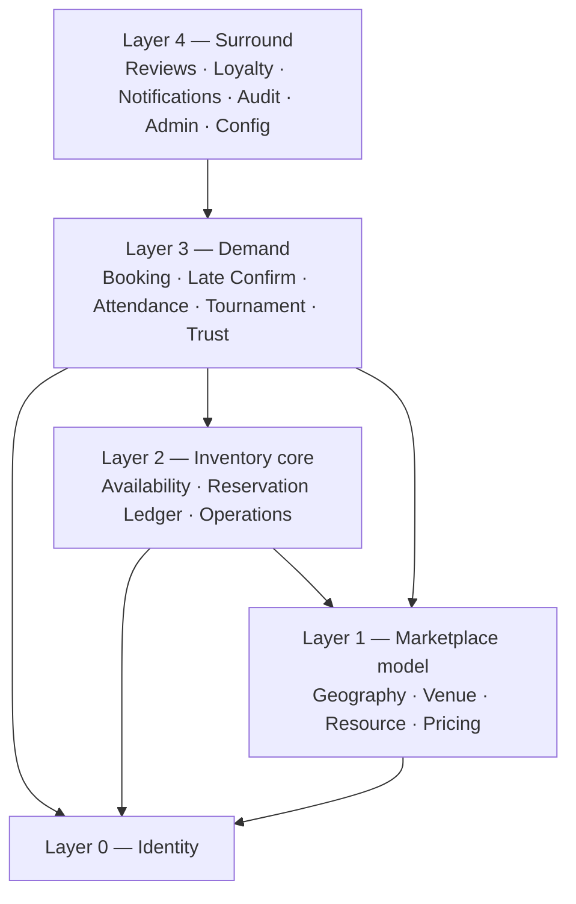

# E7GZ PS
# DOMAIN MODULE SPECIFICATION v1.1

**Updated:** 25 September 2026 — table ownership aligned to physical model v1.1.27 (schema-qualified names, `04 §3`).

**Purpose.** For every backend module: what it is responsible for, which entities and tables it owns, which services it exposes, which domain events it publishes and consumes, what it depends on, and which API surface it backs.

**Rule of ownership.** A module is the **only writer** to its tables. Other modules read through its published `api` interface. Foreign keys across modules are allowed; application joins across them are not.

---

# 1. MODULE INVENTORY

| # | Module | Java package | FRS domains | Owns tables |
|---|---|---|---|---|
| 1 | Identity | `ps.e7gz.identity` | 4.1 (18) | `iam.user_account`, `iam.otp_challenge`, `iam.auth_refresh_token`, `iam.username_change`, `iam.account_deletion_request`, `iam.account_anonymisation`, `iam.user_commitment_guard`, `iam.security_rate_limit_counter` |
| 2 | Geography | `ps.e7gz.geography` | part of 4.8 | `geo.area` |
| 3 | Venue | `ps.e7gz.venue` | 4.8 (47, shared) | `venue.venue`, `venue.venue_image`, `venue.venue_activity`, `iam.venue_account`, `iam.venue_owner_secret`, `venue.venue_opening_template`, `venue.venue_opening_day`, `venue.operating_session`, `venue.venue_selling_block` |
| 4 | Resource | `ps.e7gz.resource` | part of 4.8 | `resource.resource`, `resource.resource_selling_block`, `resource.resource_state_change` |
| 5 | Pricing | `ps.e7gz.pricing` | part of 4.8 | `pricing.venue_default_price`, `pricing.resource_price_override` |
| 6 | Reservation Ledger | `ps.e7gz.inventory.ledger` | part of 4.3 | `inventory.resource_reservation` |
| 7 | Availability | `ps.e7gz.inventory.availability` | 4.3 (15) | `inventory.venue_activity_availability` |
| 8 | Operations | `ps.e7gz.operations` | 4.9 (44) | `operations.maintenance_window`, `operations.venue_closure`, `operations.emergency`, `operations.booking_timer_pause_history`, `operations.owner_review`, `operations.operational_interruption_record` |
| 9 | Booking | `ps.e7gz.booking` | 4.4 (32), 4.7 (11) | `booking.booking`, `booking.booking_history` |
| 10 | Late Confirmation | `ps.e7gz.booking.lateconfirm` | 4.5 (18) | `booking.late_confirmation` |
| 11 | Attendance | `ps.e7gz.attendance` | 4.6 (28) | `attendance.attendance_record`, `iam.venue_account_restriction_interval`, `attendance.attendance_protection_candidate` |
| 12 | Tournament | `ps.e7gz.tournament` | 4.10 (33) | `tournament.tournament`, `tournament.tournament_resource`, `tournament.tournament_participant`, `tournament.tournament_history` |
| 13 | Trust | `ps.e7gz.trust` | 4.11 (27) | `trust.trust_event`, `trust.trust_projection`, `trust.trust_projection_checkpoint`, `trust.ban_qualification`, `trust.ban_qualification_consumption`, `trust.ban_instance`, `trust.ban_cascade_booking_target`, `trust.ban_cascade_reservation_target`, `trust.cascade_execution`, `trust.verified_player_transition` |
| 14 | Loyalty | `ps.e7gz.loyalty` | 4.12 (21) | `loyalty.points_account`, `loyalty.points_transaction`, `loyalty.wallet_account`, `loyalty.wallet_transaction`, `loyalty.referral`, `loyalty.reward_application`, `loyalty.booking_fee_receipt`, `loyalty.booking_fee_refund` |
| 15 | Reviews | `ps.e7gz.review` | 4.13 (11) | `review.review`, `review.review_report`, `review.review_moderation_event`, `review.review_cooldown`, `review.venue_rating_stats` |
| 16 | Notifications | `ps.e7gz.notification` | 4.15 (12) | `notification.notification`, `notification.notification_delivery`, `notification.notification_catalogue`, `notification.device_token`, `notification.venue_push_subscription` |
| 17 | Platform Configuration | `ps.e7gz.config` | part of 4.14 | `config.configuration_key`, `config.configuration_version`, `config.system_configuration` |
| 18 | Audit | `ps.e7gz.audit` | 4.16 (15) | `audit.audit_event` |
| 19 | Platform Administration | `ps.e7gz.admin` | 4.14 (11) | `iam.admin_account`, `admin.admin_alert` |
| 20 | Scheduling (technical) | `ps.e7gz.scheduling` | serves `NFR-04` | `technical.scheduled_job` |
| 21 | Messaging (technical) | `ps.e7gz.messaging` | serves `FR-NTF-12` | `technical.outbox_event`, `technical.idempotency_record` |

Modules 20 and 21 are **technical**, not domain modules: they own no Product rule and publish no Product-visible state.

---

# 2. CROSS-MODULE RULES

## 2.1 Dependency direction



A module may depend downward and sideways within its layer. **Upward dependencies are forbidden** and are enforced by an ArchUnit test. Where a lower layer must affect a higher one — Trust cancelling a booking, Operations cascading into Tournaments — it does so through an interface published by the higher module and injected downward, or through a domain event.

## 2.2 Reading another module

```java
// allowed — published interface in the owning module's api package
ps.e7gz.venue.api.VenueQuery#operationalEligibility(venueId, EligibilityCategory)

// forbidden — reaching into another module's tables or internals
select * from venue v join resource r ...      // inside ps.e7gz.booking
ps.e7gz.venue.domain.Venue                     // imported outside ps.e7gz.venue
```

## 2.3 Internal domain events

Published in-process after commit via the outbox, consumed asynchronously. Used where eventual consistency is acceptable: notifications, projections, alerting, abuse signals.

## 2.4 The closed list of atomic cross-module orchestrations

These — and **only** these — may span modules inside one transaction, because the Product requires them to be all-or-nothing. Each lives in a named orchestration service under `ps.e7gz.orchestration` and is listed here so the list cannot grow silently.

| # | Orchestration | Modules spanned | Source |
|---|---|---|---|
| O1 | Online booking creation | Booking · Availability · Ledger · Pricing · Identity · Trust · Scheduling · Messaging · Audit | `FR-BOK-11`, `FR-AVL-10` |
| O2 | Venue accept / reject / reject-after-expiry | Booking · Availability · Ledger · Trust · Scheduling · Messaging · Audit | `FR-BOK-14`, `FR-BOK-17` |
| O3 | Late Confirm initiate / accept / decline / timeout | Late Confirm · Booking · Availability · Ledger · Scheduling · Messaging | `FR-LCF-06`, `FR-LCF-14` |
| O4 | Manual booking creation and pre-start cancellation | Booking · Availability · Ledger · Pricing · Messaging · Audit | `FR-MAN-02` |
| O5 | Opening-hours change commit | Venue · Availability · Ledger · Booking · Tournament · Messaging · Audit | `FR-VEN-23` |
| O6 | Closure create / edit commit | Venue · Ledger · Booking · Tournament · Messaging · Audit | `FR-VEN-30` |
| O7 | Venue emergency declaration / extension / end / conversion | Operations · Venue · Ledger · Booking · Late Confirm · Tournament · Attendance · Scheduling · Messaging · Audit | `FR-OPS-09` |
| O8 | Resource emergency outage declaration / end / conversion | Operations · Resource · Ledger · Booking · Tournament · Attendance · Scheduling · Messaging · Audit | `FR-OPS-12` |
| O9 | `OWNER_REVIEW_REQUIRED` entry cascade and resolution | Operations · Resource · Ledger · Booking · Tournament · Messaging · Audit | `FR-OPS-28`, `FR-OPS-29` |
| O10 | Venue account disable / enable | Venue · Booking · Late Confirm · Tournament · Attendance · Scheduling · Messaging · Audit | `FR-VEN-09`, `FR-TRN-18` |
| O11 | Booking start-time resolution | Booking · Availability · Ledger · Attendance · Messaging | `FR-BOK-25`, `FR-BOK-26` |
| O12 | Booking completion and attendance resolution | Booking · Attendance · Trust · Loyalty · Ledger · Messaging | `FR-ATT-08`, `FR-TRS-11` |
| O13 | Attendance action — check-in / late present / no-show | Attendance · Booking · Ledger · Trust · Audit | `FR-ATT-01`…`FR-ATT-05` |
| O14 | Ban activation / extension / end reconciliation | Trust · Booking · Late Confirm · Tournament · Ledger · Messaging · Audit | `FR-TRS-20`, `FR-TRS-22`, `FR-TRS-23`, `FR-TRN-26` |
| O15 | Verified Player transition cascade | Trust · Tournament · Ledger · Messaging · Audit | `FR-TRN-20` |
| O16 | Tournament create / approve / checkpoint / start / cancel | Tournament · Availability · Ledger · Pricing · Trust · Scheduling · Messaging · Audit | `FR-TRN-09`, `FR-TRN-14` |
| O17 | Attendance / no-show / trust admin correction | Admin · Attendance · Booking · Trust · Loyalty · Messaging · Audit | `FR-ATT-11`, `FR-TRS-07` |
| O18 | Resource state change — disable / re-enable / archive / restore / console change | Resource · Pricing · Ledger · Booking · Audit | `FR-VEN-14`, `FR-VEN-15` |
| O19 | Customer Account Deletion initiation/completion | Identity · Tournament · Reviews · Audit | `FR-ACC-10`, `FR-TRN-26`, `FR-REV-06` |
| O20 | Review report submission/resolution | Reviews · Admin · Audit | `FR-REV-11`, `FR-REV-08` |

Adding an O-number requires an ADR.

---

# 3. MODULE 1 — IDENTITY

**Responsibilities.** Customer account lifecycle; username and phone uniqueness and normalisation; OTP issue, verification and limits; password hashing and reset; email verification as an independent track; auth tokens; Customer-initiated deletion requests plus admin-completed deletion/anonymisation.

**Entities.** `UserAccount` (aggregate root) · `OtpChallenge` · `AuthRefreshToken` · `UsernameChange` · `AccountDeletionRequest` · `AccountAnonymisation`

**Key rules it owns.**

| Rule | Source |
|---|---|
| Registration requires full name, username, phone, email, password; username and phone unique | `FR-ACC-01` |
| Account Verified **only** when `phone_verified = true` via SMS OTP; email OTP never activates | `FR-ACC-02` |
| Username uniqueness on a **normalised** form — trimmed, case-insensitive | `FR-ACC-06` |
| OTP: 5-minute validity · 5 attempts per code · 60-second resend · 5 sends/hour/destination · a new OTP invalidates the previous | `FR-ACC-04` |
| Username change 30-day cooldown; full name free; phone and email changes each require verification of the new value | `FR-ACC-07` |
| Password reset by verified phone OTP or email verification, without the old password | `FR-ACC-09` |
| Customer can initiate deletion in-app; O19 completes the existing anonymisation process, preserving booking/financial/audit history, removing Reviews from public display and linking request → anonymisation | `FR-ACC-10` |
| Historical entities reference the immutable User ID; reviews display the **current** username | `FR-ACC-08` |

**Services.**

```
IdentityCommands
  register(cmd) : UserId
  sendPhoneOtp(userId | destination) : OtpChallengeId      // enforces FR-ACC-04 limits
  verifyPhoneOtp(challengeId, code) : void                  // sets Account Verified
  sendEmailVerification(userId) / verifyEmail(token)
  changeUsername(userId, newUsername)                        // 30-day cooldown
  changePhone / changeEmail(userId, newValue)                // verification-gated
  requestPasswordReset / completePasswordReset
  requestAccountDeletion(userId, correlationId) : AccountDeletionRequestId  // customer, O19 initiation
  anonymiseAccount(userId, adminId, reason, requestId?)                  // O19 completion; reclassify Tournament participation atomically

IdentityQuery  (published api)
  accountState(userId) : UNVERIFIED | VERIFIED
  isPhoneVerified(userId) : boolean
  currentUsername(userId) : String
  displayIdentity(userId, Surface) : PublicIdentity | AdminIdentity
```

**Domain events published.** `UserRegistered` · `PhoneVerified` (→ Loyalty for referral eligibility, `FR-PTS-06`) · `EmailVerified` · `UsernameChanged` · `AccountDeletionRequested` · `AccountAnonymised`

**Consumes.** none.

**Depends on.** Messaging (OTP send via outbox) · Audit · Platform Configuration.

**API surface.** `/api/v1/customer/auth/**`, `/api/v1/customer/profile/**`, `/api/v1/admin/users/**`

**Notes.**
- The OTP **code is stored hashed**; attempts and send-window counters live on `iam.otp_challenge` (`issued_at`, `attempts`, `superseded_at`, `consumed_at`), so rate limiting and audit share one row (`ADR-005`). The database guard re-asserts every `FR-ACC-04` limit.
- `changeUsername` writes only `iam.user_account.username`; the 30-day cooldown is re-asserted by the database and the `iam.username_change` history row is written automatically.
- `anonymiseAccount` runs inside `admin.begin_command` and calls `iam.anonymise_user` (O19), which blanks PII, revokes Customer tokens, removes Reviews from public display, completes the open deletion request and audits; the Tournament module reclassifies participation to `ACCOUNT_DELETED` in the same transaction (deferred checks enforce both).
- Account state is a *capability input*, never a blanket gate: a banned user retains several capabilities (`FR-ACC-17`), and the ban state is owned by Trust, not here.

---

# 4. MODULE 2 — GEOGRAPHY

**Responsibilities.** Areas and their Active/Inactive status; the deactivation guard.

**Entities.** `Area`

**Key rules.**

| Rule | Source |
|---|---|
| Areas are Platform-Admin controlled, status Active or Inactive; only Active areas accept new venue assignment | `FR-VEN-12` |
| Area status governs **customer discovery only** and never blocks manual booking | `FR-VEN-12` |
| An area may be deactivated **only** when no assigned venue is marketplace ACTIVE or SUSPENDED | `FR-VEN-47` |
| Inactive areas remain in historical data; historical references are never rewritten | `FR-VEN-12` |

**Services.** `AreaCommands.create / rename / activate / deactivate` · `AreaQuery.isActive(areaId)`, `activeAreas()`

**Events published.** `AreaDeactivated` (→ Availability projection refresh)

**API surface.** `/api/v1/admin/areas/**`, read-only on `/api/v1/customer/areas`

---

# 5. MODULE 3 — VENUE

**Responsibilities.** The venue record and its two independent status domains; the shared venue account and Owner Password hash; opening-hours template; **operating-session generation**; venue-level operational selling block; venue images metadata.

**Entities.** `Venue` (root) · `VenueAccount` · `VenueImage` · `VenueActivity` · `VenueOpeningTemplate` + `VenueOpeningDay` · `VenueOperatingSession` · `VenueSellingBlock`

**Key rules.**

| Rule | Source |
|---|---|
| One shared venue account per venue; no cashier, manager or separate owner accounts | `FR-VEN-01` |
| Owner Password per protected action; no unlock window, no session mode | `FR-VEN-02`, `I7` |
| Protected / not-protected action lists | `FR-VEN-03`, `FR-VEN-04` |
| Owner Password change takes effect immediately; old value stops working at once; audited | `FR-VEN-46` |
| Marketplace status and account status are **independent** | `FR-VEN-06` |
| ONBOARDING / INACTIVE / SUSPENDED semantics | `FR-VEN-07` |
| DISABLED blocks Dashboard login and therefore every ordinary Dashboard action; it is an **access restriction, not a physical outage** | `FR-VEN-08` |
| Default schedule + weekday overrides; cross-midnight supported | `FR-VEN-17` |
| At most one operating session per operating day; sessions may touch but not overlap | `FR-VEN-18` |
| Non-overlap validated cyclically across the full week including the Sunday→Monday wrap | `FR-VEN-19` |
| A closed weekday prevents a **new** session starting, but an overnight session continues into it | `FR-VEN-20` |
| DST: non-existent local starts not offered, ambiguous repeats not duplicated, a full-day session valid at 23 or 25 real hours | `FR-VEN-21` |
| Opening-hours change is a strict 9-step all-or-nothing sequence | `FR-VEN-23` |
| Affected set revalidated before commit; a new affected reservation aborts the commit and forces a refreshed preview | `FR-VEN-26` |
| A tournament conflict **blocks** the save, before any booking-impact preview | `FR-VEN-27` |
| Closure rules, retroactive-over-ACTIVE prohibition, tournament conflict block, maintenance overlap rules | `FR-VEN-29`…`FR-VEN-33` |

**Services.**

```
VenueCommands
  createVenue / updateVenueInfo / assignActivities / uploadImageMetadata
  setMarketplaceStatus(venueId, status, adminId, reason)
  setAccountStatus(venueId, ENABLED|DISABLED, adminId, reason)   // triggers O10
  changeOwnerPassword(venueId, current, next)                    // FR-VEN-46
  resetOwnerPassword(venueId, adminId)                           // FR-ADM-03
  previewOpeningHoursChange(venueId, proposal) : ImpactPreview   // steps 1-5
  commitOpeningHoursChange(venueId, proposal, previewToken, ownerPassword?)  // steps 6-9, O5
  createClosure / editClosure / deleteClosure                    // O6

VenueQuery (published api)
  operationalEligibility(venueId, EligibilityCategory) : Eligibility
  currentOperatingSession(venueId, at) : Session?
  sessionContaining(venueId, interval) : Session?
  isInsideOnlineIntakeWindow(venueId, at) : boolean              // FR-BOK-09
  nextValidIntakeWindow(venueId, after) : Instant?               // FR-OPS-39/40
  hasVenueSellingBlock(venueId, at) : boolean
  ownerPasswordMatches(venueId, supplied) : boolean              // never cached
```

**Events published.** `VenueMarketplaceStatusChanged` · `VenueAccountDisabled` / `Enabled` · `OpeningHoursChanged` · `ClosureCreated` · `OperatingSessionsRegenerated` · `OwnerPasswordChanged`

**Depends on.** Geography · Audit · Messaging · Ledger and Booking (read, for impact preview — via their published queries)

**API surface.** `/api/v1/venue/**` (Dashboard), `/api/v1/admin/venues/**`, `/api/v1/admin/venue-accounts/**`

**Operating-session generation.** See `ADR-009`. The generator is idempotent per `(venue_id, operating_day)` and runs (a) nightly to extend the rolling horizon, (b) inside the opening-hours change transaction, (c) on demand from admin tooling.

**Impact preview token.** `previewOpeningHoursChange` returns a token bound to the exact affected set. `commitOpeningHoursChange` recomputes the set, compares it to the token, and **aborts** if it grew — this is `FR-VEN-26`'s "no booking outside the approved preview may be silently cancelled", implemented as a checksum rather than a convention.

---

# 6. MODULE 4 — RESOURCE

**Responsibilities.** Rooms and tables; base state; operational restriction; console type; activity compatibility; resource-level selling block; state-change guards.

**Entities.** `Resource` · `ResourceSellingBlock` · `ResourceStateChange` (audit-adjacent history)

**Key rules.**

| Rule | Source |
|---|---|
| Base State (ACTIVE / DISABLED / ARCHIVED) is **separate** from Operational Restriction (NONE / OWNER_REVIEW_REQUIRED); a resource may be ACTIVE and still unsellable | `FR-VEN-13` |
| Disable, Archive and Console Change are **blocked** by any current or future blocking reservation; existing reservations are never auto-cancelled | `FR-VEN-14` |
| `VENUE_RESPONSE_EXPIRED` does not block those actions, because it holds no reservation | `FR-VEN-14`, `FR-BOK-22` |
| Console change (PS4 ↔ PS5) requires the Owner Password and **clears all room price overrides**; historical bookings retain their stored console, mode and price | `FR-VEN-15` |
| Naming is fixed: Room *n* / Pool Table *n* / Table *n*; console types are PS5 and PS4 only; console type is shown wherever resource information appears | `FR-VEN-41` |
| PlayStation requires play mode Single or Multiplayer as a **pricing mode, never a player count** | `FR-VEN-42` |
| Eligibility for any flow requires `baseState = ACTIVE` **and** `operationalRestriction = NONE` | `FR-AVL-06` |

**Services.**

```
ResourceCommands
  create / rename / setActivityCompatibility
  disable / reEnable / archive / restore   (ownerPassword, O18)
  changeConsole(resourceId, PS4|PS5, ownerPassword)   // O18 — clears overrides
ResourceQuery (published api)
  eligibility(resourceId, at) : ResourceEligibility
  supportsActivity(resourceId, activity) : boolean
  hasResourceSellingBlock(resourceId, at) : boolean
  blockingReservationsPreventingStateChange(resourceId) : List<ReservationRef>
```

**Events published.** `ResourceDisabled` / `ReEnabled` / `Archived` / `Restored` · `ResourceConsoleChanged` · `ResourceOperationalRestrictionChanged`

**Notes.** `changeConsole` publishes `ResourceConsoleChanged`, which Late Confirmation consumes to record `LATE_CONFIRM_ELIGIBILITY_LOST_RESOURCE_STATE_CHANGED` with `detailCode = RESOURCE_CONSOLE_CHANGED` on any `VENUE_RESPONSE_EXPIRED` booking on that resource (`FR-BOK-22`).

---

# 7. MODULE 5 — PRICING

**Responsibilities.** Venue-level defaults, room overrides, price resolution, and the **snapshot** written into every priced record.

**Entities.** `VenueDefaultPrice` · `ResourcePriceOverride`

**Key rules.**

| Rule | Source |
|---|---|
| PlayStation pricing is venue-level defaults per **console type × play mode** — PS5 Single, PS5 Multiplayer, PS4 Single, PS4 Multiplayer; a room override replaces the default for that room; with no override the room inherits the venue default | `FR-VEN-43` |
| Billiards and Ping Pong are venue-level hourly only — no console, no play mode, **no table-level override** | `FR-VEN-44` |
| Manual, online and tournament all price from this same configuration; creation is **blocked** where the required configuration does not exist | `FR-VEN-45` |
| Price = `hourlyPrice × nominalBookedMinutes ÷ 60`, half-up to 2 decimals per line item; totals are sums of rounded line items; the stored amount is immutable | `FR-BOK-06` |
| Pricing changes and override set/reset require the Owner Password | `FR-VEN-03` |
| Tournament venue cost = historical hourly price × nominal duration, summed over resources; snapshot at **request creation** (player-hosted) or **creation** (venue-hosted); a resource loss never changes it | `FR-TRN-28` |

**Services.**

```
PricingQuery (published api)
  resolveHourlyPrice(resourceId, activity, console?, playMode?, at) : Money
  requiredConfigurationExists(venueId, activity, console?, playMode?) : boolean
PricingCommands
  setVenueDefault(..., ownerPassword)
  setRoomOverride / resetRoomOverride(..., ownerPassword)
  clearOverridesForResource(resourceId)   // called by O18 console change only
```

**Events.** `VenuePricingChanged` · `RoomOverrideChanged` (→ Availability projection: starting price on the venue card, `FR-DIS-03`)

**Notes.** `resolveHourlyPrice` is a *read*; the **snapshot** is written by the caller into its own row (`booking.hourly_price_snapshot`, `tournament_resource.hourly_price`). Pricing never owns a historical amount — that is `FR-AUD-01`'s immutability, implemented by putting the number where it can never be re-resolved.

---

# 8. MODULE 6 — RESERVATION LEDGER

**Responsibilities.** The single table of exclusive resource occupancy, and its release history. This module is deliberately tiny and deliberately dumb: it holds `I1` and nothing else.

**Entities.** `ResourceReservation`

**Reservation types held (Layer 1 of `ADR-010`).** `BOOKING` · `LATE_CONFIRM_HOLD` · `TOURNAMENT_APPROVAL_HOLD` · `TOURNAMENT_HOLD` · `MAINTENANCE` · `CLOSURE`. The Booking's lifecycle state lives on `booking.booking`, not on the reservation row.

**Key rules.**

| Rule | Source |
|---|---|
| Two active reservations must never overlap on one resource | `FR-AVL-08`, `I1` |
| Booking **status** decides whether a booking blocks inventory; **source** does not | `FR-AVL-04` |
| `VENUE_RESPONSE_EXPIRED` does not block; terminal bookings never block | `FR-AVL-05` |
| Historical planned intervals may overlap; **active occupancy may not** | `FR-AVL-12` |
| Reservation history stores `plannedStart`, `plannedEnd`, `actualReservationStart`, `actualReservationReleaseAt` and `releaseReason` | `FR-AVL-13` |

**Services.**

```
ReservationLedger
  hold(resourceId, kind, period, ownerRef) : ReservationId      // may throw OccupancyConflict
  release(reservationId, at, reason)                             // one-way: active_flag=false, actual_reservation_release_at=at
                                                                 // a no-show releases at the no-show instant; planned_range never changes
  overlapping(resourceId, period) : List<Reservation>
  overlappingAny(resourceIds, period) : Map<ResourceId, List<Reservation>>
```

**It publishes no domain events and consumes none.** Callers publish; the ledger records. Full mechanics in `05 — Availability & Reservation Engine`.

---

# 9. MODULE 7 — AVAILABILITY

**Responsibilities.** **The one canonical predicate** (`FR-AVL-01`) and the Nearest Availability projection.

**Key rules.**

| Rule | Source |
|---|---|
| One predicate governs online booking, manual booking, Late Confirm, tournament creation, tournament holds and Nearest Availability | `FR-AVL-01` |
| Evaluation order is fixed: venue selling block → resource selling block → resource base state → resource operational restriction → emergency → maintenance → closure → blocking reservations | `FR-AVL-02` |
| A selling block is evaluated **before** any reservation check and needs no fabricated interval; an unresolved emergency is never an infinitely extended reservation | `FR-AVL-02` |
| Every creation and commitment predicate requires selling block FALSE for venue **and** resource | `FR-AVL-07` |
| Eligibility is revalidated immediately before **every** commitment-strengthening transition | `FR-AVL-09` |
| Revalidation and transition commit atomically; first committer wins | `FR-AVL-10` |
| Displayed availability is a snapshot, not a commit guarantee | `FR-AVL-11` |
| Nearest Availability is the earliest valid start for the selected activity at the **1-hour minimum**, from opening hours, eligible resources, the predicate, now, and the 15-minute lead rule | `FR-DIS-04` |
| Resources DISABLED, ARCHIVED, under owner review, or under a selling block never contribute to Nearest Availability | `FR-DIS-05` |

**Services.**

```
AvailabilityQuery (published api)
  isFree(resourceId, period, at) : PredicateResult         // the eight checks, in order
  freeResources(venueId, activity, period, filters) : List<ResourceId>   // FR-DIS-12
  nearestAvailability(venueId, activity) : Instant?        // read from projection
AvailabilityGuard (used inside transactions)
  requireFree(resourceId, period) throws NotAvailable(reasonCheckIndex)
```

`PredicateResult` returns **which of the eight checks failed**, by index. This is how the Dashboard can say *why* a slot is unavailable (`FR-OPS-43`) without any caller re-deriving the reason.

**Events consumed.** every event that can change availability — reservation holds and releases, resource state changes, selling-block changes, maintenance, closures, emergencies, opening-hours changes, pricing changes (for starting price) — each triggering a projection refresh for the affected venue/activity.

**Projection.** `venue_activity_availability (venue_id, activity, nearest_available_at, starting_price, refreshed_at)`. Advisory only; the commit path never reads it (`FR-AVL-11`).

---

# 10. MODULE 8 — OPERATIONS

The largest and most intricate module: 44 requirements, and the source of most cascades.

**Responsibilities.** Maintenance windows and the rolling threshold; venue closures; venue and resource emergencies and their status lifecycle; operational selling blocks; `OWNER_REVIEW_REQUIRED` and its cascade; timer pause, resume and caps; the optimistic feasibility test.

**Entities.** `MaintenanceWindow` · `VenueClosure` · `Emergency` (venue or resource scoped) · `EmergencyPauseRecord` · `OwnerReview` · `OperationalInterruptionRecord`

**Key rules — maintenance.**

| Rule | Source |
|---|---|
| Resource-level normal operation; create/edit/delete audited | `FR-OPS-01` |
| May **never** overlap an existing blocking reservation; **never silently cancels a booking** | `FR-OPS-02` |
| Owner Password required when total maintenance for a resource exceeds **24 hours in any rolling 48-hour window**; contiguous windows count as one period; threshold is **per resource** | `FR-OPS-03` |
| An edit extending a continuous period past the threshold requires the Owner Password | `FR-OPS-04` |
| Emergency-created maintenance counts toward the same rolling total; no bypass | `FR-OPS-05` |

**Key rules — emergencies.**

| Rule | Source |
|---|---|
| Emergency Closure: no Owner Password, starts **NOW** only, cannot be scheduled, mandatory reason, full audit, owner + Admin notified | `FR-OPS-06` |
| Expected End is mandatory, later than start, no later than the end of the current operating session | `FR-OPS-07` |
| Cascade covers only reservations overlapping `[emergencyStart, expectedEnd)` | `FR-OPS-08` |
| Cascade is **all-or-nothing**; everything persists atomically **before** notifications dispatch | `FR-OPS-09` |
| Emergency cancellation is immediate and irreversible; ending early never restores | `FR-OPS-10` |
| An AWAITING booking caught by the cascade is cancelled under the **emergency** reason; the customer never receives `CUSTOMER_RECONFIRM_TIMEOUT` | `FR-OPS-44` |
| Resource emergency: no Owner Password, mandatory reason and expected return; unprotected outages may extend only to the end of the current session; longer outages become maintenance under normal maintenance authorization | `FR-OPS-11` |
| No hard venue-wide emergency rate limit | `FR-OPS-13` |
| Admin risk alert at ≥3 tournament cancellations by resource emergency in a rolling 30 days; investigative and non-blocking | `FR-OPS-14` |
| A relevant emergency **must** create the corresponding selling block — venue → venue block, resource → that resource only | `FR-OPS-15` |
| Status lifecycle ACTIVE → AWAITING_CONFIRMATION → ENDED or CONVERTED; blocks ON for ACTIVE and AWAITING; expected end **never auto-reopens** anything | `FR-OPS-18` |
| **No sellable gap** — the block is not released unless staff assert the resource is operational or a replacement restriction commits in the same transaction | `FR-OPS-21`, `FR-OPS-24` |
| Conversion targets: venue → normal closure or hours change; resource → maintenance, disabled or archived. A resource emergency may **not** convert into an hours change | `FR-OPS-23` |

**Key rules — owner review.**

| Rule | Source |
|---|---|
| Entry at the emergency's expected or actual end when the resource exceeded 24 maintenance hours in a rolling 48-hour window | `FR-OPS-26` |
| Threshold evaluated **before** ending an emergency; owner review takes precedence over availability | `FR-OPS-27` |
| Entry triggers a **system** cascade, not a venue cancellation: PENDING, AWAITING, future CONFIRMED, ACTIVE and future manual bookings → CANCELLED `RESOURCE_OWNER_REVIEW_REQUIRED`; pre-start tournaments cancelled; an ACTIVE tournament loses that resource and is cancelled only if none remains | `FR-OPS-28` |
| The cascade requires **no Owner Password anywhere** and a partial cascade is not valid | `FR-OPS-29` |
| Owner review is **not a pause state**; a PENDING booking cancelled this way stops its timer and never becomes `VENUE_RESPONSE_EXPIRED` | `FR-OPS-30` |
| Resolution requires the Owner Password and offers Return to Service / Extend Maintenance / Disable / Archive | `FR-OPS-33` |

**Key rules — timer pause.**

| Rule | Source |
|---|---|
| The venue response timer pauses for a venue emergency **or** a resource emergency affecting that booking's resource; another resource's emergency pauses nothing; while paused, Accept is disabled | `FR-OPS-34` |
| The Late Confirmation countdown pauses while an emergency or block affects the venue **or** the booked resource | `FR-OPS-35` |
| Remaining duration is **preserved** across a pause | `FR-OPS-36` |
| **Two separate cumulative 30-minute caps**; venue and resource pauses contribute to the **same** response counter so switching type never resets it; stored per booking as four named fields | `FR-OPS-37` |
| Cap outcomes map to three distinct interrupted-by-emergency reasons; reservation and commitment release; no customer penalty; **no venue non-response blame** | `FR-OPS-38` |
| Resume requires **all** of: emergency ended · account ENABLED · marketplace permits · inside a valid operating session · inside the online intake window | `FR-OPS-39` |
| Early cancellation uses the **optimistic feasibility test**; block duration is never predicted | `FR-OPS-40` |
| Customer is notified on pause and on resume, may still **Decline** while paused, and both pause records are immutable operational history | `FR-OPS-41` |

**Services.**

```
MaintenanceCommands   create / edit / delete (ownerPassword when over threshold)
MaintenanceQuery      rollingHours(resourceId, window) : Duration
                      exceedsThreshold(resourceId, proposedWindow) : boolean
ClosureCommands       create / edit / delete (via Venue O6)
EmergencyCommands     declareVenueEmergency / declareResourceOutage
                      extend / end / convert                    // O7, O8
OwnerReviewCommands   enter(resourceId, cause)                   // system-invoked, O9
                      resolve(resourceId, action, ownerPassword)
TimerPauseService     pauseAffected(scope, cause) / resumeEligible(scope)
                      optimisticFeasibility(bookingId) : FEASIBLE | CANCEL_NOW
SellingBlockQuery     venueBlocked(venueId, at) / resourceBlocked(resourceId, at)
```

**Events published.** `EmergencyDeclared` · `EmergencyExtended` · `EmergencyEnded` · `EmergencyConverted` · `MaintenanceCreated` / `Edited` / `Deleted` · `ClosureCreated` · `OwnerReviewEntered` / `Resolved` · `TimerPaused` / `TimerResumed` / `TimerPauseCapReached` · `OperationalInterruptionRecorded`

**Notes.** The selling block is a **state with an owner**, not an interval (`ADR-010`). `SellingBlockQuery` answers checks 1 and 2 of the canonical predicate and is the only correct way to ask.

---

# 11. MODULE 9 — BOOKING

**Responsibilities.** Online and manual booking lifecycle; the 20-condition creation predicate; terminal reason assignment with priority; append-only booking history; commitment counting; the customer-facing projection; `businessDate`; session snapshot.

**Entities.** `Booking` (root) · `BookingHistoryEntry` · `BookingSessionSnapshot`

**Key rules.** The full set is `FR-BOK-01`…`FR-BOK-32` and `FR-MAN-01`…`FR-MAN-11`, with lifecycle mechanics in `06 — Booking & Tournament Lifecycle Engine`. The ones that shape the module:

| Rule | Source |
|---|---|
| Duration 1–6 hours in 30-minute increments (online) | `FR-BOK-01` |
| `now <= startAt − 15 min`; exactly 15 is permitted | `FR-BOK-02` |
| At most **4** counted commitments — PENDING, AWAITING, CONFIRMED, ACTIVE — across all venues, checked on every action that would increase it | `FR-BOK-03` |
| No overlapping customer commitments, **in addition to** the 4-limit | `FR-BOK-04` |
| The interval must fit entirely inside **one** future operating session | `FR-BOK-05` |
| The **twenty cumulative creation conditions** are the complete canonical list; missing pricing configuration fails under item 20, and there is **no twenty-first condition** | `FR-BOK-11` |
| Nine canonical states; **`VENUE_RESPONSE_EXPIRED` is non-terminal** | `FR-BOK-12` |
| Customer-facing projection: Upcoming / Completed / Cancelled buckets | `FR-BOK-19` |
| Start-time and ACTIVE-interruption reason priorities; exactly one reason stored | `FR-BOK-27`, `FR-BOK-30` |
| A booking can never remain CONFIRMED past `startAt` because a check failed | `FR-BOK-26` |
| Manual booking is category C, `source = MANUAL`, never PENDING, may have no registered customer, and always carries a `businessDate` | `FR-MAN-01`, `FR-MAN-09` |
| **No back-dating** of manual bookings | `FR-MAN-05` |
| Manual bookings never count toward the 4-limit, points, progress or no-show progression; attendance is NOT_APPLICABLE | `FR-MAN-06`, `FR-MAN-07` |

**Services.**

```
BookingCommands
  createOnline(cmd)                    // O1 — the 20 conditions
  venueAccept / venueReject / rejectAfterExpiry
  customerCancel(bookingId)            // now < startAt
  createManual(cmd) / cancelManual(bookingId)
  cancelForOperationalCause(bookingIds, reason, correlationId)   // used by O5-O10, O14
BookingQuery (published api)
  countedCommitments(userId) : int                       // FR-BOK-03
  hasOverlappingCommitment(userId, period) : boolean     // FR-BOK-04
  blockingBookingsFor(resourceId, period) : List<Ref>
  customerProjection(bookingId, Surface) : BookingView   // contact-visibility applied
BookingHistory
  append(bookingId, eventType, detailCode?, actor, payload)      // append-only
```

**Events published.** `BookingCreated` · `BookingAccepted` · `BookingRejected` · `VenueResponseExpired` · `BookingConfirmed` · `BookingStarted` · `BookingCompleted` · `BookingCancelled(reason)` · `BookingNoShowRecorded`

**Notes.**
- The twenty creation conditions are implemented as an **ordered, named list in one class**, each entry citing its source, so a reviewer can diff the code against `FR-BOK-11` line by line. A unit test asserts the count is exactly twenty.
- `businessDate` is computed at creation and stored; inside a published session it is the operating-day date, and outside published hours it is the Africa/Cairo local calendar date of `startAt` (`FR-MAN-09`, `FR-AVL-14`).

---

# 12. MODULE 10 — LATE CONFIRMATION

**Responsibilities.** Revival of `VENUE_RESPONSE_EXPIRED` bookings under the **same Booking ID**; temporary holds; per-booking windows, warnings and responses.

**Entities.** `LateConfirmation` — one per booking, per AWAITING phase.

**Key rules.**

| Rule | Source |
|---|---|
| Category B — existing-commitment operational management, not new acquisition | `FR-LCF-01` |
| Venue eligibility list — marketplace ACTIVE/INACTIVE/SUSPENDED, account ENABLED, area ACTIVE, inside a valid session, no venue selling block, interval still fits valid hours, start still future | `FR-LCF-02` |
| Resource eligibility — ACTIVE, restriction NONE, no resource selling block, passes the conflict predicate | `FR-LCF-03` |
| Customer eligibility at initiation — not banned, below the 4-limit; at 4 the initiation is **blocked**, the booking stays expired, and **no hold is created** | `FR-LCF-04` |
| The venue sees a **neutral** message and never learns about the customer's other bookings; internal event `LATE_CONFIRM_FAILED_BOOKING_LIMIT` | `FR-LCF-05`, `NFR-19` |
| Initiation is **one atomic transaction** and concurrent initiations can never produce a temporary fifth commitment | `FR-LCF-06` |
| Not restricted by the customer intake window | `FR-LCF-07` |
| **Same Booking ID** and every original value preserved; all prior history preserved | `FR-LCF-08` |
| `lateConfirmExpiresAt = MIN(now + 5 min, booking.startAt)` | `FR-LCF-09` |
| State is **per booking** — own expiry, warning flag, response and hold; simultaneous Late Confirmations never interfere | `FR-LCF-10` |
| Warning notification only when the window exceeds 60 seconds, once per booking, about a minute before expiry | `FR-LCF-12` |
| Accept → CONFIRMED · Decline → `CUSTOMER_DECLINED_LATE_CONFIRM` · timeout → `CUSTOMER_RECONFIRM_TIMEOUT`; all keep the Booking ID and carry **no penalty** | `FR-LCF-13` |
| Accept revalidates commitment count, customer schedule conflict, reservation validity, ban and account, and venue/resource operational eligibility | `FR-LCF-14` |
| The customer schedule conflict is checked **only on accept**, for privacy | `FR-LCF-15` |
| A conflicting accept **fails** and records `LATE_CONFIRM_FAILED_CUSTOMER_CONFLICT`; the booking does not terminate under a generic conflict reason | `FR-LCF-16` |
| Resource unavailability is validation failure, atomic failure, or `LATE_CONFIRM_FAILED_RESOURCE_CONFLICT` — there is **no** terminal "late confirm resource unavailable" reason | `FR-LCF-17` |
| Counterpart phone visibility reopens for the AWAITING period and is fully restored on Accept | `FR-LCF-18` |

**Services.**

```
LateConfirmCommands
  initiate(bookingId)                       // venue action, O3
  customerAccept(bookingId) / customerDecline(bookingId)
  expire(bookingId)                         // scheduler-invoked
LateConfirmQuery
  isEligible(bookingId) : boolean           // internal detail never exposed to venue
  window(bookingId) : { expiresAt, pausedSince?, accumulatedPause }
```

**Events.** `LateConfirmInitiated` · `LateConfirmAccepted` · `LateConfirmDeclined` · `LateConfirmTimedOut` · `LateConfirmWarningDue`

**Notes.** Two deadlines per AWAITING phase — the expiry and the warning — both in `scheduled_job`. The warning row is simply **not created** when the window is ≤ 60 seconds (`FR-LCF-12`), rather than created and suppressed, so there is nothing to suppress incorrectly.

---

# 13. MODULE 11 — ATTENDANCE

**Responsibilities.** Check-in, Mark Present — Late, no-show; attendance result derivation and correction; Platform Attendance Protection.

**Entities.** `AttendanceRecord` (one per booking) · `AccountAccessRestrictionInterval` · `AttendanceProtectionCandidate`

**Key rules.**

| Rule | Source |
|---|---|
| Check-in is a venue staff action with **no** QR, PIN, device confirmation or biometrics; no Owner Password; audited with venue identity, timestamp and Booking ID | `FR-ATT-01` |
| Windows: check-in `[startAt, startAt+15m)`; Late Present and no-show `[startAt+15m, endAt)` | `FR-ATT-02`, `FR-ATT-03`, `FR-ATT-04` |
| Late Present blocks no-show, grants no points, grants no progress and does **not** reset the counter | `FR-ATT-03` |
| A no-show **releases the remaining interval immediately** | `FR-ATT-05` |
| A committed no-show is terminal; **venue staff cannot undo it**; reversal never evicts a later valid customer | `FR-ATT-06` |
| Attendance Result is an **independent stored field**, never permanently derived from booking status; `ABSENT_NO_SHOW` ≠ status `NO_SHOW` | `FR-ATT-07` |
| Eight default generation rules — defaults, **not permanent formulas** | `FR-ATT-08` |
| After audited correction, COMPLETED+ABSENT_NO_SHOW, CANCELLED+ATTENDED_INTERRUPTED and CANCELLED+ATTENDED are intentionally valid | `FR-ATT-09` |
| Evidence at interruption decides the outcome, with no customer penalty and a full future-fee refund | `FR-ATT-10` |
| Only Platform Admin may reverse check-in, Late Present or no-show, or issue a correction; each needs a mandatory reason and audit | `FR-ATT-11` |
| Five precise reversal semantics | `FR-ATT-12` |
| Platform Attendance Protection: six cumulative conditions, evaluated from `accountAccessRestrictionIntervals[]` against the two windows | `FR-ATT-16`, `FR-ATT-17` |
| A booking may span several access intervals; all are evaluated; **at most one** protection event per booking | `FR-ATT-21` |
| The protection event is created when the **effective outcome resolves**, not at disable time | `FR-ATT-20` |
| An admin correction to `ABSENT_NO_SHOW` **neutralises** the protection reset | `FR-ATT-24` |
| The customer notification for an overlapping disable **must not** say cancelled | `FR-ATT-25`, `FR-NTF-07` |
| Abuse monitoring may flag and alert but must **never** auto-revoke, auto-suspend, auto-reverse or auto-ban | `FR-ATT-27`, `FR-ATT-28` |

**Services.**

```
AttendanceCommands
  checkIn(bookingId, venueActor)                 // O13
  markPresentLate(bookingId, venueActor)         // O13
  markNoShow(bookingId, venueActor)              // O13 — releases the reservation at the no-show instant
  adminReverse(bookingId, which, adminId, reason)        // O17
  adminCorrect(bookingId, correctedOutcome, adminId, reason)  // O17
  resolveOnCompletion(bookingId)                 // O12 — applies FR-ATT-08 defaults
  recordAccessRestrictionInterval(bookingId, disabledAt, source, reason, correlationId)
AttendanceQuery
  result(bookingId) : AttendanceResult
  evidence(bookingId) : { checkIn?, latePresent?, noShow?, reversals[] }
  protectionApplies(bookingId) : boolean          // the six conditions of FR-ATT-16
```

**Events.** `CheckInRecorded` · `LatePresentRecorded` · `NoShowRecorded` · `AttendanceResolved(result)` · `AttendanceCorrected` · `AttendanceProtectionApplied` · `ActiveSessionAttendanceRecordingAffected`

**Notes.** Attendance writes the **canonical trust input event** in the same transaction as the outcome (`FR-TRS-05` fixes `effectiveAt = booking.startAt`). Operational evidence — check-in, reversal, Late Present — stays in booking and audit history and enters trust **only** through a resulting canonical outcome or correction (`FR-TRS-03`): pressing check-in is not itself a reward.

---

# 14. MODULE 12 — TOURNAMENT

**Responsibilities.** The tournament entity — a **separate entity from a booking** (`FR-TRN-01`) — approval, holds, participants, the checkpoint, lifecycle and cost snapshot.

**Entities.** `Tournament` · `TournamentResource` · `TournamentParticipant` · `TournamentHistoryEntry`

**Key rules (selection; full set `FR-TRN-01`…`FR-TRN-33`).**

| Rule | Source |
|---|---|
| Player-hosted requires an operational **VERIFIED** creator and venue approval; venue-hosted requires neither | `FR-TRN-02` |
| 8–32 participants · 1–4 resources · minimum 1 hour in 30-minute increments · create at `requestTime <= startAt − 2h` · checkpoint at exactly `startAt − 1h` · creation fee EGP 0 · no brackets, scoring or per-match assignment | `FR-TRN-03` |
| The interval must fit **one** operating session, so a tournament may exceed the 6-hour online maximum | `FR-TRN-04` |
| **Existing reservations always win**; a tournament may never automatically cancel an existing booking | `FR-TRN-08` |
| Approval Holds during PENDING_VENUE_APPROVAL become Tournament Holds on accept, and release on reject, expiry or cancellation | `FR-TRN-09` |
| Approval window `MIN(requestCreatedAt + 10 min, checkpointAt)` | `FR-TRN-10` |
| One pending player-hosted tournament per creator platform-wide, plus a **5-minute** retry cooldown after rejection or approval expiry | `FR-TRN-11` |
| Falling below 8 **before** the checkpoint does not cancel early; at the checkpoint <8 **Active Participants** cancels; after CONFIRMED a later drop does not auto-cancel; there is **no Run Anyway** | `FR-TRN-12`, `FR-TRN-14` |
| `INELIGIBLE` has cause `BAN` or `ACCOUNT_DELETED`; deletion wins. Active Participant count excludes both. Before `startAt`, BAN-only ineligibility may reserve one capacity slot for automatic restoration; account deletion never does | `FR-TRN-13`, `FR-TRN-26` |
| The checkpoint revalidates every assigned resource, and "venue eligible" means operationally able to honour — marketplace SUSPENDED/INACTIVE never fails a checkpoint by itself | `FR-TRN-15`, `FR-TRN-16` |
| Account disable during PENDING_VENUE_APPROVAL cancels immediately with **no cooldown** and no venue non-response blame; later re-enable never restores | `FR-TRN-18` |
| Verified Player cascade executes **once per `verifiedPlayerTransitionId`** | `FR-TRN-20` |
| Owner Password matrix: cancel WAITING **no** · cancel CONFIRMED **yes** · operational termination **yes** · emergency/owner-review consequence **no** | `FR-TRN-24` |
| Resource loss while ACTIVE: ≥1 operational resource → continue and notify; none → cancel. **Before start, any assigned resource lost cancels the whole tournament** | `FR-TRN-27` |
| Cost snapshot at request creation (player) or creation (venue); a resource loss never changes it | `FR-TRN-28` |
| Entry fee, prize and venue cost are **informational only**; E7GZ collects, holds and distributes nothing | `FR-TRN-29` |
| Revenue recognised only on COMPLETED, on its `businessDate` | `FR-TRN-30`, `FR-AUD-09` |
| Exactly one terminal reason, by a fixed 7-level priority, from a closed 12-member enum | `FR-TRN-31`, `FR-TRN-32` |

**Services.**

```
TournamentCommands
  createPlayerHosted / createVenueHosted        // O16
  venueApprove / venueReject
  join / leave / removeParticipant
  cancel(actor, ownerPassword?)                  // authority per FR-TRN-21/24
  operationalTermination(tournamentId, reason, ownerPassword)   // FR-TRN-23
  checkpoint(tournamentId)                       // scheduler-invoked, O16
  removeResource(tournamentId, resourceId, cause)               // FR-TRN-27
TournamentQuery
  activeParticipantCount(tournamentId, at) : int          // checkpoint/start truth — FR-TRN-13
  capacityOccupiedCount(tournamentId, at) : int            // JOINED + pre-start BAN-only reserved slots — ADR-023
  reconcileParticipantIneligibility(tournamentId, userId, cause, at)
  restoreBanIneligibleParticipant(tournamentId, userId, effectiveAt)
  holdsFor(resourceId, period) : List<Hold>
  creatorHasPendingRequest(userId) : boolean     // FR-TRN-11
```

**Events.** `TournamentRequested` · `TournamentApproved` / `Rejected` · `TournamentConfirmed` · `TournamentStarted` · `TournamentCompleted` · `TournamentCancelled(reason)` · `TournamentResourceAvailabilityChanged` · `ParticipantJoined` / `Left` / `Removed` · `ParticipantBecameIneligible(cause)` · `ParticipantRestoredFromBan`

**Participant architecture.** `ParticipantBecameIneligible` is an internal domain event and its `cause` is not a new Product status. `BAN` may be reversed automatically only while the Tournament is non-terminal, the account is active and the effective restoration instant is before `startAt`. `ACCOUNT_DELETED` is permanent and has precedence. The checkpoint asks `activeParticipantCount(checkpointAt)`; join admission asks `capacityOccupiedCount(now)`. O14 owns Ban-driven transitions, while O19 owns deletion precedence and slot release.

**Notes.** Private tournaments use an invite code and link that are **inactive while PENDING_VENUE_APPROVAL** (`FR-TRN-07`); the code is a high-entropy random token, and the link is a deep link carrying it. Nothing about a pending tournament is discoverable or joinable.

---

# 15. MODULE 13 — TRUST

**Responsibilities.** The immutable trust input event stream; deterministic replay; the consecutive counter, penalty stage, ban qualification and ban instances; Verified Player qualification and operational status.

**Entities.** `TrustInputEvent` (append-only) · `UserTrustState` (projection) · `BanQualification` · `BanInstance` · `VerifiedPlayerTransition`

**Key rules.** The full set is `FR-TRS-01`…`FR-TRS-27`, `FR-ACC-11`…`FR-ACC-18`; mechanics in `07 — Trust, Attendance & Enforcement Engine`. The structural ones:

| Rule | Source |
|---|---|
| Trust is calculated from immutable events; counter, stage, ban state, progress and status are **derived and never authoritative** | `FR-TRS-01` |
| The canonical event catalogue is closed — 11 members in four groups | `FR-TRS-02` |
| Operational evidence enters trust **only** through a resulting canonical outcome or correction | `FR-TRS-03` |
| Every event carries `eventId`, `eventType`, `occurredAt`, `effectiveAt`, `eventSequence`, `subjectUserId`, optional `bookingId`, optional `targetEventId`, `eventPayload` | `FR-TRS-04` |
| Effective-time rules are closed: booking-derived and protection events use `booking.startAt`; a correction uses the **same** `effectiveAt` as the event it corrects; admin events use `occurredAt` | `FR-TRS-05` |
| Replay orders **exclusively** by `effectiveAt ASC, eventSequence ASC` | `FR-TRS-06` |
| Corrections never delete — replay **neutralises** and where appropriate **substitutes** | `FR-TRS-07` |
| The **latest non-superseded** correction by `eventSequence` is authoritative; only one effective outcome per booking contributes | `FR-TRS-09` |
| Three canonical counter-reset events: ATTENDED, ATTENDED_INTERRUPTED, protection. Reaching a penalty threshold also resets, but **not as a trust event** | `FR-TRS-11` |
| Consecutive tracking is **global across E7GZ PS**, ordered by booking start time | `FR-TRS-12` |
| The ladder: 3→7 days · 2→1 month · 2→2 months · recurring every 3→2 months; the threshold intentionally returns to 3; 2 months is the maximum | `FR-TRS-13` |
| A penalty triggers when a new eligible no-show **increments the counter to the current threshold** | `FR-TRS-14` |
| **Ban Qualification** (historical, derived) and **Ban Instance** (operational) are distinct and never conflated | `FR-TRS-17` |
| A retroactively discovered ban activates at **correction time**, never back-dated; ban end is always `activatedAt + duration` | `FR-TRS-18` |
| At most **one ACTIVE ban instance** per user; a further qualification **extends** it with `newEndsAt = MAX(currentEndsAt, now + durationForNewStage)` and never repeats a cascade | `FR-TRS-22` |
| Each ban instance's cascade executes **once only**; repeated replay must never repeat it | `FR-TRS-21` |
| Replay never rewinds external booking side effects into the past | `FR-TRS-24` |
| Verified Player: qualification is 10 completed attended bookings, possibly all at one venue; operational status is separate; only VERIFIED may create a player-hosted tournament | `FR-ACC-11` |
| REVOKED **solely** by trust correction → automatic REVOKED → VERIFIED on restored qualification, no admin action, new transition ID | `FR-ACC-14` |
| Admin SUSPENDED and admin REVOKED are **protected** from automatic regain | `FR-ACC-15` |

**Services.**

```
TrustCommands
  record(event)                                  // append-only, assigns eventSequence
  adminAdjust(userId, adjustment, adminId, reason)
  suspendVerifiedPlayer / revokeVerifiedPlayer / restoreVerifiedPlayer(adminId, reason)
  liftBan / shortenBan / correctBan(adminId, reason)
TrustQuery (published api)
  currentState(userId) : TrustState
  stateAsOf(userId, instant) : TrustState        // FR-TRS-10
  isBanned(userId, at) : boolean                 // from ban instance activatedAt/endsAt
  verifiedPlayerOperationalStatus(userId) : Status
  verifiedPlayerProgress(userId) : { completed, required }
TrustReplay
  replay(userId, upTo?) : DerivedState           // deterministic, side-effect free
```

**Events.** `TrustEventRecorded` · `BanQualified` · `BanActivated` · `BanExtended` · `BanExpired` / `Lifted` / `Corrected` · `VerifiedPlayerTransitioned(transitionId, from, to)`

**Notes.** `TrustReplay.replay` is **pure**: it never writes and never cancels anything. A separate reconciler compares the replayed state to the stored derived state and emits side effects only for **newly created** derived entities, each guarded by a unique key (`FR-TRS-21`, `FR-TRN-20`, `FR-ATT-22`). That separation is what makes `NFR-05` testable and `EC-TRUS-*` satisfiable.

---

# 16. MODULE 14 — LOYALTY (POINTS · WALLET · REFERRALS · FEES)

**Responsibilities.** Append-only points and wallet ledgers with cached balances; referral lifecycle; the global booking fee and its historical snapshot; refund classification.

**Entities.** `PointsAccount` + `PointsTransaction` · `WalletAccount` + `WalletTransaction` · `Referral` · `BookingFeeRefund`

**Key rules.**

| Rule | Source |
|---|---|
| Completed booking with qualifying attendance **+200** and **+1** progress; referral signup **+1,000** and **0** progress; no-show, cancelled, rejected and review all **0** | `FR-PTS-01` |
| The configured value is read at the **successful attended completion event** and the granted amount is stored; later configuration never rewrites history | `FR-PTS-01`, `FR-AUD-01` |
| Points balance may never be negative; a compensating deduction applies `MIN(currentBalance, requestedDeduction)` | `FR-PTS-03` |
| Any shortfall is audited as `UNRECOVERED_REVERSAL_AMOUNT`, is not debt, and is never repaid from future points | `FR-PTS-04` |
| Points and wallet history are **append-only**; corrections are compensating transactions | `FR-PTS-05` |
| A referral becomes eligible only on **successful account OTP verification**; statuses PENDING / REWARDED / INVALID; one reward per referred user; no self-referral | `FR-PTS-06` |
| The reward configuration is read **at OTP verification** and the applied value stored permanently; referrals grant no progress | `FR-PTS-07` |
| Hard self-referral checks are same phone and same email; same device and same IP are stored as fraud signals only | `FR-PTS-08` |
| Invalidating a REWARDED referral creates a compensating transaction for the **exact historical reward**, and may leave an unrecovered amount | `FR-PTS-09` |
| Every user has a wallet at EGP 0 supporting fee refunds and a future conversion; **the wallet never pays the venue gaming charge** | `FR-PTS-10` |
| The wallet pays the **whole** Booking Fee of a new Online Booking when it holds at least that fee, in the creating transaction; never partly; a refund of that fee goes back to the wallet | PCR-009 |
| The wallet ledger exists in the backend; **no active wallet screen ships**; admin wallet adjustment is not a launch action | `FR-PTS-11` |
| The global booking fee is EGP 0, charged **per booking**, configurable, displayed as FREE; each booking stores the fee applied at creation; Late Confirm reuses the **original stored** fee | `FR-PTS-13` |
| Refund classification is binding the moment a non-zero fee is enabled: customer-caused follows the 15-minute rule; venue, platform or resource operationally caused receives a **full refund** | `FR-PTS-14` |
| The full-refund reason list is closed — 18 members | `FR-PTS-15` |
| **Every reachable terminal reason has exactly one fee treatment**; manual booking is NOT_APPLICABLE | `FR-PTS-16` |
| Declining or timing out a Late Confirmation is **not** an ordinary customer cancellation for fee purposes | `FR-PTS-17` |
| Correcting an attendance classification is **not** a refund trigger | `FR-PTS-18` |

**Services.**

```
PointsCommands   grantForAttendedCompletion(bookingId) / grantForReferral(referralId)
                 compensate(userId, amount, cause, adminId?, reason?)   // MIN rule
WalletCommands   creditFeeRefund(bookingId, amount, cause)
                 payFeeFromWallet(bookingId)   // PCR-009: at creation, whole fee only
ReferralCommands createOnSignup(referrerCode, referredUserId)
                 markRewardedOnVerification(referredUserId)   // FR-PTS-06
                 invalidate(referralId, adminId, reason)
FeeQuery         currentBookingFee() : Money
                 feeTreatmentFor(terminalReason) : FULL | CUSTOMER_POLICY | NOT_APPLICABLE
```

**Notes.** `feeTreatmentFor` is an **exhaustive switch over the terminal-reason enum** with no default branch, so adding a reason without a treatment fails compilation — which is how `FR-PTS-16` becomes structural rather than aspirational. At launch every treatment resolves to EGP 0, and the mapping is still fully tested (`FR-PTS-14`, `NFR-38`).

---

# 17. MODULES 15–21 — SURROUND AND TECHNICAL

## 17.1 Module 15 — Reviews

**Responsibilities.** Review lifecycle and moderation states; the post-removal cooldown; venue rating statistics.

| Rule | Source |
|---|---|
| The reviewer must be account-verified; a completed booking is **not** required | `FR-REV-01` |
| 1–5 stars plus a comment; public display shows the **current username** only; Admin sees both names | `FR-REV-02` |
| One active review per user per venue, editable and deletable; historical removed records persist | `FR-REV-03` |
| States PENDING_MODERATION / ACTIVE / HIDDEN / **REMOVED (terminal, never restorable)** | `FR-REV-04` |
| A normal eligible review is created **ACTIVE**; there is **no auto-publish** of a pending review | `FR-REV-05` |
| Author deletion removes the public review but never destroys moderation history | `FR-REV-06` |
| After admin removal, a **30-day** cooldown; the next review starts PENDING_MODERATION; a further removal starts a new cooldown | `FR-REV-07` |
| The venue is **view only**; admin actions require a reason and record previous and new status | `FR-REV-08` |
| SUSPENDED or INACTIVE venues keep reviews visible and may still receive new ones | `FR-REV-09` |
| A signed-in Customer may report an ACTIVE public Review; reporting creates `ReviewReport` only and never changes Review state by itself | `FR-REV-11` |
| Only ACTIVE public reviews count toward the venue rating | `FR-REV-04` |

`review_report` is a separate abuse-signal record. O20 resolves it independently; an optional linked moderation event must belong to the same Review.

`venue_rating_stats (venue_id, average_rating, review_count, distribution_1..5)` is maintained incrementally on every state change that enters or leaves ACTIVE, and is rebuildable by a command.

## 17.2 Module 16 — Notifications

| Rule | Source |
|---|---|
| Channels: In-App · Push · Email · **SMS for OTP only** | `FR-NTF-01` |
| Time-sensitive booking, tournament and trust events use **In-App + Push** | `FR-NTF-02` |
| Account, security and moderation events use **In-App + Email** | `FR-NTF-03` |
| Every booking notification references the specific **Booking ID** | `FR-NTF-04` |
| An attendance-unconfirmed notification must explain that **no attendance reward was applied** | `FR-NTF-05` |
| Copy must distinguish ordinary expiry from platform account disable from operational cause; internal codes remain authoritative | `FR-NTF-06` |
| A notification must **never** state that a booking was cancelled unless a rule actually cancelled it | `FR-NTF-07` |
| No mandatory customer notification merely because an account is re-enabled | `FR-NTF-08` |
| Dispatch **after** commit, never before | `FR-NTF-12` |

Entities: `Notification` (the logical event for a recipient) · `NotificationDelivery` (one row per channel attempt, with provider ID, status and error) · `DeviceToken` (Customer apps) · `VenuePushSubscription` (Venue Dashboard browsers, Web Push). Every notification code must be in `notification_catalogue`, which is seeded with the launch codes of Product §52 and extended only by migration. The venue channel is SSE + Web Push + an audible alert for new requests (`ADR-014`, `01 §14` A6 decided).

## 17.3 Module 17 — Platform Configuration

| Rule | Source |
|---|---|
| Admin controls the Global Booking Fee (EGP 0) and the Tournament Creation Fee (EGP 0) | `FR-ADM-10` |
| Every configuration change affects **future events only** | `FR-ADM-11`, `FR-AUD-01` |
| Configurable keys are exactly those registered in `config.configuration_key` (`ADR-028`, `11 §7`); every other §56 value is a Product rule | `NFR-37` |

`config.configuration_key` registers each key with type and bounds; `config.system_configuration` holds the current value; `config.configuration_version` is append-only with future-only `effective_from`, Admin and reason. Changes go through `config.change_configuration` (Loyalty keys through `loyalty.configure`). **Consumers snapshot the value into their own row at the moment the requirement names** — completion for points, OTP verification for referral reward, creation for booking fee — and never re-read configuration for a historical record.

Core no-show ladder values are **Product rules, not admin-editable configuration** (`FR-TRS-13`), and are held as constants with a change-control comment.

## 17.4 Module 18 — Audit

| Rule | Source |
|---|---|
| Every action in the canonical audit list writes a record | `FR-AUD-03` |
| Every record carries actor identity, timestamp and, where required, the mandatory reason | `FR-AUD-06` |
| Append-only guarantees across booking history, ledgers, trust events, attendance results and snapshots | `FR-AUD-04` |
| Credentials are never logged; audit records never contain secrets | `NFR-21` |
| Cascade executions are traceable end to end by a **correlation identifier** | `NFR-32` |

`audit_event (id, occurred_at, actor_type, actor_id, action, subject_type, subject_id, reason, correlation_id, payload jsonb)`. `payload` passes through a **redaction allowlist** before serialization; a unit test asserts that no field named like a credential can survive it.

## 17.5 Module 19 — Platform Administration

Owns admin identity and the admin-facing orchestration of moderation and remediation, listed in `FRS §2.10 Platform Admin reserved actions`. It **holds no Product rule of its own** — each command delegates to the owning module so that an admin path can never diverge from the normal path. `FR-TRS-26` is explicit: there is no special admin booking-creation path; support may assist but cannot bypass validation.

Also owns `admin_alert` and the operational alert catalogue of `FR-NTF-10`, `FR-BOK-28`, `FR-OPS-14`, `FR-ATT-26`, `FR-ATT-27` and `NFR-29`.

## 17.6 Module 20 — Scheduling (technical)

Owns `scheduled_job` and the lease-based worker. No Product rule. Full design in `08 §2`.

## 17.7 Module 21 — Messaging (technical)

Owns `outbox_event` and `idempotency_record`. No Product rule. Full design in `08 §4` and `ADR-015`.

---

# 18. OUTBOUND PORTS

Defined in `ps.e7gz.ports`; adapters live in `infrastructure` and are only wired into the worker profile.

```java
interface SmsSender      { SendResult send(PhoneNumber to, String templateCode, Map<String,String> vars); }
interface PushSender     { SendResult send(DeviceToken to, PushPayload payload); }   // payload carries bookingId
interface EmailSender    { SendResult send(EmailAddress to, String templateCode, Map<String,String> vars); }
interface ObjectStore    { UploadUrl presignPut(String key); DownloadUrl presignGet(String key, Duration ttl); }
interface PaymentProvider {                                    // DEFERRED — ADR-018
    AuthorizationResult authorize(PaymentIntent intent);
    CaptureResult       capture(AuthorizationId id);
    RefundResult        refund(CaptureId id, Money amount);
    PaymentStatus       status(PaymentReference ref);
}
```

`PaymentProvider` has **no implementation and no caller** at launch. An ArchUnit test asserts that nothing under `ps.e7gz.booking`, `ps.e7gz.loyalty` or `ps.e7gz.tournament` imports it — which is what makes `NFR-38`'s "no redesign" claim verifiable rather than asserted.

---

*End of Domain Module Specification v1.0. Continue to `04 — Data Model & Database Design.md`.*
