# E7GZ PS
# DATA MODEL & DATABASE DESIGN v1.0

**Engine.** PostgreSQL 16 with extensions `btree_gist`, `postgis`, `pgcrypto`, `citext`.
**Schema.** single schema `e7gz`.

---

# 1. DESIGN PRINCIPLES

| # | Principle | Source |
|---|---|---|
| P1 | **UUID v7 primary keys** — time-ordered, so index locality is good and IDs are non-guessable in URLs | — |
| P2 | Every instant is `timestamptz` in UTC; every local-time concept also stores its IANA zone | `NFR-07`, `NFR-08` |
| P3 | Every interval is `tstzrange` half-open `[start, end)` | `FR-AVL-15` |
| P4 | Money is `NUMERIC(12,2)` with an explicit currency column; never floating point | `NFR-25`, `ADR-017` |
| P5 | Product-visible enums are PostgreSQL `ENUM` types — unknown values are rejected at write time | `NFR-23` |
| P6 | Historical values are **snapshot columns on the owning row**, never re-resolved from configuration | `FR-AUD-01`, `I6` |
| P7 | Append-only tables carry a trigger **and** revoked `UPDATE`/`DELETE` privileges | `NFR-22`, `ADR-008` |
| P8 | Foreign keys everywhere, including across module boundaries; `ON DELETE` is always `RESTRICT` for anything historical | `FR-ACC-08` |
| P9 | Soft archival, never hard deletion, wherever history is required; anonymisation blanks PII in place | `FR-ACC-10` |
| P10 | Every terminal row carries exactly one reason code, enforced by `CHECK` | `NFR-26` |
| P11 | Every revenue-producing record carries `business_date` | `FR-AVL-14`, `FR-AUD-07` |

---

# 2. ENTITY LIST

63 tables in 21 module-owned groups. A browsable ERD of all of them is in `docs/04-erd/`.

| Group | Tables |
|---|---|
| Identity | `user_account` · `otp_challenge` · `auth_refresh_token` · `username_change` · `account_anonymisation` |
| Geography | `area` |
| Venue | `venue` · `venue_account` · `venue_image` · `venue_activity` · `venue_opening_template` · `venue_opening_day` · `venue_operating_session` · `venue_selling_block` |
| Resource | `resource` · `resource_selling_block` · `resource_state_change` |
| Pricing | `venue_default_price` · `resource_price_override` |
| Inventory | `resource_reservation` · `venue_activity_availability` |
| Operations | `maintenance_window` · `venue_closure` · `emergency` · `emergency_pause_record` · `owner_review` · `operational_interruption_record` |
| Booking | `booking` · `booking_history` |
| Late Confirm | `late_confirmation` |
| Attendance | `attendance_record` · `account_access_restriction_interval` · `attendance_protection_candidate` |
| Tournament | `tournament` · `tournament_resource` · `tournament_participant` · `tournament_history` |
| Trust | `trust_input_event` · `user_trust_state` · `ban_qualification` · `ban_instance` · `verified_player_transition` |
| Loyalty | `points_account` · `points_transaction` · `wallet_account` · `wallet_transaction` · `referral` · `booking_fee_refund` |
| Reviews | `review` · `review_moderation_event` · `review_cooldown` · `venue_rating_stats` |
| Notifications | `notification` · `notification_delivery` · `device_token` |
| Config | `platform_config` · `platform_config_history` |
| Audit | `audit_event` |
| Admin | `admin_account` · `admin_alert` |
| Technical | `scheduled_transition` · `outbox_event` · `idempotency_record` |

---

# 3. ERD — CORE

```mermaid
erDiagram
    AREA ||--o{ VENUE : contains
    VENUE ||--|| VENUE_ACCOUNT : "one shared account"
    VENUE ||--o{ VENUE_IMAGE : has
    VENUE ||--o{ VENUE_ACTIVITY : offers
    VENUE ||--o{ VENUE_OPENING_DAY : template
    VENUE ||--o{ VENUE_OPERATING_SESSION : "materialized"
    VENUE ||--o{ VENUE_CLOSURE : schedules
    VENUE ||--o{ VENUE_DEFAULT_PRICE : prices
    VENUE ||--o{ RESOURCE : owns
    RESOURCE ||--o{ RESOURCE_PRICE_OVERRIDE : "room override"
    RESOURCE ||--o{ MAINTENANCE_WINDOW : maintained
    RESOURCE ||--o{ RESOURCE_RESERVATION : "occupancy — EXCLUSION"
    VENUE ||--o{ EMERGENCY : declares
    RESOURCE ||--o{ EMERGENCY : "resource scope"
    RESOURCE ||--o{ OWNER_REVIEW : "restriction"

    USER_ACCOUNT ||--o{ BOOKING : books
    VENUE ||--o{ BOOKING : hosts
    RESOURCE ||--o{ BOOKING : "assigned"
    BOOKING ||--o{ BOOKING_HISTORY : "append-only"
    BOOKING ||--o| LATE_CONFIRMATION : revives
    BOOKING ||--|| ATTENDANCE_RECORD : resolves
    BOOKING ||--o{ ACCOUNT_ACCESS_RESTRICTION_INTERVAL : "disable windows"
    BOOKING ||--o| RESOURCE_RESERVATION : holds

    USER_ACCOUNT ||--o{ TOURNAMENT : creates
    VENUE ||--o{ TOURNAMENT : hosts
    TOURNAMENT ||--o{ TOURNAMENT_RESOURCE : assigns
    TOURNAMENT ||--o{ TOURNAMENT_PARTICIPANT : has
    TOURNAMENT ||--o{ TOURNAMENT_HISTORY : "append-only"
    TOURNAMENT_RESOURCE ||--o| RESOURCE_RESERVATION : holds

    USER_ACCOUNT ||--o{ TRUST_INPUT_EVENT : "append-only"
    USER_ACCOUNT ||--|| USER_TRUST_STATE : "derived projection"
    USER_ACCOUNT ||--o{ BAN_QUALIFICATION : "historical"
    USER_ACCOUNT ||--o{ BAN_INSTANCE : "operational"
    USER_ACCOUNT ||--o{ VERIFIED_PLAYER_TRANSITION : "transitions"

    USER_ACCOUNT ||--|| POINTS_ACCOUNT : has
    POINTS_ACCOUNT ||--o{ POINTS_TRANSACTION : "append-only"
    USER_ACCOUNT ||--|| WALLET_ACCOUNT : has
    WALLET_ACCOUNT ||--o{ WALLET_TRANSACTION : "append-only"
    USER_ACCOUNT ||--o{ REFERRAL : refers

    USER_ACCOUNT ||--o{ REVIEW : writes
    VENUE ||--o{ REVIEW : receives
    REVIEW ||--o{ REVIEW_MODERATION_EVENT : "append-only"
    VENUE ||--|| VENUE_RATING_STATS : aggregates
```



---

# 4. FOUNDATIONS

## 4.1 Extensions and helpers

```sql
CREATE SCHEMA e7gz;
CREATE EXTENSION IF NOT EXISTS btree_gist;   -- uuid = + range && in one exclusion constraint
CREATE EXTENSION IF NOT EXISTS postgis;      -- FR-DIS-01, FR-DIS-10  (ADR-019)
CREATE EXTENSION IF NOT EXISTS pgcrypto;
CREATE EXTENSION IF NOT EXISTS citext;       -- normalised username uniqueness, FR-ACC-06

-- UUID v7 (time-ordered). Replace with the native generator when available.
CREATE FUNCTION e7gz.uuid7() RETURNS uuid LANGUAGE sql VOLATILE AS $$
  SELECT encode(
    set_bit(set_bit(overlay(uuid_send(gen_random_uuid())
      PLACING substring(int8send((extract(epoch FROM clock_timestamp())*1000)::bigint) FROM 3)
      FROM 1 FOR 6), 52, 1), 53, 1), 'hex')::uuid;
$$;
```

## 4.2 Enum types — Product-visible, closed (`NFR-23`)

```sql
CREATE TYPE e7gz.booking_status AS ENUM (
  'PENDING','VENUE_RESPONSE_EXPIRED','AWAITING_CUSTOMER_CONFIRMATION',
  'CONFIRMED','ACTIVE','COMPLETED','REJECTED','CANCELLED','NO_SHOW');           -- FR-BOK-12

CREATE TYPE e7gz.booking_source AS ENUM ('ONLINE','MANUAL');                     -- FR-AVL-04

CREATE TYPE e7gz.attendance_result AS ENUM (
  'ATTENDED','ATTENDANCE_UNCONFIRMED','ATTENDED_INTERRUPTED',
  'ABSENT_NO_SHOW','NOT_APPLICABLE');                                            -- FR-ATT-07

CREATE TYPE e7gz.booking_terminal_reason AS ENUM (
  'CUSTOMER_CANCELLED','CUSTOMER_DECLINED_LATE_CONFIRM','CUSTOMER_RECONFIRM_TIMEOUT',
  'VENUE_REJECTED','REJECTED_AFTER_EXPIRY','VENUE_CANCELLED_CONFIRMED_BOOKING',
  'VENUE_CANCELLED_MANUAL_BOOKING','VENUE_DID_NOT_RESPOND_IN_TIME',
  'VENUE_OPENING_HOURS_CHANGED','VENUE_CLOSURE','VENUE_EMERGENCY_CLOSURE',
  'RESOURCE_EMERGENCY_OUTAGE','VENUE_RESPONSE_INTERRUPTED_BY_EMERGENCY',
  'RESOURCE_RESPONSE_INTERRUPTED_BY_EMERGENCY','LATE_CONFIRM_INTERRUPTED_BY_EMERGENCY',
  'RESOURCE_OWNER_REVIEW_REQUIRED','VENUE_ACCOUNT_DISABLED',
  'SYSTEM_RESOURCE_STATE_INTEGRITY_ERROR','USER_BANNED',
  'ADMIN_CANCELLED','ADMIN_CORRECTION','ADMIN_NO_SHOW_REVERSAL');                -- FRS 2.6

CREATE TYPE e7gz.booking_event_type AS ENUM (                                    -- FR-AUD-14, exactly 12
  'CHECK_IN_RECORDED','CHECK_IN_REVERSED','LATE_PRESENT_RECORDED','LATE_PRESENT_REVERSED',
  'NO_SHOW_RECORDED','NO_SHOW_REVERSED','ATTENDANCE_CORRECTED',
  'LATE_CONFIRM_FAILED_RESOURCE_CONFLICT','LATE_CONFIRM_FAILED_CUSTOMER_CONFLICT',
  'LATE_CONFIRM_FAILED_BOOKING_LIMIT','LATE_CONFIRM_ELIGIBILITY_LOST_RESOURCE_STATE_CHANGED',
  'VENUE_RESPONSE_INTERRUPTED_BY_ACCOUNT_DISABLE');

CREATE TYPE e7gz.lc_lost_detail_code AS ENUM (                                   -- FRS 2.7, event-specific
  'RESOURCE_DISABLED','RESOURCE_ARCHIVED','RESOURCE_CONSOLE_CHANGED','RESOURCE_OWNER_REVIEW_REQUIRED');

CREATE TYPE e7gz.tournament_status AS ENUM (
  'PENDING_VENUE_APPROVAL','WAITING_FOR_PLAYERS','CONFIRMED','ACTIVE',
  'COMPLETED','REJECTED','CANCELLED');                                           -- FR-TRN

CREATE TYPE e7gz.tournament_terminal_reason AS ENUM (                            -- FR-TRN-32, exactly 12
  'CREATOR_CANCELLED','VENUE_CANCELLED','ADMIN_CANCELLED','VENUE_REJECTED_TOURNAMENT',
  'VENUE_DID_NOT_APPROVE_TOURNAMENT_IN_TIME','MINIMUM_PARTICIPANTS_NOT_REACHED',
  'CREATOR_VERIFIED_STATUS_REVOKED','TOURNAMENT_OPERATIONAL_TERMINATION',
  'EMERGENCY_CLOSURE','RESOURCE_EMERGENCY_OUTAGE','RESOURCE_OWNER_REVIEW_REQUIRED',
  'VENUE_ACCOUNT_DISABLED');

CREATE TYPE e7gz.participant_status AS ENUM ('JOINED','LEFT','REMOVED','INELIGIBLE');
CREATE TYPE e7gz.venue_marketplace_status AS ENUM ('ONBOARDING','ACTIVE','INACTIVE','SUSPENDED');
CREATE TYPE e7gz.venue_account_status AS ENUM ('ENABLED','DISABLED');
CREATE TYPE e7gz.resource_base_state AS ENUM ('ACTIVE','DISABLED','ARCHIVED');
CREATE TYPE e7gz.resource_restriction AS ENUM ('NONE','OWNER_REVIEW_REQUIRED');
CREATE TYPE e7gz.emergency_status AS ENUM ('ACTIVE','AWAITING_CONFIRMATION','ENDED','CONVERTED');
CREATE TYPE e7gz.emergency_scope AS ENUM ('VENUE','RESOURCE');
CREATE TYPE e7gz.ban_instance_status AS ENUM ('ACTIVE','EXPIRED','LIFTED','CORRECTED');
CREATE TYPE e7gz.vp_qualification AS ENUM ('NOT_QUALIFIED','QUALIFIED');
CREATE TYPE e7gz.vp_operational_status AS ENUM ('NOT_VERIFIED','VERIFIED','SUSPENDED','REVOKED');
CREATE TYPE e7gz.review_status AS ENUM ('PENDING_MODERATION','ACTIVE','HIDDEN','REMOVED');
CREATE TYPE e7gz.referral_status AS ENUM ('PENDING','REWARDED','INVALID');
CREATE TYPE e7gz.activity AS ENUM ('PLAYSTATION','BILLIARDS','PING_PONG');       -- FR-VEN-41, PC gaming excluded
CREATE TYPE e7gz.console_type AS ENUM ('PS4','PS5');                             -- FR-VEN-41, only these
CREATE TYPE e7gz.play_mode AS ENUM ('SINGLE','MULTIPLAYER');                     -- FR-VEN-42
CREATE TYPE e7gz.fee_treatment AS ENUM ('FULL','CUSTOMER_POLICY','NOT_APPLICABLE');  -- FR-PTS-16

CREATE TYPE e7gz.trust_event_type AS ENUM (                                      -- FR-TRS-02
  'BOOKING_ATTENDED','BOOKING_ATTENDANCE_UNCONFIRMED','BOOKING_ATTENDED_INTERRUPTED',
  'BOOKING_NO_SHOW','NO_SHOW_REVERSED','ATTENDANCE_CORRECTED','ADMIN_TRUST_ADJUSTMENT',
  'VERIFIED_PLAYER_SUSPENDED','VERIFIED_PLAYER_REVOKED','VERIFIED_PLAYER_RESTORED',
  'BOOKING_ACCOUNT_DISABLE_ATTENDANCE_PROTECTION');

CREATE TYPE e7gz.reservation_kind AS ENUM (                                      -- ADR-010 Layer 1
  'BOOKING_PENDING','BOOKING_AWAITING_HOLD','BOOKING_CONFIRMED','BOOKING_ACTIVE',
  'TOURNAMENT_APPROVAL_HOLD','TOURNAMENT_HOLD','MAINTENANCE');
```

> **`MANUAL_BOOKING_PRICING_CONFIGURATION_MISSING` appears in none of these types.** It is an API error code only (`FR-MAN-10`, `FR-AUD-14`). The five deliberately removed tokens of `FR-AUD-15` appear in none of them either, and a CI test asserts it.

## 4.3 Append-only enforcement (`ADR-008`, closes `PRD §27.3` item 8)

```sql
CREATE FUNCTION e7gz.deny_mutation() RETURNS trigger LANGUAGE plpgsql AS $$
BEGIN
  RAISE EXCEPTION 'append-only violation on %.%', TG_TABLE_SCHEMA, TG_TABLE_NAME
    USING ERRCODE = 'restrict_violation';
END $$;

-- applied to every append-only table
CREATE TRIGGER trg_append_only BEFORE UPDATE OR DELETE ON e7gz.booking_history
  FOR EACH ROW EXECUTE FUNCTION e7gz.deny_mutation();
-- ... and: trust_input_event, points_transaction, wallet_transaction, audit_event,
--          review_moderation_event, emergency_pause_record, operational_interruption_record,
--          tournament_history, platform_config_history, resource_state_change

REVOKE UPDATE, DELETE ON e7gz.booking_history, e7gz.trust_input_event,
  e7gz.points_transaction, e7gz.wallet_transaction, e7gz.audit_event,
  e7gz.review_moderation_event, e7gz.emergency_pause_record,
  e7gz.operational_interruption_record, e7gz.tournament_history,
  e7gz.platform_config_history, e7gz.resource_state_change
FROM e7gz_app;
```

Migrations run as `e7gz_migrator`, a separate role that retains those privileges.

## 4.4 Money and time helpers

```sql
CREATE DOMAIN e7gz.money_egp AS NUMERIC(12,2) CHECK (VALUE >= 0);   -- NFR-25
-- price = round(hourly * nominal_minutes / 60.0, 2)  -- NUMERIC round() is half-up (FR-BOK-06)
```

---

# 5. TABLE DEFINITIONS

Every table has `id uuid PRIMARY KEY DEFAULT e7gz.uuid7()`, `created_at timestamptz NOT NULL DEFAULT now()`, and — where mutable — `updated_at timestamptz NOT NULL DEFAULT now()`. These are omitted below for brevity.

## 5.1 Identity

### `user_account`

| Column | Type | Notes |
|---|---|---|
| `full_name` | `text NOT NULL` | freely editable (`FR-ACC-07`) |
| `username` | `citext NOT NULL` | **UNIQUE**, normalised trimmed + case-insensitive (`FR-ACC-06`) |
| `phone_e164` | `text NOT NULL` | **UNIQUE** (`FR-ACC-01`) |
| `email` | `citext NOT NULL` | not unique (`FR-ACC-01`) |
| `password_hash` | `text NOT NULL` | Argon2id |
| `phone_verified` | `boolean NOT NULL DEFAULT false` | **the only marketplace activation gate** (`FR-ACC-02`) |
| `phone_verified_at` | `timestamptz` | |
| `email_verified` | `boolean NOT NULL DEFAULT false` | never activates (`FR-ACC-02`, `FR-ACC-05`) |
| `referral_code` | `text NOT NULL` | **UNIQUE**, the user's own code |
| `referred_by_code` | `text` | captured at signup (`FR-PTS-06`) |
| `anonymised_at` | `timestamptz` | set by the admin path (`FR-ACC-10`) |
| `joined_at` | `timestamptz NOT NULL` | shown in Admin (`FR-ADM-04`) |

```sql
CREATE UNIQUE INDEX ux_user_username ON e7gz.user_account (username) WHERE anonymised_at IS NULL;
CREATE UNIQUE INDEX ux_user_phone    ON e7gz.user_account (phone_e164) WHERE anonymised_at IS NULL;
CREATE INDEX ix_user_email           ON e7gz.user_account (email);
```

**Anonymisation** blanks `full_name`, `phone_e164`, `email` and `password_hash`, sets `anonymised_at`, and leaves the `id` intact so every historical reference survives (`FR-ACC-08`, `FR-ACC-10`).

### `otp_challenge`

| Column | Type | Notes |
|---|---|---|
| `user_id` | `uuid` | nullable — a destination may be challenged pre-account |
| `purpose` | `text NOT NULL` | `PHONE_VERIFICATION` · `PASSWORD_RESET` · `PHONE_CHANGE` |
| `destination` | `text NOT NULL` | E.164 phone |
| `code_hash` | `text NOT NULL` | the code is **never** stored in clear |
| `expires_at` | `timestamptz NOT NULL` | `issued_at + 5 min` (`FR-ACC-04`) |
| `attempts` | `smallint NOT NULL DEFAULT 0` | max 5 (`FR-ACC-04`) |
| `superseded_at` | `timestamptz` | a new OTP invalidates the previous (`FR-ACC-04`) |
| `consumed_at` | `timestamptz` | |

```sql
-- the resend and hourly-send limits are queries over this table (ADR-005)
CREATE INDEX ix_otp_destination_time ON e7gz.otp_challenge (destination, created_at DESC);
CREATE UNIQUE INDEX ux_otp_active ON e7gz.otp_challenge (destination, purpose)
  WHERE consumed_at IS NULL AND superseded_at IS NULL;
```

### `username_change`

`(user_id, old_username, new_username, changed_at)` — the 30-day cooldown is `MAX(changed_at)` per user (`FR-ACC-07`).

### `auth_refresh_token`

`(user_id | venue_account_id | admin_id, token_hash UNIQUE, issued_at, expires_at, rotated_to uuid, revoked_at, device_label)` — rotation on every use; a reused rotated token revokes the whole chain.

## 5.2 Geography

### `area`

`(name, name_ar, is_active boolean NOT NULL DEFAULT true, centroid geography(Point,4326))`

Deactivation guard (`FR-VEN-47`) is a command-level check, not a constraint, because it is a cross-table predicate over venue marketplace status.

## 5.3 Venue

### `venue`

| Column | Type | Notes |
|---|---|---|
| `area_id` | `uuid NOT NULL REFERENCES area` | only Active areas for **new** assignment (`FR-VEN-12`) |
| `name` | `text NOT NULL` | |
| `address` | `text NOT NULL` | |
| `location` | `geography(Point,4326) NOT NULL` | distance + map (`ADR-019`) |
| `marketplace_status` | `e7gz.venue_marketplace_status NOT NULL DEFAULT 'ONBOARDING'` | independent of account status (`FR-VEN-06`) |
| `timezone` | `text NOT NULL DEFAULT 'Africa/Cairo'` | `NFR-08` |
| `phone` | `text NOT NULL` | counterpart visibility applies (`FR-DIS-09`) |

```sql
CREATE INDEX ix_venue_location ON e7gz.venue USING gist (location);
CREATE INDEX ix_venue_area_status ON e7gz.venue (area_id, marketplace_status);
```

### `venue_account`

| Column | Type | Notes |
|---|---|---|
| `venue_id` | `uuid NOT NULL UNIQUE REFERENCES venue` | **one shared account per venue** (`FR-VEN-01`) |
| `login_identifier` | `citext NOT NULL UNIQUE` | |
| `password_hash` | `text NOT NULL` | Argon2id |
| `owner_password_hash` | `text NOT NULL` | Argon2id, **never a session** (`I7`, `ADR-011`) |
| `owner_password_changed_at` | `timestamptz NOT NULL` | old value dies immediately (`FR-VEN-46`) |
| `account_status` | `e7gz.venue_account_status NOT NULL DEFAULT 'ENABLED'` | `FR-VEN-06` |
| `language_preference` | `text NOT NULL DEFAULT 'en'` | `en` \| `ar` (`FR-VEN-40`) |

### `venue_image`

`(venue_id, object_key text NOT NULL, content_type, width, height, sort_order, uploaded_by)` — images persist through onboarding, details, edit and navigation (`FR-ADM-02`). Bytes live in object storage; only metadata is here.

### `venue_activity`

`(venue_id, activity, UNIQUE(venue_id, activity))` — which activities a venue offers (`FR-DIS-07`).

### `venue_opening_template` / `venue_opening_day`

| Column | Type | Notes |
|---|---|---|
| `venue_id` | `uuid NOT NULL` | |
| `weekday` | `smallint NOT NULL CHECK (weekday BETWEEN 0 AND 6)` | |
| `mode` | `text NOT NULL CHECK (mode IN ('DEFAULT','CUSTOM','CLOSED'))` | `FR-VEN-17` |
| `local_open` | `time` | NULL when CLOSED or DEFAULT |
| `local_close` | `time` | may be ≤ `local_open` → crosses midnight (`FR-VEN-17`) |

`UNIQUE (venue_id, weekday)`. Cyclical non-overlap across the week including the Sunday→Monday wrap is validated in the Venue module before any write (`FR-VEN-19`).

### `venue_operating_session` — materialized (`ADR-009`)

| Column | Type | Notes |
|---|---|---|
| `venue_id` | `uuid NOT NULL` | |
| `operating_day` | `date NOT NULL` | the canonical operating-day key |
| `local_start` / `local_end` | `timestamp NOT NULL` | wall clock, for snapshots (`FR-VEN-22`) |
| `session_period` | `tstzrange NOT NULL` | absolute instants — the inventory authority (`NFR-07`) |
| `timezone` | `text NOT NULL` | |
| `generated_from_version` | `bigint NOT NULL` | bumped on every hours change |

```sql
ALTER TABLE e7gz.venue_operating_session
  ADD CONSTRAINT uq_session_day UNIQUE (venue_id, operating_day),                  -- FR-VEN-18
  ADD CONSTRAINT ck_session_len CHECK (
        upper(session_period) > lower(session_period)
    AND upper(session_period) - lower(session_period) <= interval '24 hours'),      -- FR-VEN-18
  ADD CONSTRAINT ex_session_no_overlap                                              -- FR-VEN-18/19
    EXCLUDE USING gist (venue_id WITH =, session_period WITH &&);
CREATE INDEX ix_session_lookup ON e7gz.venue_operating_session USING gist (venue_id, session_period);
```

The exclusion constraint makes "sessions may touch at boundaries but may not overlap" a database guarantee — `&&` is false for adjacent half-open ranges, so touching is allowed and overlapping is not. The Sunday→Monday wrap needs no special case once sessions are absolute instants.

### `venue_selling_block` — Layer 2 state (`ADR-010`)

`(venue_id, cause text NOT NULL, emergency_id uuid, active boolean NOT NULL, started_at, ended_at)`

```sql
CREATE UNIQUE INDEX ux_venue_block_active ON e7gz.venue_selling_block (venue_id) WHERE active;
```

A **state**, not an interval: it persists past the declared emergency interval until staff resolve it (`FR-OPS-17`, `FR-OPS-18`), and an unresolved emergency is never modelled as an infinite reservation (`FR-AVL-02`).

## 5.4 Resource and Pricing

### `resource`

| Column | Type | Notes |
|---|---|---|
| `venue_id` | `uuid NOT NULL` | |
| `activity` | `e7gz.activity NOT NULL` | |
| `name` | `text NOT NULL` | Room *n* / Pool Table *n* / Table *n* (`FR-VEN-41`) |
| `console_type` | `e7gz.console_type` | **NOT NULL iff PlayStation** |
| `base_state` | `e7gz.resource_base_state NOT NULL DEFAULT 'ACTIVE'` | `FR-VEN-13` |
| `operational_restriction` | `e7gz.resource_restriction NOT NULL DEFAULT 'NONE'` | independent (`FR-VEN-13`) |

```sql
ALTER TABLE e7gz.resource ADD CONSTRAINT ck_console_iff_playstation CHECK (
  (activity = 'PLAYSTATION' AND console_type IS NOT NULL) OR
  (activity <> 'PLAYSTATION' AND console_type IS NULL));                            -- FR-VEN-41/42
ALTER TABLE e7gz.resource ADD CONSTRAINT uq_resource_name UNIQUE (venue_id, activity, name);
CREATE INDEX ix_resource_eligible ON e7gz.resource (venue_id, activity)
  WHERE base_state = 'ACTIVE' AND operational_restriction = 'NONE';                 -- FR-AVL-06
```

### `resource_selling_block`

Same shape as `venue_selling_block`, keyed on `resource_id`; one active row per resource.

### `resource_state_change` — append-only

`(resource_id, from_base_state, to_base_state, from_restriction, to_restriction, from_console, to_console, actor_type, actor_id, owner_password_used boolean, reason, correlation_id)` — `FR-VEN-16`, `FR-AUD-03`.

### `venue_default_price`

| Column | Type | Notes |
|---|---|---|
| `venue_id` | `uuid NOT NULL` | |
| `activity` | `e7gz.activity NOT NULL` | |
| `console_type` | `e7gz.console_type` | PlayStation only |
| `play_mode` | `e7gz.play_mode` | PlayStation only |
| `hourly_price` | `e7gz.money_egp NOT NULL` | |

```sql
-- PlayStation: 4 combinations. Billiards / Ping Pong: one hourly rate, no console, no mode.
ALTER TABLE e7gz.venue_default_price ADD CONSTRAINT ck_price_dimensions CHECK (
  (activity = 'PLAYSTATION' AND console_type IS NOT NULL AND play_mode IS NOT NULL) OR
  (activity <> 'PLAYSTATION' AND console_type IS NULL AND play_mode IS NULL));      -- FR-VEN-43/44
CREATE UNIQUE INDEX ux_default_price ON e7gz.venue_default_price
  (venue_id, activity, COALESCE(console_type::text,''), COALESCE(play_mode::text,''));
```

### `resource_price_override`

`(resource_id, console_type, play_mode, hourly_price)` — **PlayStation rooms only** (`FR-VEN-43`); a `CHECK` joins to the resource's activity via a trigger, and `FR-VEN-44` forbids table-level overrides for billiards and ping pong. Rows are **deleted by the console-change command** (`FR-VEN-15`); the deletion is recorded in `resource_state_change`, so the history survives the row.

## 5.5 Inventory — the core

### `resource_reservation` — Layer 1, the exclusion constraint

| Column | Type | Notes |
|---|---|---|
| `resource_id` | `uuid NOT NULL REFERENCES resource` | |
| `kind` | `e7gz.reservation_kind NOT NULL` | one of the seven exclusive kinds |
| `booking_id` | `uuid` | set for booking kinds |
| `tournament_id` | `uuid` | set for hold kinds |
| `maintenance_id` | `uuid` | set for maintenance |
| `planned_period` | `tstzrange NOT NULL` | **immutable** (`FR-AVL-13`) |
| `occupied_period` | `tstzrange` | the live occupancy; `NULL` once fully released |
| `actual_start` | `timestamptz` | `FR-AVL-13` |
| `released_at` | `timestamptz` | |
| `release_reason` | `text` | `FR-AVL-13` |

```sql
ALTER TABLE e7gz.resource_reservation
  ADD CONSTRAINT ex_no_double_booking                                              -- I1, FR-AVL-08
    EXCLUDE USING gist (resource_id WITH =, occupied_period WITH &&)
    WHERE (occupied_period IS NOT NULL),
  ADD CONSTRAINT ck_owner_ref CHECK (num_nonnulls(booking_id, tournament_id, maintenance_id) = 1),
  ADD CONSTRAINT ck_occupied_within_planned CHECK (
    occupied_period IS NULL OR occupied_period <@ planned_period);

CREATE INDEX ix_res_overlap ON e7gz.resource_reservation
  USING gist (resource_id, occupied_period) WHERE occupied_period IS NOT NULL;
CREATE INDEX ix_res_history ON e7gz.resource_reservation USING gist (resource_id, planned_period);
CREATE INDEX ix_res_booking ON e7gz.resource_reservation (booking_id);
```

**Why this exact shape.**

- `EXCLUDE … WHERE occupied_period IS NOT NULL` is `I1`. It cannot be bypassed by any code path, and a violation raises `23P01`, which `ADR-003` translates into a clean domain failure.
- `planned_period` stays immutable so historical planned intervals may overlap while active occupancy may not (`FR-AVL-12`) — the 8:00–9:00 no-show at 8:16 followed by an 8:20 booking is representable, and both records survive.
- A no-show **truncates** `occupied_period` to `[start, 8:16)` and sets `release_reason` (`FR-ATT-05`); a pre-start cancellation sets `occupied_period = NULL`.
- `VENUE_RESPONSE_EXPIRED` releases its reservation, so it stops blocking (`FR-AVL-05`) — and that is why disable, archive and console change are permitted against an expired booking (`FR-BOK-22`).

### `venue_activity_availability` — projection (`ADR-005`)

`(venue_id, activity, nearest_available_at timestamptz, starting_price e7gz.money_egp, refreshed_at)`, PK `(venue_id, activity)`. Advisory only — never read on a commit path (`FR-AVL-11`).

## 5.6 Operations — Layer 2

### `maintenance_window`

`(resource_id, period tstzrange NOT NULL, reason text NOT NULL, created_from_emergency_id uuid, owner_password_used boolean NOT NULL, created_by)`

Maintenance is **Layer 1** occupancy — it owns a `resource_reservation` row of kind `MAINTENANCE` — so `FR-OPS-02` ("maintenance may never overlap an existing blocking reservation") is enforced by the exclusion constraint itself. See `[ASSUMPTION] A1` in `01 §14`.

The rolling threshold (`FR-OPS-03`) is a query, merging contiguous windows:

```sql
-- total maintenance hours for a resource in any rolling 48h window containing :probe
SELECT sum(upper(p) - lower(p))
FROM (
  SELECT range_agg(period * tstzrange(:probe - interval '48 hours', :probe + interval '48 hours')) AS ps
  FROM e7gz.maintenance_window WHERE resource_id = :rid
) s, unnest(ps) AS p;     -- range_agg merges contiguous and overlapping windows (FR-OPS-03)
```

### `venue_closure`

`(venue_id, period tstzrange NOT NULL, kind CHECK (kind IN ('FULL_DAY','PARTIAL')), reason, created_by)` — Layer 2, **non-exclusive**: a closure may overlap existing maintenance (`FR-VEN-33`) and therefore cannot sit in the exclusion-constrained table.

### `emergency`

| Column | Type | Notes |
|---|---|---|
| `scope` | `e7gz.emergency_scope NOT NULL` | VENUE or RESOURCE (`FR-OPS-15`) |
| `venue_id` / `resource_id` | `uuid` | exactly one set per scope |
| `status` | `e7gz.emergency_status NOT NULL` | `FR-OPS-18` |
| `declared_at` | `timestamptz NOT NULL` | **NOW only**, never scheduled (`FR-OPS-06`) |
| `expected_end_at` | `timestamptz NOT NULL` | mandatory, > start, ≤ current session end (`FR-OPS-07`) |
| `declared_period` | `tstzrange NOT NULL` | the cascade window `[declared_at, expected_end_at)` (`FR-OPS-08`) |
| `reason` | `text NOT NULL` | mandatory (`FR-OPS-06`, `FR-OPS-11`) |
| `converted_to` | `text` | `CLOSURE` · `OPENING_HOURS_CHANGE` · `MAINTENANCE` · `DISABLED` · `ARCHIVED` (`FR-OPS-23`) |
| `ended_at` | `timestamptz` | |

```sql
ALTER TABLE e7gz.emergency ADD CONSTRAINT ck_emergency_scope CHECK (
  (scope='VENUE'    AND venue_id IS NOT NULL AND resource_id IS NULL) OR
  (scope='RESOURCE' AND resource_id IS NOT NULL));
ALTER TABLE e7gz.emergency ADD CONSTRAINT ck_conversion_target CHECK (      -- FR-OPS-23
  converted_to IS NULL
  OR (scope='VENUE'    AND converted_to IN ('CLOSURE','OPENING_HOURS_CHANGE'))
  OR (scope='RESOURCE' AND converted_to IN ('MAINTENANCE','DISABLED','ARCHIVED')));
```

The last `CHECK` makes "a resource emergency may **not** convert directly into an opening-hours change" a schema-level guarantee.

### `emergency_pause_record` — append-only

`(booking_id, pause_kind CHECK IN ('VENUE_RESPONSE','LATE_CONFIRM'), pause_started_at, pause_ended_at, pause_cause, accumulated_duration interval)` — immutable operational history (`FR-OPS-41`).

The **two separate counters** of `FR-OPS-37` are denormalised onto `booking` so the cap test is a single-row read:
`response_pause_started_at` · `cumulative_emergency_pause_duration` · `late_confirm_pause_started_at` · `cumulative_late_confirm_emergency_pause_duration`. Venue and resource pauses both increment the **response** counter, so switching emergency type never resets it.

### `owner_review`

`(resource_id, entered_at, entry_cause, resolved_at, resolution CHECK IN ('RETURN_TO_SERVICE','EXTEND_MAINTENANCE','DISABLE','ARCHIVE'), owner_password_used boolean, correlation_id)` — `FR-OPS-26`…`FR-OPS-33`.

### `operational_interruption_record` — append-only

`(subject_type CHECK IN ('BOOKING','MANUAL_BOOKING','TOURNAMENT'), subject_id, cause, occurred_at, attendance_evidence jsonb, refund_applied boolean, correlation_id)` — `FRS §2.13`.

## 5.7 Booking

### `booking`

| Column | Type | Notes |
|---|---|---|
| `venue_id` `resource_id` | `uuid NOT NULL` | |
| `customer_id` | `uuid` | **NULL allowed for MANUAL** (`FR-MAN-01`) |
| `source` | `e7gz.booking_source NOT NULL` | `FR-AVL-04` |
| `status` | `e7gz.booking_status NOT NULL` | `FR-BOK-12` |
| `activity` | `e7gz.activity NOT NULL` | snapshot |
| `console_type` | `e7gz.console_type` | **snapshot** — survives a later console change (`FR-VEN-15`, `FR-AUD-01`) |
| `play_mode` | `e7gz.play_mode` | snapshot |
| `resource_name_snapshot` | `text NOT NULL` | `FR-AUD-01` |
| `start_at` `end_at` | `timestamptz NOT NULL` | `end_at = start_at + nominal_booked_minutes` real elapsed (`FR-BOK-07`) |
| `nominal_booked_minutes` | `int NOT NULL` | **drives price**, never DST-adjusted (`NFR-09`) |
| `venue_hourly_price` | `e7gz.money_egp NOT NULL` | snapshot |
| `venue_price_total` | `e7gz.money_egp NOT NULL` | `round(hourly * minutes/60, 2)` (`FR-BOK-06`) |
| `booking_fee` | `e7gz.money_egp NOT NULL` | snapshot at creation; EGP 0 at launch (`FR-PTS-13`) |
| `total_amount` | `e7gz.money_egp NOT NULL` | sum of rounded line items |
| `business_date` | `date NOT NULL` | the revenue-day key, always present (`FR-AVL-14`, `FR-MAN-09`) |
| `operating_day` | `date` | NULL for a manual booking outside published hours (`FR-MAN-09`) |
| `session_local_start` `session_local_end` | `timestamp` | immutable snapshot (`FR-VEN-22`) |
| `session_timezone` | `text NOT NULL DEFAULT 'Africa/Cairo'` | |
| `venue_response_expires_at` | `timestamptz` | persisted deadline (`FR-BOK-13`) |
| `response_pause_started_at` | `timestamptz` | `FR-OPS-37` |
| `cumulative_emergency_pause_duration` | `interval NOT NULL DEFAULT '0'` | 30-minute cap |
| `late_confirm_pause_started_at` | `timestamptz` | `FR-OPS-37` |
| `cumulative_late_confirm_emergency_pause_duration` | `interval NOT NULL DEFAULT '0'` | 30-minute cap |
| `terminal_reason` | `e7gz.booking_terminal_reason` | exactly one when terminal (`NFR-26`) |
| `terminal_at` | `timestamptz` | drives phone retention (`FR-PTS-20`) |
| `venue_reject_reason_text` | `text` | mandatory venue-supplied text on reject, **separate** from the reason code (`FR-BOK-17`) |
| `commitment_period` | `tstzrange` | generated, non-NULL only while counted |
| `manual_customer_name` `manual_customer_phone` | `text` | optional capture (`FR-MAN-01`) |

```sql
-- exactly one reason code on every terminal booking, none before  (NFR-26, FR-BOK-12)
ALTER TABLE e7gz.booking ADD CONSTRAINT ck_terminal_reason CHECK (
  (status IN ('COMPLETED','REJECTED','CANCELLED','NO_SHOW') AND terminal_reason IS NOT NULL
      AND terminal_at IS NOT NULL)
  OR (status NOT IN ('COMPLETED','REJECTED','CANCELLED','NO_SHOW') AND terminal_reason IS NULL));

-- COMPLETED is terminal but is not a failure; it carries no *cause* reason.
-- Enforced by a narrower CHECK in the same migration if the Product Owner confirms A5.

-- online duration 1-6h in 30-minute increments  (FR-BOK-01)
ALTER TABLE e7gz.booking ADD CONSTRAINT ck_duration CHECK (
  nominal_booked_minutes BETWEEN 60 AND 360 AND nominal_booked_minutes % 30 = 0);

ALTER TABLE e7gz.booking ADD CONSTRAINT ck_manual_states CHECK (             -- FR-MAN-04
  source = 'ONLINE' OR status IN ('CONFIRMED','ACTIVE','COMPLETED','CANCELLED'));

ALTER TABLE e7gz.booking ADD CONSTRAINT ck_manual_no_customer_required CHECK ( -- FR-MAN-01
  source = 'MANUAL' OR customer_id IS NOT NULL);

-- the customer's counted commitment window: PENDING, AWAITING, CONFIRMED, ACTIVE, ONLINE only
ALTER TABLE e7gz.booking ADD COLUMN commitment_period tstzrange
  GENERATED ALWAYS AS (
    CASE WHEN source = 'ONLINE'
          AND status IN ('PENDING','AWAITING_CUSTOMER_CONFIRMATION','CONFIRMED','ACTIVE')
         THEN tstzrange(start_at, end_at, '[)') END) STORED;                  -- FR-BOK-03

-- no overlapping customer commitments, enforced by the database  (FR-BOK-04)
ALTER TABLE e7gz.booking ADD CONSTRAINT ex_customer_no_overlap
  EXCLUDE USING gist (customer_id WITH =, commitment_period WITH &&)
  WHERE (commitment_period IS NOT NULL AND customer_id IS NOT NULL);

CREATE INDEX ix_booking_venue_status ON e7gz.booking (venue_id, status, start_at);
CREATE INDEX ix_booking_customer     ON e7gz.booking (customer_id, start_at DESC);
CREATE INDEX ix_booking_commitments  ON e7gz.booking (customer_id)
  WHERE commitment_period IS NOT NULL;                                        -- FR-BOK-03 count
CREATE INDEX ix_booking_business     ON e7gz.booking (venue_id, business_date);-- FR-AUD-08
CREATE INDEX ix_booking_expiring     ON e7gz.booking (venue_response_expires_at)
  WHERE status = 'PENDING';
```

The second exclusion constraint is the notable one: `FR-BOK-04`'s no-overlapping-commitments rule becomes a database guarantee exactly like the double-booking rule, so two concurrent requests from one customer for overlapping times cannot both succeed.

### `booking_history` — append-only

| Column | Type | Notes |
|---|---|---|
| `booking_id` | `uuid NOT NULL` | |
| `sequence` | `bigint NOT NULL` | monotonic per booking |
| `occurred_at` | `timestamptz NOT NULL` | |
| `entry_kind` | `text NOT NULL CHECK (entry_kind IN ('STATUS_TRANSITION','BOOKING_EVENT'))` | keeps the two enums apart (`FR-AUD-13`) |
| `from_status` `to_status` | `e7gz.booking_status` | for transitions |
| `terminal_reason` | `e7gz.booking_terminal_reason` | for terminal transitions |
| `event_type` | `e7gz.booking_event_type` | for booking events (`FR-AUD-14`) |
| `detail_code` | `e7gz.lc_lost_detail_code` | **only** with `LATE_CONFIRM_ELIGIBILITY_LOST_RESOURCE_STATE_CHANGED`; immutable (`NFR-24`) |
| `actor_type` `actor_id` | | `CUSTOMER` · `VENUE` · `ADMIN` · `SYSTEM` |
| `correlation_id` | `uuid` | `NFR-32` |

```sql
ALTER TABLE e7gz.booking_history
  ADD CONSTRAINT uq_history_seq UNIQUE (booking_id, sequence),
  ADD CONSTRAINT ck_entry_shape CHECK (
    (entry_kind='STATUS_TRANSITION' AND to_status IS NOT NULL AND event_type IS NULL) OR
    (entry_kind='BOOKING_EVENT'     AND event_type IS NOT NULL AND to_status IS NULL)),
  ADD CONSTRAINT ck_detail_code_scope CHECK (                                  -- NFR-24
    detail_code IS NULL
    OR event_type = 'LATE_CONFIRM_ELIGIBILITY_LOST_RESOURCE_STATE_CHANGED');
```

`FR-AUD-05` — *"Auto Cancelled stays visible even after a Late Confirm revival"* — is automatic here: nothing is ever removed, and the revival adds rows rather than rewriting them.

## 5.8 Late Confirmation

### `late_confirmation`

| Column | Type | Notes |
|---|---|---|
| `booking_id` | `uuid NOT NULL` | **same Booking ID** (`FR-LCF-08`) |
| `attempt_no` | `smallint NOT NULL` | per-booking state (`FR-LCF-10`) |
| `initiated_at` | `timestamptz NOT NULL` | |
| `expires_at` | `timestamptz NOT NULL` | `MIN(now + 5 min, booking.start_at)` (`FR-LCF-09`) |
| `warning_sent_at` | `timestamptz` | once per booking, only when window > 60s (`FR-LCF-12`) |
| `hold_reservation_id` | `uuid` | the temporary hold |
| `customer_response` | `text CHECK (customer_response IN ('ACCEPTED','DECLINED','TIMED_OUT'))` | `FR-LCF-13` |
| `responded_at` | `timestamptz` | |

```sql
ALTER TABLE e7gz.late_confirmation
  ADD CONSTRAINT uq_lc_attempt UNIQUE (booking_id, attempt_no),
  ADD CONSTRAINT ck_lc_window CHECK (expires_at <= (SELECT start_at FROM ... ));  -- via trigger
CREATE UNIQUE INDEX ux_lc_open ON e7gz.late_confirmation (booking_id)
  WHERE customer_response IS NULL;             -- at most one open Late Confirm per booking
```

## 5.9 Attendance

### `attendance_record` — one per booking

| Column | Type | Notes |
|---|---|---|
| `booking_id` | `uuid NOT NULL UNIQUE` | |
| `result` | `e7gz.attendance_result` | **independent stored field** (`FR-ATT-07`); NULL until resolution |
| `check_in_at` | `timestamptz` | window `[start, start+15m)` (`FR-ATT-02`) |
| `check_in_reversed_at` | `timestamptz` | admin only (`FR-ATT-11`) |
| `late_present_at` | `timestamptz` | window `[start+15m, end)` (`FR-ATT-03`) |
| `late_present_reversed_at` | `timestamptz` | |
| `no_show_at` | `timestamptz` | window `[start+15m, end)` (`FR-ATT-04`) |
| `no_show_reversed_at` | `timestamptz` | |
| `recorded_by_venue_account_id` | `uuid` | audited identity (`FR-ATT-01`) |
| `resolved_at` | `timestamptz` | |
| `protection_applied` | `boolean NOT NULL DEFAULT false` | at most one per booking (`FR-ATT-22`) |

```sql
-- a Late-Present booking can never afterwards be marked no-show  (FR-ATT-04)
ALTER TABLE e7gz.attendance_record ADD CONSTRAINT ck_late_present_blocks_noshow CHECK (
  NOT (late_present_at IS NOT NULL AND late_present_reversed_at IS NULL
       AND no_show_at IS NOT NULL AND no_show_at > late_present_at));
```

`FR-ATT-09` is why `attendance_record.result` carries **no** cross-check against `booking.status`: after an audited correction, `COMPLETED` + `ABSENT_NO_SHOW`, `CANCELLED` + `ATTENDED_INTERRUPTED` and `CANCELLED` + `ATTENDED` are all intentionally valid.

### `account_access_restriction_interval`

`(booking_id, disabled_at NOT NULL, reenabled_at, source, admin_id, reason, correlation_id, ordinal)` — an ordered list per booking; all intervals are evaluated at resolution and **at most one** protection event is emitted (`FR-ATT-21`).

## 5.10 Tournament

### `tournament`

| Column | Type | Notes |
|---|---|---|
| `venue_id` | `uuid NOT NULL` | |
| `host_type` | `text NOT NULL CHECK (host_type IN ('PLAYER','VENUE'))` | `FR-TRN-02` |
| `creator_user_id` | `uuid` | NOT NULL when PLAYER |
| `creator_participates` | `boolean NOT NULL` | Organizer Only vs Organizer + Participant (`FR-TRN-05`) |
| `activity` | `e7gz.activity NOT NULL` | |
| `play_mode` | `e7gz.play_mode` | PlayStation only (`FR-TRN-04`) |
| `status` | `e7gz.tournament_status NOT NULL` | |
| `capacity` | `smallint NOT NULL CHECK (capacity BETWEEN 8 AND 32)` | `FR-TRN-03` |
| `start_at` `end_at` | `timestamptz NOT NULL` | must fit one session (`FR-TRN-04`) |
| `nominal_minutes` | `int NOT NULL CHECK (nominal_minutes >= 60 AND nominal_minutes % 30 = 0)` | `FR-TRN-03` |
| `checkpoint_at` | `timestamptz NOT NULL` | exactly `start_at - 1h` (`FR-TRN-03`) |
| `approval_expires_at` | `timestamptz` | `MIN(created + 10m, checkpoint_at)` (`FR-TRN-10`) |
| `visibility` | `text NOT NULL CHECK (visibility IN ('PUBLIC','PRIVATE'))` | `FR-TRN-06` |
| `invite_code` | `text UNIQUE` | inactive while PENDING_VENUE_APPROVAL (`FR-TRN-07`) |
| `venue_cost_total` | `e7gz.money_egp NOT NULL` | **snapshot**, never changed by resource loss (`FR-TRN-28`) |
| `entry_fee` `prize` | `e7gz.money_egp` | **informational only** (`FR-TRN-29`) |
| `business_date` | `date NOT NULL` | revenue only on COMPLETED (`FR-TRN-30`, `FR-AUD-09`) |
| `terminal_reason` | `e7gz.tournament_terminal_reason` | exactly one when terminal (`FR-TRN-31`) |

```sql
ALTER TABLE e7gz.tournament ADD CONSTRAINT ck_t_terminal CHECK (
  (status IN ('COMPLETED','REJECTED','CANCELLED')
     AND (status = 'COMPLETED' OR terminal_reason IS NOT NULL))
  OR (status NOT IN ('COMPLETED','REJECTED','CANCELLED') AND terminal_reason IS NULL));
ALTER TABLE e7gz.tournament ADD CONSTRAINT ck_checkpoint CHECK (checkpoint_at = start_at - interval '1 hour');
ALTER TABLE e7gz.tournament ADD CONSTRAINT ck_playmode CHECK (
  (activity='PLAYSTATION' AND play_mode IS NOT NULL) OR (activity<>'PLAYSTATION' AND play_mode IS NULL));

-- one pending player-hosted request per creator, platform-wide  (FR-TRN-11)
CREATE UNIQUE INDEX ux_one_pending_request ON e7gz.tournament (creator_user_id)
  WHERE host_type='PLAYER' AND status='PENDING_VENUE_APPROVAL';
```

### `tournament_resource`

`(tournament_id, resource_id, hourly_price_snapshot, reservation_id, removed_at, removal_cause)` — 1 to 4 rows (`FR-TRN-03`); `removed_at` supports `FR-TRN-27` resource loss without changing the stored cost.

### `tournament_participant`

`(tournament_id, user_id, status e7gz.participant_status, joined_at, left_at, removed_at, ineligible_reason)`, `UNIQUE (tournament_id, user_id)` — historical participation is always retained (`FR-TRN-13`).

Active participant count (`FR-TRN-13`) is a query: `status = 'JOINED'` and the user is not banned and not deleted.

## 5.11 Trust

### `trust_input_event` — append-only, the authority

| Column | Type | Notes |
|---|---|---|
| `event_type` | `e7gz.trust_event_type NOT NULL` | closed catalogue (`FR-TRS-02`) |
| `subject_user_id` | `uuid NOT NULL` | |
| `occurred_at` | `timestamptz NOT NULL` | |
| `effective_at` | `timestamptz NOT NULL` | closed rules (`FR-TRS-05`) |
| `event_sequence` | `bigint NOT NULL` | global monotonic, from a sequence |
| `booking_id` | `uuid` | optional |
| `target_event_id` | `uuid` | the event this one corrects (`FR-TRS-07`) |
| `corrected_outcome` | `e7gz.attendance_result` | mandatory on `ATTENDANCE_CORRECTED` (`FR-TRS-07`) |
| `payload` | `jsonb NOT NULL DEFAULT '{}'` | |

```sql
ALTER TABLE e7gz.trust_input_event
  ADD CONSTRAINT uq_trust_seq UNIQUE (event_sequence),
  ADD CONSTRAINT ck_corrected_outcome CHECK (                                   -- FR-TRS-07
    event_type <> 'ATTENDANCE_CORRECTED'
    OR corrected_outcome IN ('ATTENDED','ATTENDED_INTERRUPTED','ATTENDANCE_UNCONFIRMED','ABSENT_NO_SHOW'));

-- exactly one protection event per booking  (FR-ATT-22, NFR-06)
CREATE UNIQUE INDEX ux_one_protection_per_booking ON e7gz.trust_input_event (booking_id)
  WHERE event_type = 'BOOKING_ACCOUNT_DISABLE_ATTENDANCE_PROTECTION';

-- the replay index: exactly the ordering FR-TRS-06 mandates
CREATE INDEX ix_trust_replay ON e7gz.trust_input_event (subject_user_id, effective_at, event_sequence);
```

### `user_trust_state` — derived projection, never authoritative (`FR-TRS-01`)

`(user_id PK, consecutive_no_shows, penalty_stage, current_threshold, completed_attended_count, vp_qualification, vp_operational_status, last_replayed_event_sequence, recomputed_at)`

### `ban_qualification` (historical) and `ban_instance` (operational) — kept distinct (`FR-TRS-17`)

```sql
CREATE TABLE e7gz.ban_instance (
  id uuid PRIMARY KEY DEFAULT e7gz.uuid7(),
  user_id uuid NOT NULL REFERENCES e7gz.user_account,
  qualification_id uuid NOT NULL REFERENCES e7gz.ban_qualification,   -- FR-TRS-18
  penalty_stage smallint NOT NULL,
  activated_at timestamptz NOT NULL,          -- never back-dated (FR-TRS-18)
  ends_at timestamptz NOT NULL,               -- always activated_at + duration
  duration interval NOT NULL,
  status e7gz.ban_instance_status NOT NULL,
  activation_reason text NOT NULL,
  cascade_executed_at timestamptz             -- FR-TRS-21: once only
);
-- at most one ACTIVE ban instance per user  (FR-TRS-22)
CREATE UNIQUE INDEX ux_one_active_ban ON e7gz.ban_instance (user_id) WHERE status = 'ACTIVE';
```

`FR-TRS-22`'s extension rule `newEndsAt = MAX(currentEndsAt, now + durationForNewStage)` updates `ends_at` and `penalty_stage` on the **same instance** and never touches `cascade_executed_at`, so the cascade cannot repeat.

### `verified_player_transition`

`(user_id, from_status, to_status, transition_id UNIQUE, occurred_at, cause, admin_id, cascade_executed_at)` — every operational transition gets an immutable ID (`FR-ACC-12`) and the tournament cascade runs **once per transition ID** (`FR-TRN-20`).

## 5.12 Loyalty

```sql
CREATE TABLE e7gz.points_transaction (          -- append-only  (FR-PTS-05)
  id uuid PRIMARY KEY DEFAULT e7gz.uuid7(),
  points_account_id uuid NOT NULL,
  amount integer NOT NULL,                       -- signed; balance may never go below 0
  cause text NOT NULL,                           -- ATTENDED_COMPLETION | REFERRAL_SIGNUP | COMPENSATION | ADMIN
  booking_id uuid, referral_id uuid,
  granted_value_snapshot integer NOT NULL,       -- the configured value at the moment (FR-PTS-01)
  compensates_transaction_id uuid,
  unrecovered_reversal_amount integer NOT NULL DEFAULT 0,   -- FR-PTS-04
  admin_id uuid, reason text,
  occurred_at timestamptz NOT NULL DEFAULT now()
);
-- a reward cannot be granted twice for the same cause  (FR-PTS-01, ADR-015)
CREATE UNIQUE INDEX ux_points_booking_reward ON e7gz.points_transaction (booking_id)
  WHERE cause = 'ATTENDED_COMPLETION';
CREATE UNIQUE INDEX ux_points_referral_reward ON e7gz.points_transaction (referral_id)
  WHERE cause = 'REFERRAL_SIGNUP';
```

`points_account.balance` is a cached sum maintained in the same transaction, with `CHECK (balance >= 0)` — `FR-PTS-03`. The `MIN(currentBalance, requestedDeduction)` rule and the `UNRECOVERED_REVERSAL_AMOUNT` audit line are applied by the Loyalty module and recorded on the compensating row.

### `referral`

`(referrer_user_id, referred_user_id UNIQUE, code, status e7gz.referral_status, reward_value_applied integer, rewarded_at, invalidated_at, admin_id, reason, fraud_signals jsonb)`

```sql
ALTER TABLE e7gz.referral ADD CONSTRAINT ck_no_self_referral
  CHECK (referrer_user_id <> referred_user_id);                                  -- FR-PTS-06
```

Same-phone and same-email hard checks are command-level (they compare against `user_account`); same-device and same-IP go into `fraud_signals` and never block (`FR-PTS-08`).

### `wallet_account` / `wallet_transaction`

Same append-only ledger shape. The wallet exists in the backend with a balance of EGP 0 and **no customer screen** at launch (`FR-PTS-10`, `FR-PTS-11`).

## 5.13 Reviews

```sql
CREATE TABLE e7gz.review (
  id uuid PRIMARY KEY DEFAULT e7gz.uuid7(),
  user_id uuid NOT NULL, venue_id uuid NOT NULL,
  rating smallint NOT NULL CHECK (rating BETWEEN 1 AND 5),                       -- FR-REV-02
  comment text,
  status e7gz.review_status NOT NULL,
  author_deleted_at timestamptz,                                                 -- FR-REV-06
  created_at timestamptz NOT NULL DEFAULT now(),
  updated_at timestamptz NOT NULL DEFAULT now()
);
-- one current review per user per venue  (FR-REV-03)
CREATE UNIQUE INDEX ux_review_current ON e7gz.review (user_id, venue_id)
  WHERE status <> 'REMOVED' AND author_deleted_at IS NULL;
-- only ACTIVE reviews count toward the rating  (FR-REV-04)
CREATE INDEX ix_review_rating ON e7gz.review (venue_id) WHERE status = 'ACTIVE';
```

`review_cooldown (user_id, venue_id, removed_at, cooldown_until)` implements the 30-day post-removal cooldown and the PENDING_MODERATION re-entry (`FR-REV-07`). `REMOVED` is terminal and there is no transition out of it — enforced in the state machine and asserted by a test (`FR-REV-04`).

## 5.14 Notifications, config, audit, technical

```sql
CREATE TABLE e7gz.notification (
  id uuid PRIMARY KEY DEFAULT e7gz.uuid7(),
  recipient_type text NOT NULL,      -- CUSTOMER | VENUE | ADMIN
  recipient_id uuid NOT NULL,
  code text NOT NULL,                -- language-neutral template code  (ADR-021)
  booking_id uuid,                   -- every booking notification carries it  (FR-NTF-04)
  tournament_id uuid,
  params jsonb NOT NULL DEFAULT '{}',
  created_at timestamptz NOT NULL DEFAULT now(),
  read_at timestamptz
);
CREATE TABLE e7gz.notification_delivery (
  id uuid PRIMARY KEY DEFAULT e7gz.uuid7(),
  notification_id uuid NOT NULL REFERENCES e7gz.notification,
  channel text NOT NULL CHECK (channel IN ('IN_APP','PUSH','EMAIL','SMS')),      -- FR-NTF-01
  status text NOT NULL CHECK (status IN ('PENDING','SENT','FAILED','DEAD_LETTER')),
  attempt smallint NOT NULL DEFAULT 0,
  provider_message_id text, error_code text,
  last_attempt_at timestamptz
);
CREATE UNIQUE INDEX ux_delivery_once ON e7gz.notification_delivery (notification_id, channel);

CREATE TABLE e7gz.scheduled_transition (                                          -- ADR-006
  id uuid PRIMARY KEY DEFAULT e7gz.uuid7(),
  type text NOT NULL,                -- VENUE_RESPONSE_EXPIRY | LATE_CONFIRM_EXPIRY | ...
  subject_id uuid NOT NULL,
  due_at timestamptz NOT NULL,
  state text NOT NULL DEFAULT 'PENDING'
      CHECK (state IN ('PENDING','PAUSED','LEASED','DONE','SUPERSEDED','FAILED')),
  attempt smallint NOT NULL DEFAULT 0,
  leased_until timestamptz, leased_by text,
  idempotency_key text NOT NULL,
  last_error text
);
CREATE UNIQUE INDEX ux_sched_idem ON e7gz.scheduled_transition (idempotency_key);
CREATE INDEX ix_sched_due ON e7gz.scheduled_transition (due_at)
  WHERE state IN ('PENDING','LEASED');

CREATE TABLE e7gz.outbox_event (                                                  -- ADR-004
  id bigserial PRIMARY KEY,
  event_type text NOT NULL, aggregate_type text NOT NULL, aggregate_id uuid NOT NULL,
  payload jsonb NOT NULL, correlation_id uuid,
  state text NOT NULL DEFAULT 'PENDING'
      CHECK (state IN ('PENDING','DISPATCHED','DEAD_LETTER')),
  attempt smallint NOT NULL DEFAULT 0, next_attempt_at timestamptz,
  created_at timestamptz NOT NULL DEFAULT now(), dispatched_at timestamptz
);
CREATE INDEX ix_outbox_pending ON e7gz.outbox_event (id) WHERE state = 'PENDING';

CREATE TABLE e7gz.idempotency_record (                                            -- ADR-015
  idempotency_key text NOT NULL, endpoint text NOT NULL, principal_id uuid NOT NULL,
  request_fingerprint text NOT NULL,
  response_status smallint NOT NULL, response_body jsonb NOT NULL,
  created_at timestamptz NOT NULL DEFAULT now(),
  PRIMARY KEY (idempotency_key, endpoint, principal_id)
);

CREATE TABLE e7gz.audit_event (                                                   -- append-only
  id uuid PRIMARY KEY DEFAULT e7gz.uuid7(),
  occurred_at timestamptz NOT NULL DEFAULT now(),
  actor_type text NOT NULL CHECK (actor_type IN ('CUSTOMER','VENUE','ADMIN','SYSTEM')),
  actor_id uuid,
  action text NOT NULL,
  subject_type text NOT NULL, subject_id uuid NOT NULL,
  reason text,                       -- mandatory where the action requires one (FR-AUD-06)
  owner_password_used boolean,
  owner_password_outcome text CHECK (owner_password_outcome IN ('SUCCESS','FAILURE')),
  correlation_id uuid,               -- NFR-32
  payload jsonb NOT NULL DEFAULT '{}'    -- redaction-allowlisted; never a secret (NFR-21)
);
CREATE INDEX ix_audit_subject ON e7gz.audit_event (subject_type, subject_id, occurred_at DESC);
CREATE INDEX ix_audit_correlation ON e7gz.audit_event (correlation_id);

CREATE TABLE e7gz.platform_config (
  key text PRIMARY KEY, value jsonb NOT NULL, updated_at timestamptz NOT NULL DEFAULT now());
CREATE TABLE e7gz.platform_config_history (                                       -- append-only
  id uuid PRIMARY KEY DEFAULT e7gz.uuid7(), key text NOT NULL,
  old_value jsonb, new_value jsonb NOT NULL,
  effective_from timestamptz NOT NULL,     -- future events only (FR-ADM-11)
  admin_id uuid NOT NULL, reason text);
```

---

# 6. INDEX STRATEGY

| Query | Index |
|---|---|
| Availability overlap on one resource | `ix_res_overlap` GiST `(resource_id, occupied_period) WHERE NOT NULL` |
| Historical reservation replay | `ix_res_history` GiST `(resource_id, planned_period)` |
| Discovery: venues in an area, by distance | `ix_venue_location` GiST + `ix_venue_area_status` |
| Nearest Availability read | PK on `venue_activity_availability (venue_id, activity)` |
| Customer commitment count | `ix_booking_commitments` partial `(customer_id) WHERE commitment_period IS NOT NULL` |
| Venue pending queue | `ix_booking_venue_status (venue_id, status, start_at)` |
| Expiring venue responses | `ix_booking_expiring (venue_response_expires_at) WHERE status='PENDING'` |
| Due scheduled transitions | `ix_sched_due (due_at) WHERE state IN ('PENDING','LEASED')` |
| Trust replay per user | `ix_trust_replay (subject_user_id, effective_at, event_sequence)` — exactly `FR-TRS-06` |
| Revenue aggregation | `ix_booking_business (venue_id, business_date)` — `FR-AUD-08` |
| Operating-session containment | `ix_session_lookup` GiST `(venue_id, session_period)` |
| Audit by correlation | `ix_audit_correlation` — `NFR-32` |
| Outbox dispatch | `ix_outbox_pending (id) WHERE state='PENDING'` |

---

# 7. THE CONSTRAINTS THAT CARRY A REQUIREMENT

A reviewer can check the most important requirements by reading the schema alone.

| Constraint | Requirement it guarantees |
|---|---|
| `ex_no_double_booking` | `FR-AVL-08` — two active reservations never overlap on one resource |
| `ex_customer_no_overlap` | `FR-BOK-04` — no overlapping customer commitments |
| `ex_session_no_overlap` | `FR-VEN-18`/`FR-VEN-19` — sessions may touch, never overlap, including the week wrap |
| `ck_terminal_reason` | `NFR-26` — exactly one reason code on every terminal booking |
| `ck_t_terminal` | `FR-TRN-31` — exactly one tournament terminal reason |
| `ck_detail_code_scope` | `NFR-24` — `detailCode` only on its own event type |
| `ck_entry_shape` | `FR-AUD-13` — reason codes and events never conflate |
| `ck_duration` | `FR-BOK-01` — 1–6 hours in 30-minute increments |
| `ck_price_dimensions` | `FR-VEN-43`/`FR-VEN-44` — PlayStation console×mode, others hourly only |
| `ck_console_iff_playstation` | `FR-VEN-41`/`FR-VEN-42` |
| `ck_conversion_target` | `FR-OPS-23` — a resource emergency may not convert into an hours change |
| `ux_one_active_ban` | `FR-TRS-22` — at most one ACTIVE ban instance per user |
| `ux_one_protection_per_booking` | `FR-ATT-22` — exactly one protection event per booking |
| `ux_one_pending_request` | `FR-TRN-11` — one pending player-hosted request per creator platform-wide |
| `ux_points_booking_reward` / `ux_points_referral_reward` | `FR-PTS-01` — a reward can never be granted twice |
| `ux_review_current` | `FR-REV-03` — one current review per user per venue |
| `ck_no_self_referral` | `FR-PTS-06` |
| `ck_manual_states` / `ck_manual_no_customer_required` | `FR-MAN-04` / `FR-MAN-01` |
| append-only triggers + revoked privileges | `NFR-22`, `FR-AUD-04`, `I6` |

---

# 8. MIGRATION AND SEED

- **Flyway** with versioned, forward-only SQL migrations; every migration reviewed as SQL, never generated from entities.
- Migrations run as `e7gz_migrator`; the application runs as `e7gz_app` with `UPDATE`/`DELETE` revoked on append-only tables (`§4.3`).
- Seed data: activities, the launch areas, `platform_config` defaults (booking fee EGP 0, tournament creation fee EGP 0, completed-booking points 200, referral reward 1000, Verified Player requirement 10), and the no-show ladder as **constants, not configuration** (`FR-TRS-13`).
- Every enum type is created in the first migration and extended only through change control (`FRS §6.4`).

---

*End of Data Model & Database Design v1.0. Continue to `05 — Availability & Reservation Engine.md`.*
