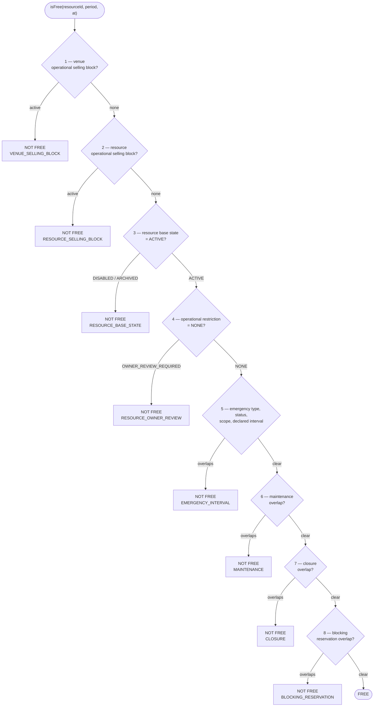
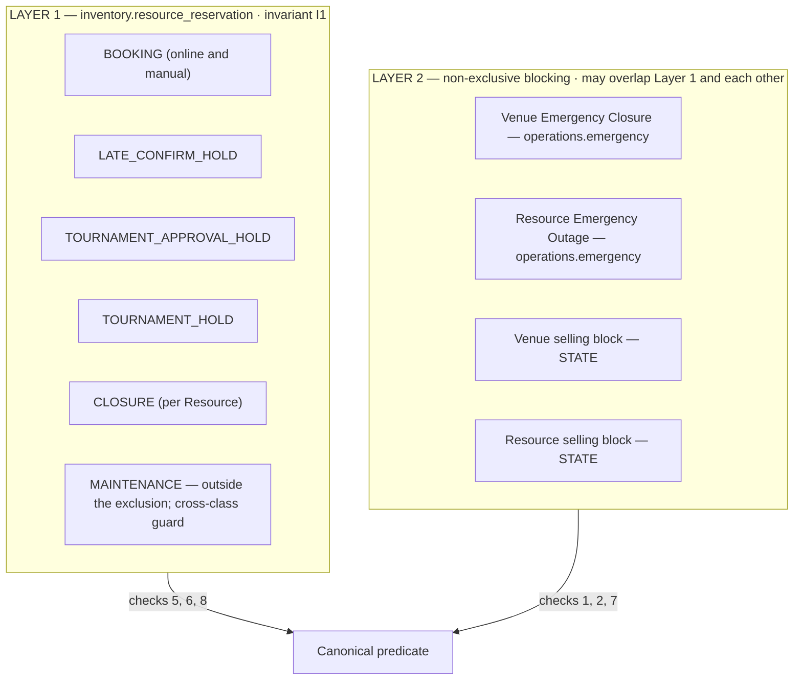
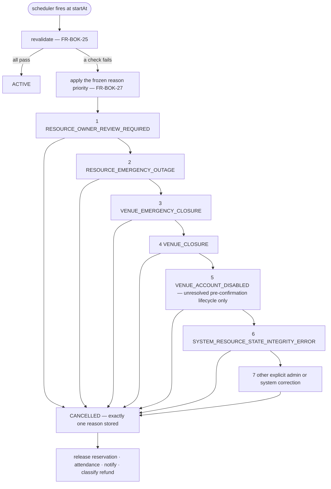

# E7GZ PS
# AVAILABILITY & RESERVATION ENGINE v1.1

**Updated:** 25 September 2026 — ledger mechanics aligned to physical model v1.1.27 (`inventory.resource_reservation`, `04 §4.1`).

> *"A double booking is a Sev-1 defect."* — PRD §10
> *"Availability must be guaranteed by the server and the database."*

This is the most important document in the pack. Everything else can be rebuilt; a customer-visible double booking cannot be taken back.

---

# 1. WHAT THE ENGINE IS RESPONSIBLE FOR

The Product asks three separate questions and forbids conflating them (`FR-AVL-01`, `PRD §10.1`):

| | Question | Answered by |
|---|---|---|
| **A** | Is this resource interval free? | `AvailabilityQuery.isFree` — the canonical predicate |
| **B** | Is this **online booking** allowed? | Booking module's 20-condition predicate, which **includes** A |
| **C** | Is this tournament or operational action allowed? | Tournament / Operations predicates, each of which **includes** A |

There is exactly **one** implementation of A. B and C compose it; they never re-derive it, shortcut it, or trust a cached answer at commit time.

---

# 2. THE CANONICAL PREDICATE

## 2.1 The eight ordered checks (`FR-AVL-02`)

The order is frozen. It is not an optimisation choice, and the implementation evaluates it in exactly this sequence so that the failing check index is meaningful.



**Two rules the order encodes**, both stated in `FR-AVL-02` and easy to get wrong:

1. **A selling block is evaluated explicitly *before* any reservation check, and needs no fabricated future interval.** Checks 1 and 2 are state lookups, not interval overlaps. A venue under an emergency selling block therefore rejects a manual booking whose interval does *not* overlap the declared emergency interval (`EC-AVAI-003`) — which an interval-only model would wrongly allow.
2. **An unresolved emergency is never treated as an infinitely extended reservation.** Check 5 tests the *declared* interval; the open-ended part of an unresolved emergency lives in checks 1–2 as a block state. This is why the data model splits into two layers (`ADR-010`).

## 2.2 Reference implementation

```java
public PredicateResult isFree(UUID resourceId, Range<Instant> period, Instant at) {
    // 1
    if (sellingBlocks.venueBlocked(venueOf(resourceId), at))
        return notFree(Check.VENUE_SELLING_BLOCK);                      // FR-AVL-02 #1, FR-AVL-07
    // 2
    if (sellingBlocks.resourceBlocked(resourceId, at))
        return notFree(Check.RESOURCE_SELLING_BLOCK);                   // FR-AVL-02 #2, FR-AVL-07
    // 3 + 4  — both required, independently   (FR-AVL-06, FR-VEN-13)
    var r = resources.load(resourceId);
    if (r.baseState() != ACTIVE)                return notFree(Check.RESOURCE_BASE_STATE);
    if (r.restriction() != NONE)                return notFree(Check.RESOURCE_OWNER_REVIEW);
    // 5  — declared emergency interval only   (FR-AVL-02, FR-OPS-08)
    if (emergencies.declaredIntervalOverlaps(resourceId, period))
        return notFree(Check.EMERGENCY_INTERVAL);
    // 6
    if (maintenance.overlaps(resourceId, period)) return notFree(Check.MAINTENANCE);
    // 7
    if (closures.overlaps(venueOf(resourceId), period)) return notFree(Check.CLOSURE);
    // 8
    if (ledger.hasBlockingOverlap(resourceId, period))
        return notFree(Check.BLOCKING_RESERVATION);                     // FR-AVL-03
    return PredicateResult.free();
}
```

`PredicateResult` carries the **failing check index**. That is how the Dashboard can tell a venue *why* a conversion is not executable and list the blocking commitments (`FR-OPS-43`) without any caller re-deriving the reason — and how the Customer App can show *Closed Now · Opens at 12:00 PM* rather than a generic unavailable (`FR-DIS-06`).

## 2.3 What blocks, and what does not

| Blocks inventory | Does **not** block | Source |
|---|---|---|
| Booking `PENDING` | `VENUE_RESPONSE_EXPIRED` — its reservation was released | `FR-AVL-05`, `FR-BOK-18` |
| Booking `AWAITING_CUSTOMER_CONFIRMATION` (temporary hold) | any terminal booking | `FR-AVL-05` |
| Booking `CONFIRMED` | a booking's **source** — status decides, source never does | `FR-AVL-04` |
| Booking `ACTIVE` | | |
| Manual booking `CONFIRMED` / `ACTIVE` — the only reachable blocking states for `source = MANUAL` | | `FR-AVL-04` |
| Player Tournament **Approval Hold** | | `FR-TRN-09` |
| Tournament **Hold** | | `FR-AVL-03` |
| Maintenance | | `FR-AVL-03` |
| Venue Closure | | Layer 2 |
| Emergency Closure — declared interval | an unresolved emergency as an infinite interval | `FR-AVL-02` |
| Resource Emergency Outage — declared interval | an emergency on **another** resource | `FR-OPS-12` |

---

# 3. THE RESERVATION LEDGER

## 3.1 Two layers (`ADR-010`)



**What overlaps what.** Active `BOOKING`, `LATE_CONFIRM_HOLD`, `TOURNAMENT_*` and `CLOSURE` rows never overlap one another on a Resource: `ex_no_double_booking` (`EXCLUDE USING gist (resource_id WITH =, planned_range WITH &&) WHERE active_flag AND reservation_type <> 'MAINTENANCE'`) makes that a database guarantee (`I1`). `MAINTENANCE` rows are outside that constraint because the Product lets Maintenance overlap Maintenance (Product §39.2; `01 §14` A1) and lets a Closure overlap Maintenance (`FR-VEN-33`). Everything else about Maintenance is still enforced by the database: the cross-class guard locks the Resource row and refuses Maintenance over any Booking, hold or Closure (`FR-OPS-02`), and any commitment over active Maintenance.

**Why emergencies and selling blocks are in Layer 2.** They are *required* to overlap:

- `FR-OPS-08` — an emergency overlaps and cancels the reservations inside its window; that overlap *is* the cascade.
- `FR-OPS-12` — a resource emergency terminates the ACTIVE booking on that resource.
- `FR-AVL-02` — an unresolved emergency is never treated as an infinitely extended reservation, and a selling block is a *state* checked first.

## 3.2 The row and its life

```
planned_start ─────────────────────────── planned_end     immutable  (FR-AVL-13)
     │  planned_range = [planned_start, planned_end)        immutable
     ├── active_flag = true                                  HELD — inside ex_no_double_booking
     └── active_flag = false, actual_reservation_release_at  RELEASED — one-way, never re-activated
actual occupancy = [actual_reservation_start, COALESCE(actual_reservation_release_at, planned_end))
```

| Life event | Effect on the ledger | Source |
|---|---|---|
| Online Booking created | insert `BOOKING` row, active | `FR-BOK-13` |
| Venue accepts | no ledger change (the Booking row changes state) | `FR-BOK-14` |
| Venue rejects | release now, `release_reason` recorded | `FR-BOK-17` |
| Venue response expires | release now; the Booking is **not** terminal | `FR-BOK-18`, `FR-AVL-05` |
| Late Confirm initiated | **new** `LATE_CONFIRM_HOLD` row for the same Booking | `FR-LCF-06` |
| Late Confirm accepted | the hold remains the Booking's active reservation | `FR-LCF-13` |
| Late Confirm declined / timed out | release the hold | `FR-LCF-13` |
| Booking starts | no ledger change; `actual_reservation_start` was set at insert | `FR-BOK-24` |
| **No-show recorded** | release at the no-show instant — the remaining interval is sellable at once; `planned_range` unchanged | `FR-ATT-05`, `FR-AVL-12` |
| Booking completes | release at `end_at` | `FR-BOK-24` |
| Cancelled before start | release now with the terminal cause | `FRS §2.1` |
| Emergency / owner-review cascade | release now (future and ACTIVE) | `FR-OPS-08`, `FR-OPS-28` |
| Tournament request | insert one `TOURNAMENT_APPROVAL_HOLD` per assigned Resource | `FR-TRN-09` |
| Venue approves the Tournament | release the approval holds and insert `TOURNAMENT_HOLD` rows in the same transaction | `FR-TRN-09` |
| Tournament Resource lost while ACTIVE | release that Resource's hold; the Tournament continues if ≥1 remains | `FR-TRN-27` |
| Venue Closure | insert `CLOSURE` rows for each Resource after the closure cascade released the affected commitments | `FR-VEN-29`…`FR-VEN-33` |
| Maintenance | insert `MAINTENANCE` row (may overlap other Maintenance) | `FR-OPS-01`…`FR-OPS-03` |

**The 8:16 case, end to end** (`FR-AVL-12`, `EC-AVAI-004`). An 8:00–9:00 booking is marked no-show at 8:16. Its reservation is released with `actual_reservation_release_at = 8:16`; `planned_range` stays `[8:00, 9:00)`. A new booking at 8:20–9:00 inserts cleanly — released rows are outside `ex_no_double_booking`. Both records survive with **overlapping planned intervals and non-overlapping actual occupancy**, which is exactly what the requirement asks for. Reversing the no-show at 8:40 changes trust and attendance, and **never evicts the new customer** (`FR-ATT-06`), because a released row is never re-activated.

---

# 4. CONCURRENCY

**Closes `PRD §27.3` open item 1. Full record in `ADR-003`.**

## 4.1 The guarantee

`NFR-02` — *first successfully committed valid transition wins, with mandatory revalidation for the loser.* `EC-AVAI-001` — N simultaneous bookings for one slot produce exactly one CONFIRMED path and N−1 **clean** failures with **no partial reservation**.

## 4.2 The mechanism

```sql
BEGIN;  -- READ COMMITTED (the command context refuses anything else)

-- command context: one lock order for every module, one command instant  (04 §2.1, ADR-026)
SELECT tournament.begin_command(ARRAY[:customerId], ARRAY[:venueId], ARRAY[:resourceId], ARRAY[]::uuid[]);

-- the 20 conditions, including the canonical predicate  (FR-BOK-11)
--   ... checks 1-8 ...

-- the commitment count and overlap  (FR-BOK-03, FR-BOK-04) — the commitment guard row is already locked
SELECT count(*) FROM booking.booking
 WHERE customer_id = :uid AND commitment_period IS NOT NULL;

INSERT INTO booking.booking (...) VALUES (...);   -- guards: snapshots, intake window, fee, Venue ACTIVE; ex_customer_no_overlap may raise 23P01
-- THE AUTHORITY: succeeds or raises 23P01 on ex_no_double_booking
INSERT INTO inventory.resource_reservation (id, resource_id, reservation_type, booking_id, planned_start, planned_end, actual_reservation_start, active_flag, version)
VALUES (:rid, :resourceId, 'BOOKING', :bookingId, :start, :end, :start, true, 0);
INSERT INTO booking.booking_history (...) VALUES (...);
INSERT INTO technical.scheduled_job (...) VALUES (...);   -- VENUE_RESPONSE_EXPIRY at created_at + 10 minutes
INSERT INTO technical.outbox_event (...) VALUES (...);

COMMIT;   -- deferred integrity checks run here
```

```java
try {
    return bookingRepo.createOnline(cmd);
} catch (ExclusionViolation e) {              // SQLSTATE 23P01
    return switch (e.constraint()) {
        case "ex_no_double_booking"   -> Failure.slotNoLongerAvailable();   // FR-AVL-11
        case "ex_customer_no_overlap" -> Failure.overlappingCommitment();   // FR-BOK-04
        default -> throw e;
    };
}
```

The whole transaction rolls back, so there is no partial reservation. The caller receives a typed failure, not a retry loop: `FR-AVL-11` says an offered action **may fail**, and the customer is told to pick another slot.

## 4.3 Why not `SERIALIZABLE`

It would also deliver the guarantee, but it would impose serialization failures and a retry loop on every unrelated write path in the system, for an invariant the exclusion constraint already enforces precisely, always, and independently of isolation level. `NFR-02` explicitly leaves the strategy open — this is the narrower, stronger choice.

## 4.4 The races the design must survive

| Race | Resolution | Source |
|---|---|---|
| N customers, one slot | exclusion constraint; one commits, N−1 get `23P01` → clean failure | `EC-AVAI-001` |
| Late Confirm hold vs a new booking on the freed slot | both insert into the ledger; the constraint decides. The loser records `LATE_CONFIRM_FAILED_RESOURCE_CONFLICT` — **not** a terminal reason | `FR-LCF-17`, `FR-AUD-15` |
| Tournament hold vs booking | same constraint. **Existing reservations always win**: tournament creation fails, the booking is untouched | `FR-TRN-08` |
| No-show release vs a new sale | the release commits first or second; either way the constraint holds | `FR-AVL-12` |
| Two venues initiating Late Confirm for a customer at 3 commitments | `FOR UPDATE` on the commitment state serialises the count; the second sees 4 and is blocked with a **neutral** message | `FR-LCF-04`, `FR-LCF-05` |
| Venue accepts at `expiresAt − 1s` while the worker fires at `expiresAt` | both re-read under `READ COMMITTED`; the accept transaction that commits first wins, the other re-reads and marks itself `SUPERSEDED` | `FR-AVL-15` |
| Opening-hours commit vs a new booking created after the preview | the commit recomputes the affected set, finds it grew, and **aborts** with a refreshed preview | `FR-VEN-26` |
| Emergency cascade vs a concurrent booking creation | the cascade sets the selling block in the same transaction; the creation either committed first (and is then cancelled by the cascade) or sees the block at check 1 | `FR-OPS-15` |

---

# 5. NEAREST AVAILABILITY

## 5.1 The requirement

`FR-DIS-04` — the earliest valid start time for the currently selected activity at the **1-hour minimum duration**, computed from opening hours, eligible resources, the canonical predicate, the current time and the 15-minute lead rule. For PlayStation, before any room or console filter, the earliest valid PlayStation resource.
`FR-DIS-05` — resources DISABLED, ARCHIVED, under owner review, or under a selling block must **never** contribute.
`NFR-11` — a venue list must render without perceptible delay; p95 under 1 second.

## 5.2 The algorithm

```
nearestAvailability(venue, activity):
  candidates = resources of (venue, activity)
               where base_state = ACTIVE and restriction = NONE           # FR-DIS-05
               and not resource-selling-blocked                           # FR-DIS-05
  if venue-selling-blocked: return none                                   # FR-DIS-05
  earliest = max(now + 15 minutes, next session start)                    # FR-BOK-02
  for each future operating session s, in order:                          # ADR-009
     for each candidate r:
        scan s for the first 60-minute window [t, t+60m) inside s
             where isFree(r, [t, t+60m)) is FREE                          # FR-AVL-01, FR-DIS-04
     return the minimum t found in s
  return none
```

Candidate start times are the ledger's "free gap" boundaries inside the session, not a minute-by-minute scan: the busy set for a resource in a session is a small number of ranges, so the gaps are computed directly with `range_agg`.

## 5.3 The projection (`ADR-005`)

Computing this per venue per request would not hold `NFR-11` as the venue count grows. `FR-AVL-11` explicitly authorises precomputation: *displayed availability is a snapshot, not a commit guarantee.*

- `venue_activity_availability (venue_id, activity, nearest_available_at, starting_price, refreshed_at)`.
- Refreshed by the projection worker on any event that can change availability: reservation hold or release, resource state change, selling-block change, maintenance, closure, emergency, opening-hours change, pricing change.
- Read by discovery, the venue card (`FR-DIS-03`), the map marker (`FR-DIS-10`) and venue details (`FR-DIS-11`) with one indexed query.
- **Never read on a commit path.** Creation, accept, Late Confirm, manual booking and tournament creation all call the live predicate.

Staleness is bounded by outbox dispatch latency (milliseconds under `NOTIFY`) and is, by the Product's own statement, acceptable — the commit revalidates and may fail.

## 5.4 Find Available (`FR-DIS-12`)

Distinct from Nearest Availability: it takes area, activity, date, start time and duration and returns **only resources available for the entire requested interval**, evaluated live against the canonical predicate. **No price filter in this release.** Because the interval is supplied, the query is a single pass over candidate resources with one predicate call each.

---

# 6. REVALIDATION POINTS

`FR-AVL-09` names the commitment-strengthening transitions and adds *"and before any future transition whose effect is to obtain or strengthen a resource or venue commitment. No lifecycle boundary is exempt."*

| # | Transition | Revalidates | Source |
|---|---|---|---|
| 1 | Online booking creation | all 20 conditions | `FR-BOK-11` |
| 2 | Venue Accept | venue category-B eligibility, venue block, resource base state, restriction, resource block, reservation, interval, **and always customer account and ban** | `FR-BOK-14` |
| 3 | Late Confirm initiation | venue list, resource list, customer not banned and below 4 | `FR-LCF-02`…`FR-LCF-04` |
| 4 | Late Confirm accept | commitment count, customer schedule conflict, reservation, ban and account, venue and resource operational eligibility including block | `FR-LCF-14` |
| 5 | Manual booking creation | the category-C predicate incl. required pricing configuration | `FR-MAN-02` |
| 6 | Tournament creation | every assigned resource: ACTIVE, NONE, no block, no conflict, activity compatible | `FR-TRN-33` |
| 7 | Tournament approval | holds still valid; resources still eligible | `FR-TRN-09` |
| 8 | Tournament checkpoint | every assigned resource, plus venue **operational** eligibility — marketplace SUSPENDED never fails it alone | `FR-TRN-15`, `FR-TRN-16` |
| 9 | Booking `CONFIRMED → ACTIVE` | venue block, resource base state, restriction, resource block, applicable closure or emergency — **atomically with the transition** | `FR-BOK-25` |
| 10 | Tournament `CONFIRMED → ACTIVE` | every resource; any under owner review cancels **before gameplay begins** | `FR-TRN-17` |
| 11 | Resource or hold assignment | full resource eligibility | `FR-AVL-09` |

**Implementation.** Each is a call to `AvailabilityGuard.requireFree(...)` plus the transition-specific extras, inside the transaction, immediately before the mutation. An ArchUnit test asserts that every command annotated `@CommitmentStrengthening` calls the guard.

---

# 7. START-TIME RESOLUTION — WHY IT CANNOT STALL

`FR-BOK-26` — **a booking can never remain CONFIRMED past `startAt` because a check failed.** Every start-time failure produces a deterministic terminal transition, a closed reason code, an attendance result, a notification and a refund classification.



**`SYSTEM_RESOURCE_STATE_INTEGRITY_ERROR`** (`FR-BOK-28`) is the engine's self-check: if a resource base-state anomaly somehow survives to `startAt`, the booking is cancelled immediately with **no customer penalty**, a full future-fee refund, a customer notification and a Platform Admin alert carrying booking ID, resource ID, the unexpected state, `startAt`, detection time, the conflicting source where known and a correlation identifier. It is an architectural smoke alarm: firing it means a defect exists, and `NFR-29` requires the alert to carry the full diagnostic payload.

---

# 8. WHAT BLOCKS A RESOURCE STATE CHANGE

`FR-VEN-14` — Disable, Archive and Console Change are **blocked** by any current or future blocking reservation. Existing reservations are **never** automatically cancelled; the venue must resolve them first.

```sql
-- the blocking set the Dashboard must display  (FR-VEN-14, FR-OPS-43)
SELECT rr.id, rr.reservation_type, rr.planned_range, rr.booking_id, rr.tournament_id, rr.maintenance_id
FROM inventory.resource_reservation rr
WHERE rr.resource_id = :rid
  AND rr.active_flag
  AND rr.reservation_type <> 'CLOSURE'          -- a normal closure alone does not block
  AND rr.planned_end > now();
```

| Blocks the change | Does **not** block | Source |
|---|---|---|
| CONFIRMED · ACTIVE · PENDING · AWAITING | `VENUE_RESPONSE_EXPIRED` — no reservation is held | `FR-VEN-14`, `FR-BOK-22` |
| Player Tournament Approval Hold · Tournament Hold | a normal venue closure alone | `FR-VEN-14` |
| Resource Maintenance | | `FR-VEN-14` |

When the change proceeds against a `VENUE_RESPONSE_EXPIRED` booking, the system records `LATE_CONFIRM_ELIGIBILITY_LOST_RESOURCE_STATE_CHANGED` with the matching `detailCode`, and **no additional customer push is required** (`FR-BOK-22`).

An active emergency blocks **availability** but does not by itself forbid Disable, Archive or Console Change, provided the Owner Password passes, remaining future reservations are resolved and maintenance restrictions pass (`FR-OPS-42`). Where the resource cannot return to service but still holds future protected reservations, the selling block **remains** and the Dashboard must display the blocking commitments and state that they must be resolved first — never present an unavailable conversion as executable (`FR-OPS-43`). `PredicateResult`'s failing-check index plus the query above is exactly what that screen needs.

---

# 9. TESTING THE ENGINE

These are launch-bar items, not nice-to-haves (`PRD §4.3`).

| Test | Asserts | Source |
|---|---|---|
| **Concurrency pack** — N threads, one slot, repeated | exactly 1 success, N−1 clean failures, 0 partial reservations, 0 overlapping rows | `EC-AVAI-001`, `NFR-02` |
| **Invariant sweep** — after every test suite, scan for overlapping actual occupancy per resource (`[actual_reservation_start, COALESCE(actual_reservation_release_at, planned_end))`, Maintenance excluded) | zero rows, always | `FR-AVL-08`, `NFR-28` |
| **Six-flow eligibility** — resource ACTIVE + OWNER_REVIEW_REQUIRED | rejected by all six flows of `FR-AVL-01` | `EC-AVAI-002` |
| **Selling block beyond interval** — manual booking outside the declared emergency window | refused at check 1 or 2 | `EC-AVAI-003` |
| **No-show resale** — no-show 8:16, book 8:20 | succeeds; both records survive; planned intervals overlap, occupancy does not | `EC-AVAI-004` |
| **businessDate always present** — manual booking at 3 AM for a venue closing at 2 AM | succeeds and carries a `businessDate` | `EC-AVAI-005`, `FR-MAN-09` |
| **Predicate singularity** — static analysis | only one call site constructs the eight checks; no flow re-implements them | `FR-AVL-01` |
| **Boundary pack** — every timer at the deadline and ±1 second | expiry owns `now >= deadline` | `EC-X-002`, `FR-AVL-15` |
| **Fault injection** in every cascade | no partial state and **no sellable gap** | `FR-OPS-09`, `FR-OPS-21` |

The invariant sweep is also a **production check**: a scheduled query runs nightly and raises Sev-1 on any row, per `NFR-28`.

---

*End of Availability & Reservation Engine v1.0. Continue to `06 — Booking & Tournament Lifecycle Engine.md`.*
