# E7GZ PS
# BOOKING & TOURNAMENT LIFECYCLE ENGINE v1.1

State machines, transition guards, cascades and sequence diagrams for the booking and tournament domains.

**Updated 25 September 2026 — database enforcement (`ADR-026`).** Both state machines below are also enforced by the physical model: `booking.guard_booking_transition` (the FRS §2.1 graph, the permitted reasons per source state, Customer cancellation only before Start, No-show reversal before/after the original `endAt`, terminal immutability) and the Tournament guards (`tournament.guard_tournament_update`, `tournament.guard_tournament_due_boundary`, `tournament.assert_tournament_history_chain`). The lifecycle engine in Java decides which transition to take and which reason under the frozen priority; the database refuses any transition or reason outside the graph. Player-hosted approval uses `approvalExpiresAt = MIN(requestCreatedAt + 10 min, checkpointAt)`, Venue Reject stores `REJECTED/VENUE_REJECTED_TOURNAMENT` and the approval timeout stores `CANCELLED/VENUE_DID_NOT_APPROVE_TOURNAMENT_IN_TIME` (`FR-TRN-10`).

---

# 1. BOOKING STATE MACHINE

## 1.1 States (`FR-BOK-12`)

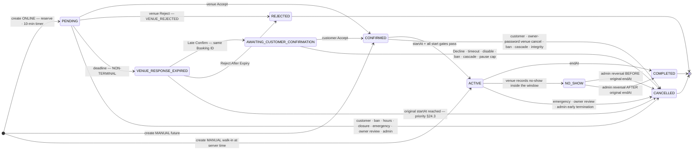

**`VENUE_RESPONSE_EXPIRED` is non-terminal** (`FR-BOK-12`). It holds no reservation (`FR-AVL-05`), is shown to the customer under *Cancelled* with *"Venue did not respond in time"* (`FR-BOK-20`), and remains internally eligible for Late Confirmation until `startAt`. There is no pre-emptive customer opt-out and no automatic reactivation.

## 1.2 Transition guard table

Every transition is implemented as a guard + effect pair. The guard is the revalidation; the effect is the mutation. Both run inside the same transaction (`FR-AVL-10`).

| From → To | Guard | Effect | Source |
|---|---|---|---|
| — → PENDING | the 20 cumulative conditions | reserve · consume a commitment · set `venue_response_expires_at = now + 10m` · history · outbox | `FR-BOK-11`, `FR-BOK-13` |
| PENDING → CONFIRMED | category B venue eligibility, venue block, resource base state + restriction + block, reservation, interval, **and always customer account and ban** | keep reservation · history · notify | `FR-BOK-14`, `FR-BOK-15` |
| PENDING → REJECTED | venue is the actor; **mandatory venue-supplied reject reason text** | `VENUE_REJECTED` · release reservation **immediately** · history · notify | `FR-BOK-17` |
| PENDING → VENUE_RESPONSE_EXPIRED | `now >= venue_response_expires_at` and the timer is not paused | release reservation immediately · history · notify · expose in Missed/Expired | `FR-BOK-18` |
| PENDING → CANCELLED | cause-specific | release · exactly one reason · history · notify | `FRS §2.1` |
| VRE → AWAITING | venue + resource + customer eligibility, **atomically** | create temporary hold · `expires_at = MIN(now+5m, startAt)` · reopen phone visibility | `FR-LCF-02`…`FR-LCF-09`, `FR-LCF-18` |
| VRE → REJECTED | `now < startAt` | `REJECTED_AFTER_EXPIRY` | `FR-BOK-21` |
| VRE → CANCELLED at `startAt` | priority: owner review → resource emergency → venue emergency → account disabled → `VENUE_DID_NOT_RESPOND_IN_TIME` | the last applies **only** when no overriding cause exists | `FR-BOK-23` |
| AWAITING → CONFIRMED | commitment count, customer schedule conflict, reservation, ban and account, venue and resource operational eligibility | hold becomes the reservation · restore phone visibility | `FR-LCF-14`, `FR-LCF-18` |
| AWAITING → CANCELLED | Decline / timeout / disable / ban / cascade / pause cap | release hold and commitment · **no penalty** | `FR-LCF-13`, `FR-OPS-38`, `FR-OPS-44` |
| CONFIRMED → ACTIVE | venue block, resource base state, restriction, resource block, applicable closure or emergency — atomically | reservation kind → ACTIVE, `actual_reservation_start` | `FR-BOK-25` |
| CONFIRMED → CANCELLED | customer pre-start · venue cancel **with Owner Password** · ban · cascade · integrity | release · exactly one reason | `FR-BOK-27`, `FR-VEN-03` |
| ACTIVE → COMPLETED | `now >= endAt` and not otherwise terminal | release at `endAt` · **attendance resolves** | `FR-BOK-24`, `FR-ATT-08` |
| ACTIVE → NO_SHOW | inside `[startAt+15m, endAt)`, no valid check-in, no Late Present | **release** the reservation now · `NO_SHOW_RECORDED` · default attendance `ABSENT_NO_SHOW` | `FR-ATT-04`, `FR-ATT-05` |
| ACTIVE → CANCELLED | emergency / owner review / admin | release now · attendance **from evidence** | `FR-BOK-29`, `FR-BOK-30`, `FR-ATT-10` |
| NO_SHOW → CANCELLED / COMPLETED | admin reversal, before/after original `endAt` | **never restores already released inventory** | `FR-ATT-12`, `FR-ATT-06` |

## 1.3 The twenty creation conditions (`FR-BOK-11`)

Implemented as one ordered, named list in a single class, each entry citing its source. A unit test asserts the count is exactly **twenty**.

| # | Condition |
|---|---|
| 1 | account verified by phone OTP |
| 2 | customer not banned |
| 3 | customer below the 4-commitment limit |
| 4 | no overlapping customer commitment |
| 5 | venue marketplace **ACTIVE** (category A) |
| 6 | venue account **ENABLED** |
| 7 | area **ACTIVE** |
| 8 | venue inside an operating session |
| 9 | at least 10 minutes before session end |
| 10 | no venue operational selling block |
| 11 | no resource operational selling block |
| 12 | requested start at least 15 minutes ahead |
| 13 | duration 1–6 hours |
| 14 | duration in 30-minute increments |
| 15 | interval fits **one** future operating session |
| 16 | resource base state **ACTIVE** |
| 17 | resource operational restriction **NONE** |
| 18 | no overlapping blocking reservation |
| 19 | activity / resource compatibility |
| 20 | all other required product validation |

> **No twenty-first condition.** Missing pricing configuration fails under **item 20** for an online booking. The explicit "required pricing configuration exists" condition belongs to the **manual** predicate (`FR-MAN-02` item 15) and returns `MANUAL_BOOKING_PRICING_CONFIGURATION_MISSING` there — an API error code only, never a booking event and never a terminal reason (`FR-MAN-10`, `FR-AUD-14`). A code comment records that adding a twenty-first condition is a Product Change Request against v5.0 §22, and the Product Owner has ruled that none is added.

## 1.4 Manual booking — the differences

| | Online | Manual |
|---|---|---|
| Eligibility category | **A** — new-activity marketplace | **C** — internal venue operation |
| Marketplace status | must be ACTIVE | ACTIVE, INACTIVE or SUSPENDED; **never ONBOARDING** (`FR-MAN-02`) |
| Opening hours | must fit one future session (`FR-BOK-05`) | **not required** to fit published hours (`FR-MAN-03`) |
| Area status | must be ACTIVE | does not block (`FR-MAN-03`, `FR-VEN-12`) |
| Reachable states | all nine | CONFIRMED · ACTIVE · COMPLETED · CANCELLED only (`FR-MAN-04`) |
| Start | ≥ 15 minutes ahead | **NOW or FUTURE, never past** (`FR-MAN-05`) |
| Customer | required, verified | may be absent; optional name and phone (`FR-MAN-01`) |
| Commitment limit | counts toward 4 | does not count (`FR-MAN-07`) |
| Trust, points, progress | full participation | **nothing** (`FR-MAN-06`) |
| Attendance | resolved from evidence | **NOT_APPLICABLE**, including on operational termination (`FR-MAN-06`) |
| Booking fee | stored, EGP 0 at launch | **NOT_APPLICABLE** treatment (`FR-MAN-08`, `FR-PTS-16`) |
| Cancellation | customer or venue with Owner Password | venue **without** Owner Password, `VENUE_CANCELLED_MANUAL_BOOKING`, from CONFIRMED or ACTIVE (`FR-MAN-08`; amended by PCR-007) |
| `businessDate` | operating-day date | operating-day date inside a session; the Africa/Cairo calendar date of `startAt` outside published hours — **always present** (`FR-MAN-09`) |

## 1.5 Customer-facing projection (`FR-BOK-19`)

| Bucket | Statuses |
|---|---|
| **Upcoming** | PENDING · AWAITING_CUSTOMER_CONFIRMATION · CONFIRMED · ACTIVE |
| **Completed** | COMPLETED |
| **Cancelled** | VENUE_RESPONSE_EXPIRED · CANCELLED · REJECTED · NO_SHOW |

A `VENUE_RESPONSE_EXPIRED` booking sits under *Cancelled* with *"Venue did not respond in time"* while remaining internally revivable — the projection is a display mapping, never a state change (`FR-BOK-20`).

---

# 2. SEQUENCE DIAGRAMS — BOOKING

## 2.1 Venue accept

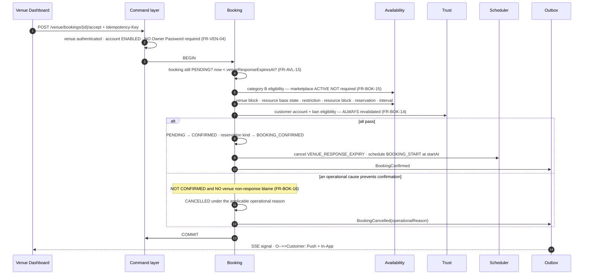

The `else` branch is `FR-BOK-16` and it matters: a venue that could not accept because an emergency or owner review intervened is **never** recorded as having failed to respond.

## 2.2 Venue response expiry, then Late Confirm revival

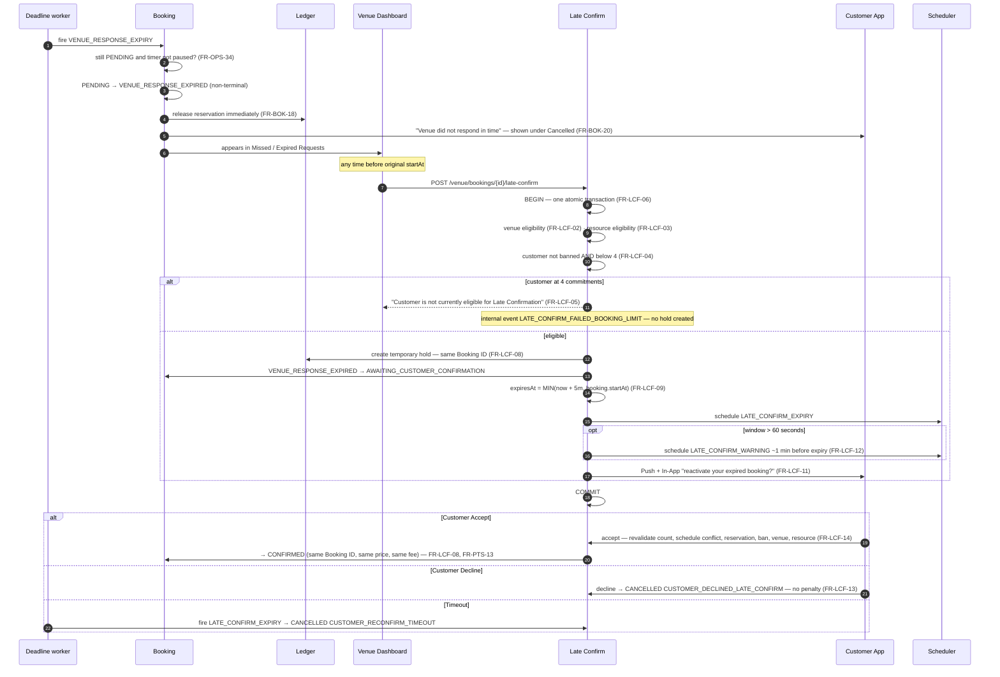

**The two short-window cases** (`FR-LCF-12`, and the acceptance obligations):

- Initiating at 7:59 PM for an 8:00 PM booking gives exactly **60 seconds** and **no** warning notification — the warning transition is simply never scheduled.
- Initiating at 7:50 PM gives 5 minutes and one warning at roughly 7:54 PM.

**The conflicting accept** (`FR-LCF-15`, `FR-LCF-16`): the customer's schedule conflict is checked **only** on accept, for privacy. A conflicting accept **fails**, records `LATE_CONFIRM_FAILED_CUSTOMER_CONFLICT`, and the booking stays AWAITING until its own expiry — it does not terminate under a generic schedule-conflict reason, because no such reason exists (`FR-AUD-15`).

## 2.3 Start, check-in, completion

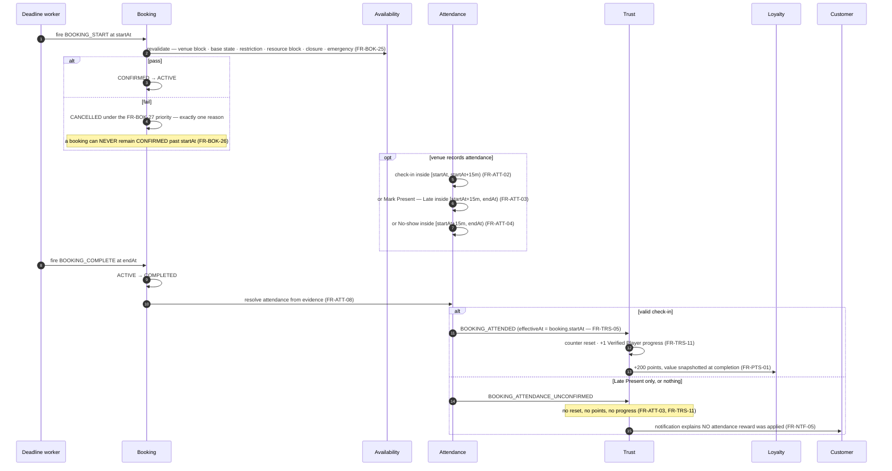

## 2.4 Opening-hours change — the nine ordered steps (`FR-VEN-23`)

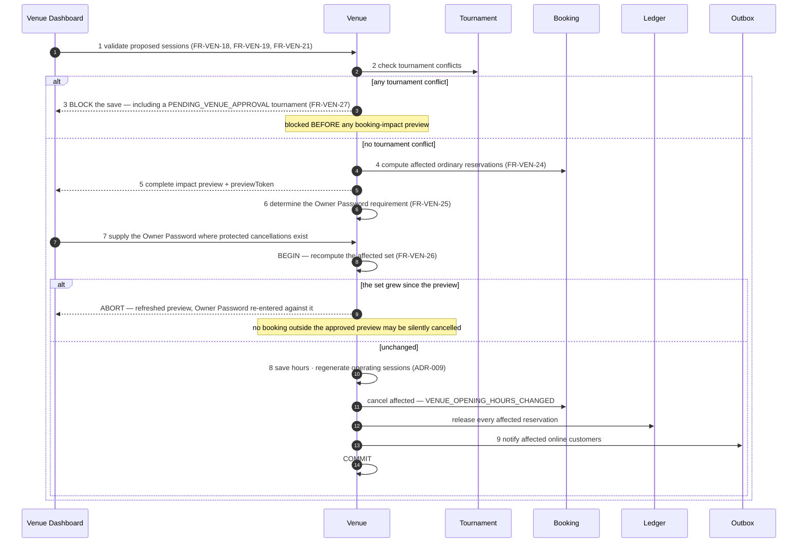

**Affected set** (`FR-VEN-24`): future PENDING, AWAITING, CONFIRMED and MANUAL. **ACTIVE sessions are not cancelled.** `VENUE_RESPONSE_EXPIRED` holds no reservation and is not cancelled.
**Owner Password** (`FR-VEN-25`): required only when the save cancels a CONFIRMED online booking or an AWAITING booking. Pending-online and manual cancellations alone do not require it.
**AWAITING** (`FR-VEN-28`): its Late Confirmation timer stops immediately, the hold releases, and the customer is notified explicitly.

If any step fails, **nothing changes**.

## 2.5 Venue emergency cascade

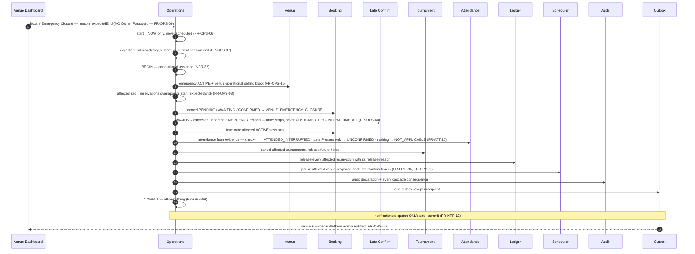

**Irreversibility** (`FR-OPS-10`): ending the emergency early never restores what was cancelled. **Scope** (`FR-OPS-08`): only reservations overlapping `[emergencyStart, expectedEnd)`. **No sellable gap** (`FR-OPS-21`, `FR-OPS-24`): the block is released only when staff assert the venue or resource is operational, or a replacement restriction commits **in the same transaction**.

## 2.6 Emergency timer pause, resume and cap

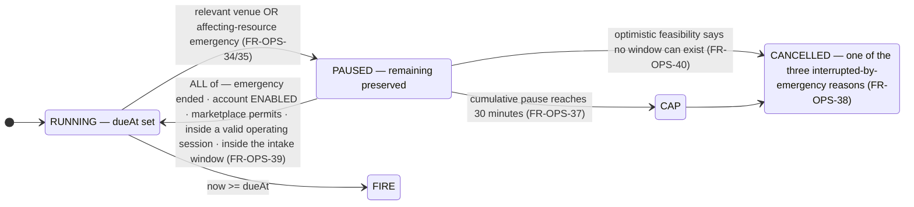

**The two counters are separate, and each has its own 30-minute cap** (`FR-OPS-37`):

| Counter | Scope | Cap outcome |
|---|---|---|
| `cumulative_emergency_pause_duration` | venue response, per booking. **Venue and resource pauses both increment it**, so switching emergency type never resets the clock | venue-level cause → `VENUE_RESPONSE_INTERRUPTED_BY_EMERGENCY`; resource-level cause → `RESOURCE_RESPONSE_INTERRUPTED_BY_EMERGENCY` |
| `cumulative_late_confirm_emergency_pause_duration` | Late Confirm, per AWAITING phase | `LATE_CONFIRM_INTERRUPTED_BY_EMERGENCY` |

The named acceptance case — paused 12 minutes by a venue emergency, resumed, then paused 19 minutes by a resource emergency — cancels at the **30-minute cumulative mark under the resource reason**, because one counter serves both.

**The optimistic feasibility test** (`FR-OPS-40`), which is what makes early cancellation deterministic rather than a guess:

```
optimisticFeasibility(booking):
    remaining = responseTimerRemaining(booking)
    # assume the selling block could resolve THIS INSTANT
    for each future valid operating session s before booking.startAt:      # ADR-009
        window = [max(now, s.start), s.end - 10 minutes)                   # FR-BOK-09 intake cutoff
        if length(window) >= remaining:  return FEASIBLE
    return CANCEL_NOW
```

*No such window even under immediate resolution* → cancel now under the applicable interrupted-by-emergency reason. *A window could exist but the emergency is unresolved* → the booking stays paused only until the 30-minute cap, which is the deterministic outer bound. **Block duration is never predicted by the scheduler.** The test is a pure function of stored state, so repeated evaluation of identical state gives an identical decision — the PRD's Phase 5 exit criterion.

**While paused** (`FR-OPS-41`, `FR-BOK-32`): the customer may still **Decline**, taking effect immediately under `CUSTOMER_DECLINED_LATE_CONFIRM`, and may still cancel a PENDING booking. Pause records are immutable operational history.

## 2.7 Owner-review entry cascade

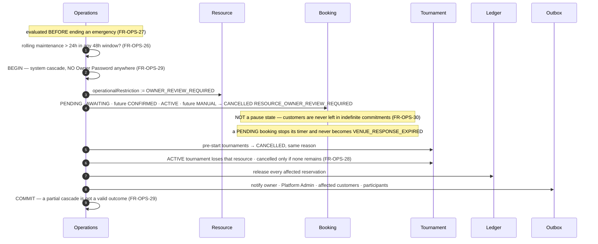

**Affected customers** get no penalty, an explicit operational reason, the ability to rebook normally and a full future-fee refund. No replacement booking is created. Attendance is `NOT_APPLICABLE` with no trust effect (`FR-OPS-31`).

**Resolution** (`FR-OPS-33`) requires the Owner Password and offers Return to Service / Extend Maintenance / Disable / Archive. Return to Service requires no blocking maintenance, no emergency selling block and an otherwise operational resource.

## 2.8 Venue account disable

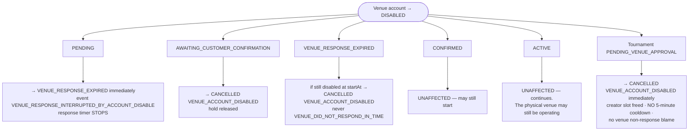

Sources: `FR-VEN-08`, `FR-VEN-09`, `FR-VEN-10`, `FR-VEN-11`, `FR-ATT-14`, `FR-TRN-18`, `FR-TRN-19`.

`VENUE_ACCOUNT_DISABLED` applies **only** to an unresolved pre-confirmation response lifecycle; it is never a general `CONFIRMED → ACTIVE` cancellation reason (`FR-VEN-10`). Marketplace SUSPENDED or INACTIVE creates **no venue blame** and needs no new expiry reason (`FR-VEN-11`).

**Platform Attendance Protection.** Disabling the account does not terminate an ACTIVE session, but it may prevent reliable attendance recording. Each disable window is appended to `venue_account_restriction_interval`. At attendance resolution the six cumulative conditions of `FR-ATT-16` are evaluated against the check-in window and the no-show window (`FR-ATT-17`); if they hold, **one** `BOOKING_ACCOUNT_DISABLE_ATTENDANCE_PROTECTION` trust event is emitted with `effectiveAt = booking.startAt`, resetting the consecutive counter and doing nothing else (`FR-ATT-19`). Two disable/re-enable cycles inside one session produce **one** event and **one** reset (`FR-ATT-21`). An admin correction to `ABSENT_NO_SHOW` **neutralises** the reset (`FR-ATT-24`). The customer notification `ACTIVE_SESSION_ATTENDANCE_RECORDING_AFFECTED` **must not** contain cancellation language (`FR-ATT-25`, `FR-NTF-07`).

---

# 3. TOURNAMENT STATE MACHINE

## 3.1 States

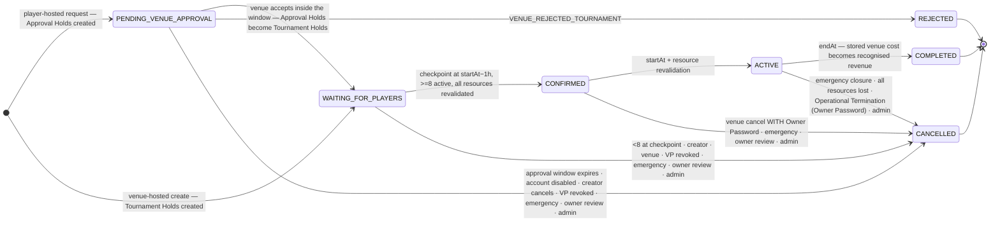

## 3.2 Terminal reason priority (`FR-TRN-31`)

Exactly one reason is stored, by this priority where causes compete:

**1.** `RESOURCE_OWNER_REVIEW_REQUIRED` → **2.** `RESOURCE_EMERGENCY_OUTAGE` → **3.** `EMERGENCY_CLOSURE` → **4.** `VENUE_ACCOUNT_DISABLED` → **5.** `MINIMUM_PARTICIPANTS_NOT_REACHED` → **6.** `CREATOR_VERIFIED_STATUS_REVOKED` → **7.** explicit actor cancellation.

## 3.3 Cancellation authority and Owner Password (`FR-TRN-21`, `FR-TRN-24`)

| Actor | May cancel | Owner Password |
|---|---|---|
| Venue | any state before ACTIVE — for player-hosted, after its own approval | WAITING_FOR_PLAYERS **no** · CONFIRMED **yes** |
| Creator | PENDING_VENUE_APPROVAL and WAITING_FOR_PLAYERS, **before the checkpoint** | n/a — **after CONFIRMED the creator may no longer cancel through E7GZ** |
| Venue, ACTIVE tournament | only via **Tournament Operational Termination** | **yes** + mandatory reason + audit + participant and organizer notification |
| Platform Admin | any non-completed tournament | n/a |
| System | emergency / owner-review consequences | **no** — these are system consequences, not the venue's cancel action |

## 3.4 Tournament sequence — player-hosted, end to end

```mermaid
sequenceDiagram
    autonumber
    participant C as Creator (Customer App)
    participant TR as Tournament
    participant T as Trust
    participant AV as Availability
    participant L as Ledger
    participant D as Venue Dashboard
    participant W as Deadline worker
    participant P as Participants

    C->>TR: create request — activity, mode, resources 1-4, capacity 8-32, start
    TR->>T: creator operational Verified Player status = VERIFIED? (FR-TRN-02)
    TR->>TR: requestTime <= startAt − 2h (FR-TRN-03)
    TR->>TR: one pending player-hosted request platform-wide? cooldown elapsed? (FR-TRN-11)
    TR->>AV: every assigned resource — ACTIVE, NONE, no block, no conflict, compatible (FR-TRN-33)
    Note over AV: EXISTING RESERVATIONS ALWAYS WIN — creation fails, bookings untouched (FR-TRN-08)
    TR->>L: create Approval Holds on each resource (FR-TRN-09)
    TR->>TR: snapshot venue cost at REQUEST CREATION (FR-TRN-28)
    TR->>D: approval window = MIN(created + 10m, checkpointAt) (FR-TRN-10)
    Note over TR: not in Discover · invite code and link INACTIVE · nobody may join (FR-TRN-07)

    alt venue accepts
        D->>TR: accept → WAITING_FOR_PLAYERS  · Approval Holds → Tournament Holds
        Note over TR: discovery rules activate now
        P->>TR: join while now < startAt, capacityOccupiedCount(now) < capacity, not banned, invite valid if private (FR-TRN-12, ADR-023)
        W->>TR: checkpoint at EXACTLY startAt − 1h (FR-TRN-03)
        TR->>TR: reconcile BAN-only restorations effective by checkpointAt — boundary time, not worker time
        TR->>TR: activeParticipantCount(checkpointAt) >= 8? (FR-TRN-13, ADR-023)
        TR->>AV: revalidate EVERY assigned resource + venue OPERATIONAL eligibility (FR-TRN-15, FR-TRN-16)
        alt >= 8 and resources valid
            TR->>TR: → CONFIRMED (a later drop below 8 does NOT auto-cancel — FR-TRN-14)
        else < 8
            TR->>TR: → CANCELLED MINIMUM_PARTICIPANTS_NOT_REACHED  · release holds — same transaction
            Note over TR: there is NO "Run Anyway" override (FR-TRN-14)
        end
    else venue rejects
        D->>TR: → REJECTED VENUE_REJECTED_TOURNAMENT  · holds released  · 5-min cooldown (FR-TRN-11)
    else approval window expires
        W->>TR: → CANCELLED VENUE_DID_NOT_APPROVE_TOURNAMENT_IN_TIME  · holds released
    else venue account disabled
        TR->>TR: → CANCELLED VENUE_ACCOUNT_DISABLED immediately, NO cooldown, no blame (FR-TRN-18)
    end

    W->>TR: start at startAt — first reconcile BAN-only restorations effective before startAt, then revalidate every resource (FR-TRN-17, FR-TRN-26)
    Note over TR: no automatic Participant restoration at/after startAt; any resource under owner review cancels BEFORE gameplay begins
    W->>TR: end at endAt → COMPLETED  · stored venue cost becomes Dashboard revenue on businessDate (FR-TRN-30)
```

## 3.5 Resource loss during a tournament (`FR-TRN-27`)

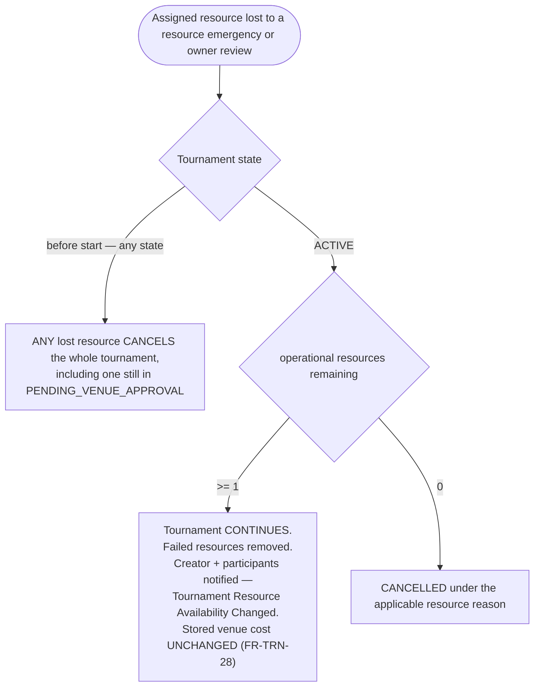

## 3.6 Verified Player cascade (`FR-TRN-20`)

| Creator status change | PENDING_VENUE_APPROVAL | WAITING_FOR_PLAYERS | CONFIRMED | ACTIVE | New creation |
|---|---|---|---|---|---|
| **REVOKED**, or qualification lost by trust correction | CANCELLED `CREATOR_VERIFIED_STATUS_REVOKED` | CANCELLED same reason | **remains** | **remains** | blocked |
| **SUSPENDED** | remains | remains | remains | remains | blocked |
| **Restored** | never resurrects a cancelled tournament | | | | allowed |

The cascade executes **once per `verifiedPlayerTransitionId`** (`FR-TRN-20`, `NFR-06`) — the unique transition ID is the idempotency key, and `cascade_executed_at` is set in the same transaction.

## 3.7 Participant handling (`FR-TRN-13`, `FR-TRN-26`, `ADR-023`)

`INELIGIBLE` stays one Participant Status. The current row also carries an explicit cause: `BAN` or `ACCOUNT_DELETED`. The cause is implementation data subordinate to the status; it does not create another state machine.

| Situation | Architectural effect | Capacity / checkpoint effect |
|---|---|---|
| Ban becomes effective while participant is pre-start | `JOINED → INELIGIBLE/BAN` in O14 | removed from **Active Participant Count** immediately; while account remains active and `now < startAt`, **one capacity slot stays reserved** |
| Account is deleted/anonymised | `JOINED` or `INELIGIBLE/BAN → INELIGIBLE/ACCOUNT_DELETED` in O19 | removed from Active count; any BAN-only reserved slot is released immediately |
| Deletion and Ban compete | `ACCOUNT_DELETED` wins | no restoration right and no reserved slot |
| Ban expires/is lifted before `startAt` | `INELIGIBLE/BAN → JOINED` automatically if Tournament is non-terminal and account active | uses the already-reserved slot; does not require newly free capacity |
| Ban no longer effective at exact `checkpointAt` | reconcile **as of `checkpointAt` before counting**, even if worker runs later | restored participant is included in the checkpoint count |
| Ban expires after checkpoint but before `startAt` | auto-restore to `JOINED` | Tournament stays CONFIRMED; reserved slot becomes ordinary JOINED occupancy |
| Ban expires/lifts at or after `startAt` | **no automatic restoration** | BAN-only reservation right ends at Start |
| Tournament already cancelled at checkpoint | no later restoration may resurrect it | terminal state remains terminal |

**Two counts, two purposes.**

```text
activeParticipantCount(at)
  = JOINED + active account + no Ban effective at `at`
  → used only for checkpoint / participant eligibility truth

capacityOccupiedCount(at)
  = JOINED
    + INELIGIBLE/BAN with active account while `at < startAt`
  → used for Join/capacity admission
```

The join path locks the Tournament participant set, evaluates `capacityOccupiedCount(now)`, then inserts/updates. Ban activation/end and account deletion take the same serialization path, so a restored BAN-only participant can neither overfill capacity nor evict a later participant. Historical Participant state and cause transitions are retained.

---

# 4. WHAT THE ENGINE DELIBERATELY DOES NOT DO

Taken from `Out-of-Scope & MVP Exclusions v1.0` and binding on the architecture (`01 §15` rule 10):

- **No Auto Accept** for online bookings (`FR-BOK-13`).
- **No ordinary early session end.** An ACTIVE booking blocks its resource until `endAt`; the only early-termination paths are venue emergency closure, resource emergency outage, entry into `OWNER_REVIEW_REQUIRED`, and Platform Admin support correction (`FR-BOK-29`).
- **No support replacement booking** and **no special admin booking-creation path**. All customer booking creation uses the same online predicate; support may assist but cannot bypass validation (`FR-TRS-26`).
- **No back-dated manual booking**, ever (`FR-MAN-05`).
- **No venue staff reversal** of check-in, Late Present or no-show (`FR-ATT-06`, `FR-ATT-11`).
- **No tournament brackets, scoring, per-match scheduling or per-match resource assignment** (`FR-TRN-03`).
- **No "Run Anyway"** at a failed checkpoint (`FR-TRN-14`).
- **No terminal reason invented for a validation-only conflict**; resource and schedule conflicts use validation failure or the defined non-terminal booking events (`FR-AUD-15`).
- **No silent restoration** of a booking cancelled by a ban correction, emergency, account-disable path or owner-review cascade. Rebooking uses the normal flow (`FR-TRS-25`).

---

*End of Booking & Tournament Lifecycle Engine v1.0. Continue to `07 — Trust, Attendance & Enforcement Engine.md`.*
