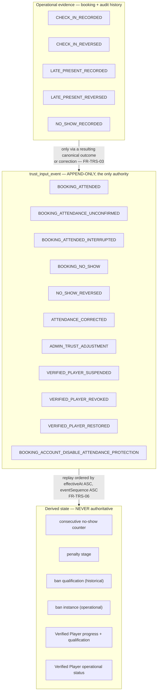
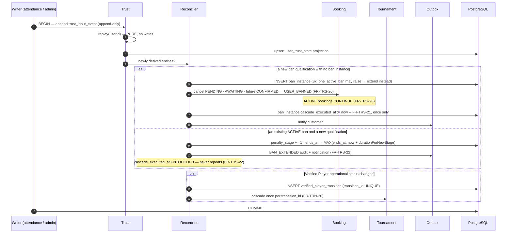
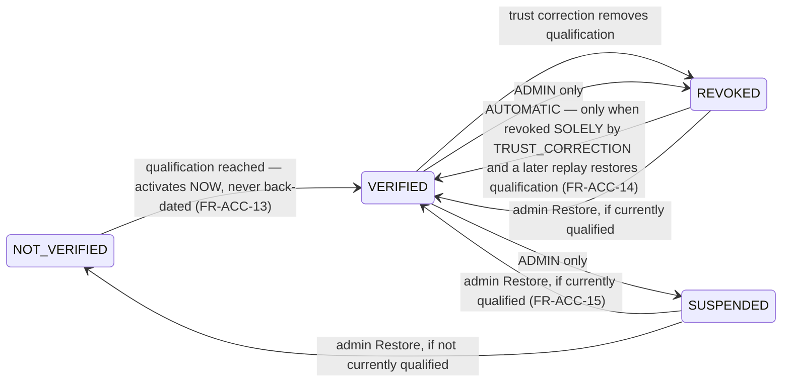

# E7GZ PS
# TRUST, ATTENDANCE & ENFORCEMENT ENGINE v1.0

> *"Trust is reconstructible, not asserted."* — PRD §3.2, principle 3

This engine is the reason penalties in E7GZ PS are defensible. Every counter, stage, ban and Verified Player status is **derived** from an immutable ordered event stream and can be replayed as of any past instant (`FR-TRS-01`, `FR-TRS-10`, `NFR-05`).

---

# 1. THE MODEL IN ONE PICTURE



**`FR-TRS-03` is the line to hold:** pressing check-in is not itself a reward. Operational evidence stays in booking and audit history and enters trust **only** through a resulting canonical outcome or correction.

---

# 2. THE EVENT STREAM

## 2.1 Closed catalogue (`FR-TRS-02`)

| Group | Members |
|---|---|
| **Booking outcomes** | `BOOKING_ATTENDED` · `BOOKING_ATTENDANCE_UNCONFIRMED` · `BOOKING_ATTENDED_INTERRUPTED` · `BOOKING_NO_SHOW` |
| **Corrections** | `NO_SHOW_REVERSED` · `ATTENDANCE_CORRECTED` |
| **Administration** | `ADMIN_TRUST_ADJUSTMENT` · `VERIFIED_PLAYER_SUSPENDED` · `VERIFIED_PLAYER_REVOKED` · `VERIFIED_PLAYER_RESTORED` |
| **System protection** | `BOOKING_ACCOUNT_DISABLE_ATTENDANCE_PROTECTION` |

Ban creation and expiry are **derived outputs**, not trust inputs (`FRS §2.9`).

## 2.2 Event shape (`FR-TRS-04`)

```
eventId · eventType · occurredAt · effectiveAt · eventSequence
subjectUserId · bookingId? · targetEventId? · correctedOutcome? · eventPayload
```

## 2.3 Effective-time rules — closed (`FR-TRS-05`)

| Event | `effectiveAt` |
|---|---|
| any booking-derived outcome | `booking.startAt` |
| the protection event | `booking.startAt` |
| any correction of a booking event | **the same `effectiveAt` as the event it corrects** |
| `ADMIN_TRUST_ADJUSTMENT` and the three Verified Player admin events | `occurredAt` |

This is what makes the named acceptance case work: *reversing a Monday no-show on Friday changes the **Monday** position in the sequence, not the Friday position.* The correction inherits Monday's `effectiveAt`, so replay reorders history correctly rather than appending a late fix.

## 2.4 Ordering (`FR-TRS-06`)

**Exclusively** `effectiveAt ASC, eventSequence ASC`. There is no competing ordering, no tie-break on `occurredAt`, and no per-type precedence. `eventSequence` comes from a single global PostgreSQL sequence, so it is monotonic and gap-tolerant.

Index: `(subject_user_id, effective_at, event_sequence)` — literally the replay order.

---

# 3. REPLAY

## 3.1 The algorithm

```java
DerivedState replay(UUID userId, Instant upTo /* nullable = now */) {
    var s = DerivedState.initial();
    var events = repo.orderedFor(userId, upTo);        // effectiveAt ASC, eventSequence ASC

    // FR-TRS-09: only ONE effective outcome per booking contributes
    var effective = resolveEffectiveOutcomes(events);

    for (var e : effective) {
        switch (e.type()) {
            case BOOKING_ATTENDED -> {                                   // FR-TRS-11
                s.consecutiveNoShows = 0;                                 // reset
                s.completedAttended += 1;                                 // +1 progress
            }
            case BOOKING_ATTENDED_INTERRUPTED,
                 BOOKING_ACCOUNT_DISABLE_ATTENDANCE_PROTECTION ->
                s.consecutiveNoShows = 0;                                 // reset, no reward
            case BOOKING_ATTENDANCE_UNCONFIRMED -> { /* nothing */ }      // FR-TRS-11
            case BOOKING_NO_SHOW -> {
                s.consecutiveNoShows += 1;
                if (s.consecutiveNoShows == thresholdFor(s.penaltyStage)) {  // FR-TRS-14
                    s.qualifications.add(new BanQualification(e.effectiveAt(), s.penaltyStage));
                    s.penaltyStage += 1;                                  // FR-TRS-16
                    s.consecutiveNoShows = 0;                             // reset at qualification
                }
            }
            case ADMIN_TRUST_ADJUSTMENT -> s.apply(e.payload());
            case VERIFIED_PLAYER_SUSPENDED, VERIFIED_PLAYER_REVOKED,
                 VERIFIED_PLAYER_RESTORED -> s.applyAdminVp(e);           // FR-ACC-15
        }
    }
    s.vpQualification = s.completedAttended >= REQUIRED_COMPLETED ? QUALIFIED : NOT_QUALIFIED;
    return s;                                                             // PURE — no writes
}
```

`replay` is **pure**. It never writes, never cancels a booking, never sends a notification. That separation is what makes `NFR-05`'s determinism testable, and it is what prevents `FR-TRS-24`'s violation — *replay never rewinds external booking side effects into the past.*

## 3.2 The counter rules (`FR-TRS-11`, `FR-TRS-12`)

| Trust input | Counter | Progress | Points |
|---|---|---|---|
| `BOOKING_ATTENDED` | **reset** | **+1** | **+200** |
| `BOOKING_ATTENDED_INTERRUPTED` | **reset** | — | — |
| `BOOKING_ACCOUNT_DISABLE_ATTENDANCE_PROTECTION` | **reset** | — | — |
| `BOOKING_ATTENDANCE_UNCONFIRMED` | nothing | — | — |
| `BOOKING_NO_SHOW` | **+1** | — | — |

The **three canonical counter-reset trust events** are exactly `ATTENDED`, `ATTENDED_INTERRUPTED` and the protection event. Separately — and **not** as a trust event — reaching a penalty threshold also resets the counter at ban creation or extension (`FR-TRS-11`, `FR-TRS-16`).

Cancelled, rejected, venue-response-expired, attendance-unconfirmed, **manual bookings** and tournament participation neither increment nor reset. Consecutive tracking is **global across E7GZ PS**, ordered by booking start time (`FR-TRS-12`).

## 3.3 Corrections (`FR-TRS-07`, `FR-TRS-09`)

Corrections never delete. Replay **neutralises** the targeted effect and, where appropriate, **substitutes** the corrected effect.

```
resolveEffectiveOutcomes(events):
    for each bookingId in events:
        base       = the original BOOKING_* outcome
        corrections = ATTENDANCE_CORRECTED / NO_SHOW_REVERSED targeting it, or targeting an earlier correction
        winner     = the LATEST NON-SUPERSEDED correction by eventSequence, else base   # FR-TRS-09
        emit exactly ONE effective outcome for that booking at base.effectiveAt         # FR-TRS-09
```

**Three sequential corrections on one booking therefore yield exactly one effective outcome and one counter effect.** A chain can never double a reward, a reset or a penalty.

`ATTENDANCE_CORRECTED` carries a mandatory `correctedOutcome` ∈ {ATTENDED, ATTENDED_INTERRUPTED, ATTENDANCE_UNCONFIRMED, ABSENT_NO_SHOW} (`FR-TRS-07`), enforced by `ck_corrected_outcome` in the schema.

A correction to `ATTENDED` uses the points value applicable to the booking's **original** completion date and configuration, posts the transaction at correction time, and records the historical value, correction time, reason and admin identity (`FR-TRS-08`).

## 3.4 As-of replay (`FR-TRS-10`)

`replay(userId, upTo)` with a cut-off reproduces historical state from the same inputs. Two separate historical queries exist and **may legitimately differ after a correction** (`FR-ACC-18`, `FR-TRS-19`):

| Query | Answered from |
|---|---|
| *Was this user qualified then?* | `replay(userId, t).vpQualification` — derived history |
| *Did this user hold tournament privileges then?* | `verified_player_transition` rows active at `t` — operational history |
| *Was this user banned then?* | `ban_instance.activatedAt` / `endsAt` spanning `t` — **not** the qualification point |

Historical qualification never implies historical operational tournament privileges.

---

# 4. SIDE EFFECTS — THE RECONCILER

`replay` computes state. A separate **reconciler** compares the replayed state to the stored projection and emits side effects **only for newly created derived entities**, each guarded by a unique key.



## 4.1 The three idempotency keys (`NFR-06`)

| Cascade | Key | Guard |
|---|---|---|
| Ban cancellation cascade | `ban_instance_id` | `cascade_executed_at IS NULL` checked and set in the same transaction (`FR-TRS-21`) |
| Tournament cascade on a Verified Player change | `verified_player_transition_id` | `UNIQUE` on the transition, `cascade_executed_at` set once (`FR-TRN-20`) |
| Attendance protection reset | `booking_id` | `ux_one_protection_per_booking` partial unique index (`FR-ATT-22`) |

**Replaying trust twice never cancels the same booking twice.** That is a launch-bar assertion, and these three keys are how it is guaranteed at the data layer rather than in a code path.

---

# 5. BANS

## 5.1 The ladder (`FR-TRS-13`)

| Stage | Consecutive no-shows required | Ban duration |
|---|---|---|
| 0 | **3** | 7 days |
| 1 | **2** | 1 month |
| 2 | **2** | 2 months |
| recurring maximum | **every 3** | 2 months |

The threshold **intentionally returns to 3** at the recurring stage, and 2 months is the maximum.

**A penalty triggers when a new eligible no-show increments the counter to the current threshold** — never merely because a stored number exceeds a later threshold (`FR-TRS-14`). This is why the counter is recomputed by replay rather than compared against a stored value: a correction that changes history must change *when* the threshold was crossed, not just the final number.

## 5.2 Qualification vs instance (`FR-TRS-17`, `FR-TRS-18`)

| | **Ban Qualification** | **Ban Instance** |
|---|---|---|
| Nature | historical, derived | operational |
| Carries | `qualificationAt` | `banInstanceId`, `activatedAt`, `endsAt`, `penaltyStage`, `duration`, `status`, `activationReason` |
| Time | when the history says the threshold was crossed | **now**, at correction or detection time — **never back-dated** |
| Answers | *did the history qualify them?* | *were they actually banned then?* |

A retroactively discovered ban activates at **correction time** and produces **one** instance carrying a historical `qualificationAt` and a current `activatedAt`. Ban end is always `activatedAt + duration`.

## 5.3 Extension (`FR-TRS-22`)

At most **one ACTIVE ban instance** per user, enforced by `ux_one_active_ban`. A further qualification while banned:

1. advances the stage as a **full trigger**,
2. resets the counter to 0,
3. **extends** the existing instance: `newEndsAt = MAX(currentEndsAt, now + durationForNewStage)`,
4. writes a `BAN_EXTENDED` audit record with instance ID, triggering qualification and event, previous and new stage, old and new end, and timestamp,
5. **never** repeats the already-executed cascade.

## 5.4 The cascade (`FR-TRS-20`)

| Booking state | Effect |
|---|---|
| PENDING | CANCELLED `USER_BANNED` |
| AWAITING_CUSTOMER_CONFIRMATION | CANCELLED `USER_BANNED`, **hold released** |
| future CONFIRMED | CANCELLED `USER_BANNED` |
| **ACTIVE** | **continues** |

Future holds release; the customer is notified.

## 5.5 What a banned user may still do (`FR-ACC-17`, `FRS §2.11`)

| May | May not |
|---|---|
| Log in, browse, view venues, view history, view account standing and profile | Create a booking |
| **Cancel an existing future booking** | **Accept** a Late Confirmation |
| **Decline** a Late Confirmation | Join a tournament |
| Write, edit and delete reviews | Create a tournament |

This is a **per-capability** check, never a blanket block — the architecture consequence is that `isBanned` is an input to a capability decision, not a gate at the authentication layer (`01 §9.3`).

## 5.6 Corrections and their limits (`FR-TRS-24`, `FR-TRS-25`)

Replay corrects **trust state** but **never rewinds external booking side effects into the past**. A ban proved invalid is CORRECTED/ENDED, restrictions stop, the user is notified and state is recalculated — but **previously cancelled bookings do not return**, and the slots already sold to other customers are not taken back. Rebooking uses the normal flow. There is no Support Replacement Booking and no special admin booking-creation path (`FR-TRS-26`).

---

# 6. VERIFIED PLAYER

## 6.1 Two independent domains (`FR-ACC-11`)

| Domain | Values | Derived from |
|---|---|---|
| **Qualification** | NOT_QUALIFIED · QUALIFIED | corrected trust history — **10 completed attended bookings, all of which may be at the same venue** |
| **Operational status** | NOT_VERIFIED · VERIFIED · SUSPENDED · REVOKED | qualification **plus** admin actions |

Only **VERIFIED** may create a player-hosted tournament. Progress is displayed as *"6 / 10 Completed Bookings"*.

Manual bookings and tournament participation contribute **nothing** to progress (`FR-ACC-16`, `FR-MAN-06`). Referrals grant no progress (`FR-PTS-07`). Reviews grant no progress (`FR-PTS-01`). No-shows create no progress.

## 6.2 Status transitions



**Every transition creates an immutable `verifiedPlayerTransitionId`** (`FR-ACC-12`), including a retroactively discovered first qualification.

**Admin SUSPENDED and admin REVOKED are protected** — automatic trust regain never overrides them (`FR-ACC-15`). The reconciler therefore checks the *cause* of the current status before applying an automatic transition: only `revoked_cause = 'TRUST_CORRECTION'` is auto-restorable.

The named acceptance case — *a user who loses status through a trust correction, then regains qualification through a later correction, is VERIFIED again with **no** admin action, and carries **two** distinct transition IDs* — falls out of this design directly.

---

# 7. ATTENDANCE

## 7.1 The three actions and their windows

```
startAt                       startAt + 15m                          endAt
  |------------ CHECK-IN ---------|-------- LATE PRESENT / NO-SHOW -----|
  [                               )[                                    )
```

| Action | Window | Preconditions | Owner Password | Source |
|---|---|---|---|---|
| **Check-in** | `[startAt, startAt+15m)` — refused at exactly +15:00 | — | **no** | `FR-ATT-01`, `FR-ATT-02` |
| **Mark Present — Late** | `[startAt+15m, endAt)` | no valid check-in, no committed no-show | **no** | `FR-ATT-03` |
| **No-show** | `[startAt+15m, endAt)` | no valid check-in, no Late Present | **no** | `FR-ATT-04` |

No QR code, no PIN, no customer device confirmation, no biometrics (`FR-ATT-01`, `Out-of-Scope §2`). Every action is audited with venue account identity, timestamp and Booking ID.

**A customer marked Late Present can never afterwards be marked no-show for the same booking** (`FR-ATT-04`) — enforced by `ck_late_present_blocks_noshow` in the schema.

**A no-show releases the remaining interval immediately** (`FR-ATT-05`) by truncating the reservation; the resource may then be sold online, manually or otherwise under normal rules. **A committed no-show is terminal and venue staff cannot undo it** (`FR-ATT-06`); reversal requires Platform Admin, and reversing never evicts a later customer who validly obtained the released slot.

## 7.2 Attendance Result — an independent stored field (`FR-ATT-07`)

`ATTENDED` · `ATTENDANCE_UNCONFIRMED` · `ATTENDED_INTERRUPTED` · `ABSENT_NO_SHOW` · `NOT_APPLICABLE`

The token is `ABSENT_NO_SHOW`, **deliberately distinct** from booking status `NO_SHOW`. The architecture keeps them in two different enum types so they cannot be assigned to each other.

## 7.3 Default generation (`FR-ATT-08`) — defaults, **not permanent formulas**

| Situation | Default result |
|---|---|
| COMPLETED after a valid check-in | `ATTENDED` |
| COMPLETED without verified attendance and without no-show | `ATTENDANCE_UNCONFIRMED` |
| status `NO_SHOW` | `ABSENT_NO_SHOW` |
| valid check-in then emergency interruption | `ATTENDED_INTERRUPTED` |
| manual booking | `NOT_APPLICABLE` |
| cancelled or rejected before attendance | `NOT_APPLICABLE` |
| interruption with Late Present only | `ATTENDANCE_UNCONFIRMED` |
| interruption with no evidence | `NOT_APPLICABLE` |

After an audited correction, the following are **intentionally valid** (`FR-ATT-09`) and must not be "fixed" by any consistency check: COMPLETED + `ABSENT_NO_SHOW` · CANCELLED + `ATTENDED_INTERRUPTED` · CANCELLED + `ATTENDED`. `ATTENDANCE_CORRECTED` may replace the result **without** changing an already-terminal status.

## 7.4 Reversal semantics (`FR-ATT-12`)

| Reversal | Effect |
|---|---|
| Check-in reversed while ACTIVE | booking stays ACTIVE; **no-show eligibility re-opens** within the window |
| Check-in reversed after an ATTENDED completion | creates `ATTENDANCE_CORRECTED`; points reversed by a **compensating transaction** |
| Late Present reversed before `endAt` | re-opens no-show eligibility |
| No-show reversed **before** original `endAt` | booking stays CANCELLED under `ADMIN_NO_SHOW_REVERSAL` |
| No-show reversed **after** original `endAt` | COMPLETED / `ATTENDANCE_UNCONFIRMED` unless attendance is separately established |

After a wrong no-show, the admin chooses **explicitly** (`FR-ATT-13`): attendance confirmed with reallocation → `ATTENDED_INTERRUPTED`; attendance confirmed, session actually completed → `ATTENDED`; penalty removal only → `ATTENDANCE_UNCONFIRMED`. The API therefore has no "undo" endpoint — it has a correction endpoint that requires the chosen outcome.

## 7.5 Platform Attendance Protection

**The problem** (`FR-ATT-14`, `FR-ATT-15`): disabling the venue account does not terminate an ACTIVE session — the physical venue may still be operating — but it blocks the Dashboard, so attendance may go unrecorded through no fault of the customer. Evidence recorded **before** the disable stays authoritative.

**The six cumulative conditions** (`FR-ATT-16`). Protection applies only when **all** hold:

1. the booking was ACTIVE,
2. the account became DISABLED **during** the session,
3. the disable **materially prevented reliable attendance recording**,
4. no authoritative check-in existed beforehand,
5. no authoritative no-show existed beforehand,
6. the final effective outcome is **not** `ATTENDED`, `ATTENDED_INTERRUPTED` or `ABSENT_NO_SHOW`.

Eligible outcomes are `ATTENDANCE_UNCONFIRMED` and `NOT_APPLICABLE` from operational early termination.

**Condition 3, made computable** (`FR-ATT-17`): evaluate `accountAccessRestrictionIntervals[]` against the check-in window and the no-show window. A disable interval overlapping the window in which the missing evidence would have been recorded is what makes recording unreliable. Genuinely ambiguous cases resolve through admin correction, **never an inferred outcome**.

```
protectionApplies(booking):
    if booking never reached ACTIVE: return false
    intervals = accountAccessRestrictionIntervals(booking)   # ordered, may be several
    checkInWindow = [startAt, startAt+15m)
    noShowWindow  = [startAt+15m, endAt)
    overlapsRelevant = any i in intervals where
        i overlaps checkInWindow  or  i overlaps noShowWindow
    return overlapsRelevant
       and no authoritative check-in before the first disable
       and no authoritative no-show before the first disable
       and effectiveOutcome in { ATTENDANCE_UNCONFIRMED, NOT_APPLICABLE }
```

**Timing** (`FR-ATT-20`): the event is created **when the effective attendance outcome resolves**, not at disable time. At disable time the system records only a protection *candidate* plus audit context.

**Exactly one** (`FR-ATT-21`, `FR-ATT-22`): a booking may span several access intervals; all are evaluated; **at most one** effective protection event is emitted per booking, guaranteed by `ux_one_protection_per_booking`. If the booking ultimately produces `ATTENDED` or `ATTENDED_INTERRUPTED`, the protection event is **not** additionally applied — exactly one counter-reset mechanism per booking. Two disable/re-enable cycles inside one session therefore produce **one** event and **one** reset.

**Later evidence governs** (`FR-ATT-23`): a valid check-in after re-enable within the window → normal `ATTENDED`; a Late Present after re-enable → `ATTENDANCE_UNCONFIRMED` with the protection reset still applicable; a valid no-show after re-enable within the window → authoritative. **An expired check-in window is never retroactively reopened.**

**Neutralisation** (`FR-ATT-24`): an admin correction to `ABSENT_NO_SHOW` neutralises the protection reset. No customer ever receives both a protected reset and a valid no-show increment for the same effective outcome.

**Scope** (`FR-ATT-18`): protection is not limited to sessions reaching normal `endAt` — it still applies when the session terminates early through a venue emergency, a resource emergency or owner review. The attendance result of an early termination remains governed by the normal interruption model; the protection event never changes it.

**Notifications.** Customer: `ACTIVE_SESSION_ATTENDANCE_RECORDING_AFFECTED`, In-App + Push, and it **must not** say the booking was cancelled unless another rule actually cancelled it (`FR-ATT-25`, `FR-NTF-07`). Platform Admin: an operational alert with venue, Booking ID, session interval, disable time, current attendance evidence, and whether protection may be required (`FR-ATT-26`).

## 7.6 Abuse monitoring (`FR-ATT-27`, `FR-ATT-28`, `FR-OPS-14`, `NFR-31`)

**Non-blocking operational signals** computed by the projection worker and surfaced to Platform Admin:

- unusually high check-in rate
- high check-in reversal rate
- unusual concentration of Verified Player progress from one venue
- repeated check-ins immediately before the 15-minute deadline
- high Late Present rate
- repeated Late Present on the same users
- Late Present reversals
- suspicious repeated customer/venue patterns
- ≥3 tournament cancellations by resource emergency at one venue in a rolling 30 days

**Architectural rule.** Monitoring may flag, alert and surface for review. It must **never** automatically revoke Verified Player status, suspend a venue, reverse check-ins or ban users. Every consequence requires explicit admin action. The signal pipeline therefore has **no write path into Trust, Venue status or Booking** — it writes only to `admin_alert`, and an ArchUnit test enforces it.

---

# 8. POINTS AND THEIR REVERSAL

Points sit beside trust, not inside it (`FR-PTS-02`): points are a reward currency; trust governs standing and eligibility.

| Cause | Points | Progress | When the configured value is read |
|---|---|---|---|
| Completed booking with qualifying attendance | **+200** | **+1** | at the **successful attended completion event** (`FR-PTS-01`) |
| Referral signup | **+1,000** | 0 | at **OTP verification** (`FR-PTS-07`) |
| No-show · cancelled · rejected · **review** | 0 | 0 | — |

**The granted amount is stored in the transaction**; later configuration never rewrites history (`FR-PTS-01`, `FR-AUD-01`).

**Reversal** (`FR-PTS-03`, `FR-PTS-04`, `FR-PTS-09`): the balance may never be negative. A compensating deduction applies `MIN(currentBalance, requestedDeduction)`. Any shortfall is recorded in audit as `UNRECOVERED_REVERSAL_AMOUNT`; it does **not** create a negative balance, does **not** become future debt, and future earned points are **not** automatically used to repay it.

The named case: reversing a +1,000 referral for a user holding 300 points leaves the balance at **0** and records a **700** unrecovered amount that is never later deducted.

---

# 9. TESTING THE ENGINE

Launch-bar items (`PRD §4.3`, `EC-X-005`).

| Test | Asserts | Source |
|---|---|---|
| **Seeded replay** | replaying a seeded history reproduces the stored counter, stage, ban and Verified Player status exactly | `NFR-05` |
| **As-of replay** | replay at arbitrary past instants reproduces historical state | `FR-TRS-10` |
| **Reordering correction** | reversing a Monday no-show on Friday changes the **Monday** position, not the Friday one | `FR-TRS-05` |
| **Chained corrections** | three sequential attendance corrections on one booking yield exactly **one** effective outcome and one counter effect | `FR-TRS-09` |
| **Retroactive ban** | a correction that newly qualifies a user starts the ban **today** and cancels only bookings existing now | `FR-TRS-18`, `FR-TRS-24` |
| **Ban extension** | a second qualification during an active ban produces **one** instance, an advanced stage, a reset counter and a `BAN_EXTENDED` record | `FR-TRS-22` |
| **Double replay** | replaying trust twice never cancels the same booking twice | `FR-TRS-21` |
| **VP auto-regain** | trust-correction revoke then re-qualify → VERIFIED with no admin action and **two** transition IDs | `FR-ACC-14` |
| **VP admin protection** | an admin-suspended user who reaches qualification stays SUSPENDED | `FR-ACC-15` |
| **Protection once** | two disable/re-enable cycles in one session → one event, one reset | `FR-ATT-21` |
| **Protection out of window** | a disable only outside both attendance windows → no protection | `FR-ATT-17` |
| **Protection neutralised** | an admin correction to `ABSENT_NO_SHOW` leaves an increment and no reset | `FR-ATT-24` |
| **Purity** | `replay` performs no writes — asserted by a read-only connection in the test | `FR-TRS-24` |
| **No auto-punishment** | no path from the abuse-signal pipeline writes to Trust, Venue status or Booking | `FR-ATT-28` |

---

*End of Trust, Attendance & Enforcement Engine v1.0. Continue to `08 — Scheduling, Timers & Event Architecture.md`.*
