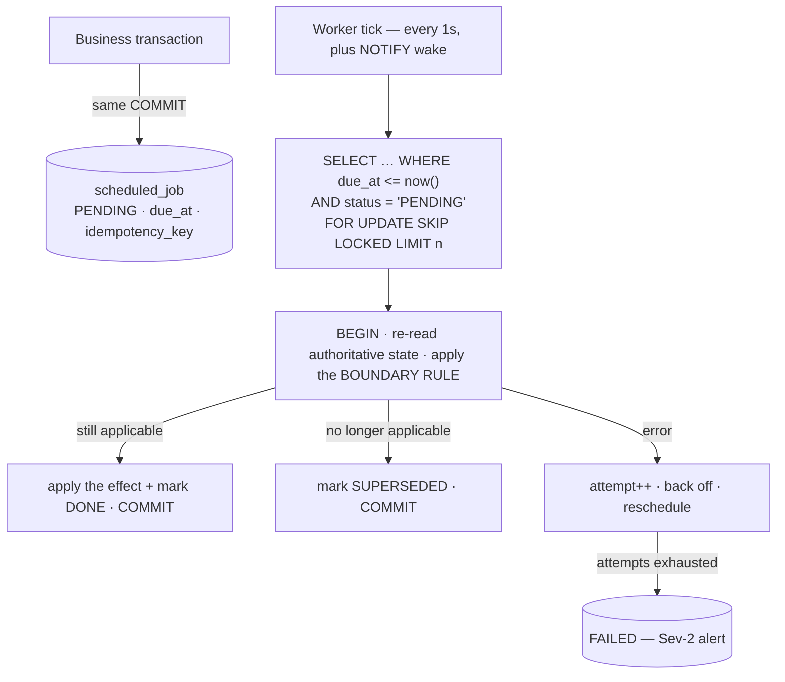
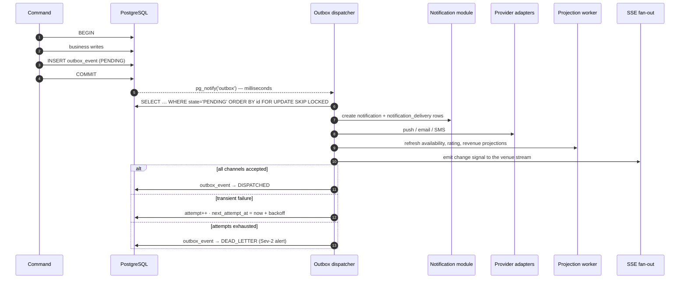

# E7GZ PS
# SCHEDULING, TIMERS & EVENT ARCHITECTURE v1.1

**Updated:** 25 September 2026 — names and mechanics aligned to physical model v1.1.27 (`04`, `ADR-026`–`ADR-028`).

**Closes `PRD §27.3` open items 2 and 5.**

---

# 1. WHAT THE PRODUCT SCHEDULES

Ten scheduled transitions, all of them customer-visible, several of them pausable.

| # | Transition | Due instant | Pausable | Source |
|---|---|---|---|---|
| T1 | Venue response expiry | `booking.venue_response_expires_at` = creation + 10 min | **yes** | `FR-BOK-13`, `FR-BOK-18` |
| T2 | Late Confirm expiry | `MIN(initiation + 5 min, booking.startAt)` | **yes** | `FR-LCF-09` |
| T3 | Late Confirm expiring warning | ~1 min before T2; **only if the window > 60 s** | follows T2 | `FR-LCF-12` |
| T4 | Booking start | `booking.start_at` | no | `FR-BOK-24` |
| T5 | Booking completion | `booking.end_at` | no | `FR-BOK-24` |
| T6 | `VENUE_RESPONSE_EXPIRED` resolution at original start | `booking.start_at` | no | `FR-BOK-23` |
| T7 | Tournament approval expiry | `MIN(requestCreatedAt + 10 min, checkpointAt)` | no | `FR-TRN-10` |
| T8 | Tournament checkpoint | exactly `start_at − 1 h` | no | `FR-TRN-03`, `FR-TRN-14` |
| T9 | Tournament start / end | `start_at` / `end_at` | no | `FR-TRN-17` |
| T10 | Ban instance expiry + pre-start Tournament Participant reconciliation | `ban_instance.ends_at` | no | `FR-TRS-23`, `FR-TRN-26` |

Plus three operational reminders (`FR-OPS-25`, `NFR-30`): emergency expected-end reached while still ACTIVE · resource return-to-service time reached while still out · manual confirmation required.

---

# 2. THE DEADLINE ENGINE

## 2.1 Design (`ADR-006`)



## 2.2 The three properties that matter

**1. Durable.** The row is written in the **same transaction** as the business state that created it. A booking cannot exist without its expiry deadline, and a deadline cannot exist for a booking that rolled back.

**2. Idempotent** (`NFR-04`). Each transition carries a natural `idempotency_key` — `VENUE_RESPONSE_EXPIRY:{bookingId}`, `TOURNAMENT_CHECKPOINT:{tournamentId}` — with a `UNIQUE` index. A retried worker run re-reads state, finds the transition already `DONE`, and does nothing. The effect and the `DONE` marking commit together, so there is no window in which the effect applied but the row still looks pending.

**3. Late firing is harmless** (`NFR-14`). The worker **never** decides an outcome from when it ran. It re-reads authoritative state and applies the boundary rule `now >= deadline` (`FR-AVL-15`). A worker that fires three minutes late produces exactly the same outcome as one that fires on time — it simply produces it three minutes late.

**Tournament/Ban boundary rule.** Ban expiry is effective at `ban_instance.ends_at`, not at worker execution time. Before `TOURNAMENT_CHECKPOINT` counts participants, it reconciles `INELIGIBLE/BAN` rows against `checkpointAt`; before `TOURNAMENT_START`, it reconciles against `startAt`. Therefore a T10 worker that runs late cannot incorrectly exclude a participant whose Ban had already ended at the Product boundary. No automatic restoration is performed at or after `startAt`.

```java
void fire(ScheduledJob t) {
    switch (t.type()) {
        case VENUE_RESPONSE_EXPIRY -> {
            var b = bookings.load(t.subjectId());
            if (b.status() != PENDING)        { t.supersede("no longer PENDING"); return; }
            if (b.responsePaused())           { t.supersede("paused — rescheduled on resume"); return; }
            if (clock.now().isBefore(b.venueResponseExpiresAt()))
                                              { t.reschedule(b.venueResponseExpiresAt()); return; }
            bookings.expireVenueResponse(b);                     // FR-BOK-18
            t.done();
        }
        // ... one arm per transition type
    }
}
```

## 2.3 Leases and multiple workers

`FOR UPDATE SKIP LOCKED` lets any number of worker replicas poll the same table with no coordination service, no leader election and no lock server. A worker that dies mid-transaction rolls back; its row is unlocked and picked up by the next poller. `leased_until` and `leased_by` exist for observability and for reaping a stuck lease, not for correctness.

## 2.4 Precision and load

- Tick interval **1 second**. Every Product boundary is expressed in whole minutes except the Late Confirm warning ("about a minute before expiry"), so 1-second resolution is ample.
- A `pg_notify('sched')` on the insert of a near-term transition wakes the worker immediately, which matters for a Late Confirm window of 60 seconds.
- `ix_scheduled_job_worker (status, due_at) WHERE status = 'PENDING'` and `ix_scheduled_job_lease_expiry (leased_until) WHERE status = 'LEASED'` keep each poll a bounded index scan regardless of table size; completed rows are archived monthly. Workers use `technical.job_lease` / `job_finish` / `job_rearm`; statuses are `PENDING · PAUSED · LEASED · DONE · SUPERSEDED · FAILED` (`ck_scheduled_job_status`).

## 2.5 Pause and resume (`FR-OPS-34`…`FR-OPS-41`)

This is the capability that rules out every fire-and-forget alternative (`ADR-006`).

```
pause(transition, cause):
    remaining            := due_at − now()
    pause_started_at     := now()                       # on the booking row
    status               := 'PAUSED'
    append booking_timer_pause_history(pauseStartedAt, pauseCause)   # immutable — FR-OPS-41

resume(transition):
    require ALL of:                                      # FR-OPS-39
        emergency ended
        venue account ENABLED
        marketplace permits the action
        venue inside a valid operating session
        now inside the online intake window
    accumulated += now() − pause_started_at
    if accumulated >= 30 minutes:  cap(transition)       # FR-OPS-37
    else: due_at := now() + remaining ; status := 'PENDING'   # remaining PRESERVED — FR-OPS-36
    close booking_timer_pause_history(pauseEndedAt, accumulatedDuration)
```

**Ending an emergency while the venue is closed does not restart the timer** — it waits for the **next** valid intake window (`FR-OPS-39`). Because operating sessions are materialized rows (`ADR-009`), "the next valid intake window" is a forward index scan, not a recomputation of the weekly template.

**The cap** (`FR-OPS-37`, `FR-OPS-38`). Two independent 30-minute cumulative counters, both stored on the booking:

| Counter | Fed by | Cap outcome |
|---|---|---|
| `cumulative_emergency_pause_duration` | venue-response pauses from **both** venue and resource emergencies | venue cause → `VENUE_RESPONSE_INTERRUPTED_BY_EMERGENCY`<br/>resource cause → `RESOURCE_RESPONSE_INTERRUPTED_BY_EMERGENCY` |
| `cumulative_late_confirm_emergency_pause_duration` | Late Confirm pauses, per AWAITING phase | `LATE_CONFIRM_INTERRUPTED_BY_EMERGENCY` |

Because one counter serves both emergency types, **switching emergency type can never reset the clock** — the named case of 12 minutes venue + 19 minutes resource cancels at the 30-minute mark under the resource reason.

**Early cancellation — the optimistic feasibility test** (`FR-OPS-40`). Evaluated whenever a pause begins or an emergency state changes:

```
remaining = responseTimerRemaining(booking)
# assume the current selling block could resolve THIS INSTANT
for each future valid operating session s with s.start < booking.startAt:
    window = [max(now, s.start), min(s.end - 10 minutes, booking.startAt))   # FR-BOK-09
    if length(window) >= remaining: return FEASIBLE
return CANCEL_NOW
```

- **No such window even under immediate resolution** → cancel now under the applicable interrupted-by-emergency reason.
- **A window could exist but the emergency is unresolved** → stay paused only until the 30-minute cap, the deterministic outer bound.
- **Block duration is never predicted by the scheduler.**

The function is pure over stored state, so repeated evaluation of identical state gives an identical decision — the PRD's Phase 5 exit criterion.

**While paused** (`FR-OPS-41`, `FR-BOK-32`): the customer sees *"Confirmation temporarily paused due to venue/resource issue."*, may still **Decline** — taking effect immediately under `CUSTOMER_DECLINED_LATE_CONFIRM` — and may still cancel a PENDING booking. On resume the remaining time is shown.

## 2.6 The warning transition (`FR-LCF-12`)

If the Late Confirm window exceeds 60 seconds, **two** rows are created: the expiry and the warning at `expiresAt − 60s`. If the window is 60 seconds or less, **the warning row is never created** — there is nothing to suppress, so it cannot be suppressed incorrectly. The first notification then carries the real short countdown.

---

# 3. DOMAIN EVENT CATALOGUE

## 3.1 The three event kinds — kept apart (`FR-AUD-13`)

| Kind | Table | Product-visible? | Extensible without change control? |
|---|---|---|---|
| **Booking Events** | `booking_history` | **yes** — closed enum of 12 (`FR-AUD-14`) | **no** |
| **Trust Input Events** | `trust_event` | **yes** — closed catalogue of 11 (`FR-TRS-02`) | **no** |
| **Integration events** | `outbox_event` | **no** — architecture-internal | yes |

Three separate Java types; a CI test asserts they share no members and that none contains `MANUAL_BOOKING_PRICING_CONFIGURATION_MISSING` or any of the five removed tokens of `FR-AUD-15`.

## 3.2 Integration event catalogue

Internal, architecture-owned, consumed by Notifications, Projections and Alerting.

| Aggregate | Events |
|---|---|
| Identity | `UserRegistered` · `PhoneVerified` · `EmailVerified` · `UsernameChanged` · `AccountAnonymised` |
| Venue | `VenueMarketplaceStatusChanged` · `VenueAccountDisabled` · `VenueAccountEnabled` · `OpeningHoursChanged` · `ClosureCreated` · `OperatingSessionsRegenerated` · `OwnerPasswordChanged` |
| Resource | `ResourceDisabled` · `ResourceReEnabled` · `ResourceArchived` · `ResourceRestored` · `ResourceConsoleChanged` · `ResourceRestrictionChanged` |
| Pricing | `VenuePricingChanged` · `RoomOverrideChanged` |
| Inventory | `ReservationHeld` · `ReservationReleased` |
| Operations | `EmergencyDeclared` · `EmergencyExtended` · `EmergencyEnded` · `EmergencyConverted` · `MaintenanceCreated` · `MaintenanceEdited` · `MaintenanceDeleted` · `OwnerReviewEntered` · `OwnerReviewResolved` · `TimerPaused` · `TimerResumed` · `TimerPauseCapReached` · `OperationalInterruptionRecorded` |
| Booking | `BookingCreated` · `BookingAccepted` · `BookingRejected` · `VenueResponseExpired` · `BookingConfirmed` · `BookingStarted` · `BookingCompleted` · `BookingCancelled` · `BookingNoShowRecorded` |
| Late Confirm | `LateConfirmInitiated` · `LateConfirmAccepted` · `LateConfirmDeclined` · `LateConfirmTimedOut` · `LateConfirmWarningDue` |
| Attendance | `CheckInRecorded` · `LatePresentRecorded` · `NoShowRecorded` · `AttendanceResolved` · `AttendanceCorrected` · `AttendanceProtectionApplied` · `ActiveSessionAttendanceRecordingAffected` |
| Tournament | `TournamentRequested` · `TournamentApproved` · `TournamentRejected` · `TournamentConfirmed` · `TournamentStarted` · `TournamentCompleted` · `TournamentCancelled` · `TournamentResourceAvailabilityChanged` · `ParticipantJoined` · `ParticipantLeft` · `ParticipantRemoved` · `ParticipantBecameIneligible{cause}` · `ParticipantRestoredFromBan` |
| Trust | `TrustEventRecorded` · `BanQualified` · `BanActivated` · `BanExtended` · `BanExpired` · `BanLifted` · `BanCorrected` · `VerifiedPlayerTransitioned` |
| Loyalty | `PointsGranted` · `PointsCompensated` · `ReferralRewarded` · `ReferralInvalidated` · `WalletCredited` |
| Reviews | `ReviewCreated` · `ReviewEdited` · `ReviewDeleted` · `ReviewModerated` |
| Admin | `AdminAlertRaised` |

**Every event carries** `correlationId` (`NFR-32`), `occurredAt`, the aggregate reference and — for anything booking-related — the **Booking ID**, so every notification can deep-link to the exact booking (`FR-NTF-04`).

---

# 4. THE OUTBOX

## 4.1 Flow



## 4.2 Guarantees

| Guarantee | How |
|---|---|
| **After commit, never before** (`FR-NTF-12`) | the outbox row does not exist until the business transaction commits |
| **Never for a rolled-back transaction** | the row rolls back with everything else |
| **Complete cascade first** (`NFR-03`) | every cascade consequence and every outbox row are in the same commit |
| **Within seconds** (`NFR-13`) | `pg_notify` on commit wakes the dispatcher in milliseconds; a 1-second poll is the safety net, since `NOTIFY` is not durable |
| **At least once** | rows stay `PENDING` until a channel accepts |
| **Never twice, visibly** | `ux_delivery_once (notification_id, channel)` makes a duplicate dispatch a no-op |
| **Ordered per aggregate** | dispatcher orders by `id` and processes one aggregate's events in sequence |

## 4.3 Retry and dead-letter

| Attempt | Delay |
|---|---|
| 1 | immediate |
| 2 | 5 s |
| 3 | 30 s |
| 4 | 2 min |
| 5 | 10 min |
| 6 | 1 h |
| 7 | → `DEAD_LETTER` + Sev-2 alert |

Adapters classify errors: **transient** (5xx, timeout, throttle) retries; **permanent** (invalid token, unsubscribed, malformed) goes straight to a terminal delivery state and, for an invalid push token, revokes the subscription (`device_token.revoked_at`, or `venue_push_subscription.revoked_at` for a Venue browser). Subscriptions are never deleted.

## 4.4 Channel routing (`FR-NTF-01`…`FR-NTF-03`)

| Recipient class | Channels | Source |
|---|---|---|
| Customer — time-sensitive booking / tournament / trust | **In-App + Push** | `FR-NTF-02` |
| Customer — operational and platform causes | **In-App + Push** | `FRS §2.12` |
| Customer — account / security / moderation | **In-App + Email** | `FR-NTF-03` |
| Phone verification | **SMS** — the only SMS at launch | `FR-NTF-01` |
| Email verification | Email OTP or link, independent of activation | `FR-ACC-05` |
| Venue / Owner | Venue notification surface — SSE + Web Push + in-Dashboard list | `FR-NTF-09`, `ADR-014` |
| Platform Admin | Admin operational notification surface | `FR-NTF-10` |

## 4.5 Copy rules the architecture must support

| Rule | Architectural consequence | Source |
|---|---|---|
| Every booking notification references the **Booking ID** | `bookingId` is a required field on the payload type for every booking notification code; enforced by the type, not by convention | `FR-NTF-04` |
| An attendance-unconfirmed notification must explain that **no attendance reward was applied** | a distinct code, not a parameter on the generic completion code | `FR-NTF-05` |
| Copy must distinguish ordinary expiry · platform account disable · operational cause, while **internal codes remain authoritative** | three distinct codes; the surface translates. No backend prose (`ADR-021`) | `FR-NTF-06` |
| A notification must **never** say a booking was cancelled unless a rule actually cancelled it | codes that imply cancellation may only be emitted by a handler that wrote a terminal status; asserted by a test | `FR-NTF-07`, `FR-ATT-25` |
| **No** mandatory customer notification merely because an account is re-enabled | `VenueAccountEnabled` has **no** customer-notification consumer | `FR-NTF-08` |
| The customer is notified whenever an admin materially changes a ban, no-show, attendance result, points, booking status or referral reward | every admin remediation command emits a customer notification event | `FR-NTF-11` |

---

# 5. THE SSE CHANNEL

`GET /api/v1/venue/stream` — one authenticated stream per venue account (`ADR-014`).

```
event: change
data: {"type":"BOOKING","id":"018f…","reason":"CREATED"}

event: change
data: {"type":"TOURNAMENT","id":"018f…","reason":"REQUESTED"}

: heartbeat every 15s
```

- **Signals only, never business payloads.** The client refetches the affected resource, so an at-most-once transport carries no correctness weight.
- Fan-out across API replicas via PostgreSQL `LISTEN`/`NOTIFY` on channel `venue_{venueAccountId}` — no broker, no shared cache.
- The stream closes immediately when the venue account becomes `DISABLED` (`FR-VEN-08`).
- A 30-second poll remains as a backstop; a dropped stream is invisible to the user.
- Web Push covers the Dashboard-not-open case, and every new booking or tournament request plays an audible alert on the open Dashboard (`01 §14` A6, decided).

---

# 6. IDEMPOTENCY ON WRITES

`ADR-015`. Every commitment-strengthening, money-moving or points-moving write requires an `Idempotency-Key` header.

```
key = Idempotency-Key header (client-generated UUID)
record = (key, endpoint, principalId)  PRIMARY KEY

on request:
  INSERT INTO idempotency_record (…) ON CONFLICT DO NOTHING
  if conflict:
      stored = SELECT …
      if stored.request_fingerprint <> fingerprint(request): 422 IDEMPOTENCY_KEY_REUSED
      else: return stored.response_status, stored.response_body        # replay
  else:
      execute the command
      UPDATE idempotency_record SET response_status, response_body     # same transaction
```

The record is written **in the business transaction**, so a rolled-back command leaves no record and the client may safely retry.

**Scope.** Booking create · venue accept / reject / reject-after-expiry · Late Confirm initiate / accept / decline · manual booking create and cancel · customer cancel · check-in / late-present / no-show · tournament create / approve / join / leave / cancel · every admin remediation · every points, wallet and referral mutation.

Records are retained 30 days.

---

# 7. THE PROJECTION WORKER

Rebuildable read models. **None is a source of truth**, and a full rebuild command ships with the application.

| Projection | Refreshed by | Serves |
|---|---|---|
| `venue_activity_availability` | any reservation, resource-state, selling-block, maintenance, closure, emergency, hours or pricing event | `FR-DIS-03`, `FR-DIS-04`, `FR-DIS-10`, `NFR-11` |
| `venue_rating_stats` | any review transition into or out of `ACTIVE` | `FR-REV-04`, `FR-VEN-39` |
| Revenue aggregates | booking and tournament completion | `FR-VEN-35`, `FR-VEN-36`, `FR-AUD-08` |
| `trust_projection` | every trust input event — **written synchronously**, not by this worker | `FR-TRS-01` |
| Abuse signals | attendance and tournament-cancellation events | `FR-ATT-27`, `FR-OPS-14`, `NFR-31` |

`trust_projection` is deliberately synchronous: an eligibility decision reads it, and an eventually-consistent ban would let a banned user book.

---

# 8. CLOCK DISCIPLINE

| Rule | Why |
|---|---|
| One injected `Clock` bean; `Instant.now()` is banned by an ArchUnit test | every boundary test must be able to move time |
| Deadlines are **persisted instants**, never computed at read time | `NFR-10`, `NFR-04` |
| Clients receive **instants**, never remaining seconds | a skewed device clock cannot change an outcome (`01 §6.1`) |
| Workers compare against the **database** clock (`now()`), not the JVM clock | multiple replicas share one authority |
| NTP on every host; clock skew is monitored and alerts above 500 ms | boundary correctness at ±1 second (`EC-X-002`) |

---

# 9. TESTING THE SCHEDULER

| Test | Asserts | Source |
|---|---|---|
| **Boundary pack** — every timer at the deadline and ±1 s | `now < deadline` permits, `now >= deadline` expires | `EC-X-002`, `FR-AVL-15` |
| **Late firing** — fire a transition 5 minutes late | identical outcome to on-time firing | `NFR-14` |
| **Double firing** — fire the same transition twice | effect applied once | `NFR-04` |
| **Crash mid-fire** — kill the worker between effect and marking | the effect and the marking are one transaction, so either both or neither | `NFR-04` |
| **Pause / resume** — 10-minute timer, 3 minutes elapsed, paused, resumed | resumes with **7 minutes** remaining | `FR-OPS-36` |
| **Mixed-type pause** — 12 min venue, resume, 19 min resource | cancels at the 30-minute mark under the **resource** reason | `FR-OPS-37`, `FR-OPS-38` |
| **Resume gating** — emergency ends while the venue is closed | timer does not restart; waits for the next valid intake window | `FR-OPS-39` |
| **Feasibility determinism** — evaluate repeatedly on identical state | identical decision every time | `FR-OPS-40`, PRD Phase 5 exit |
| **Short Late Confirm window** — initiate at 7:59 PM for 8:00 PM | exactly 60 seconds, **no** warning row created | `FR-LCF-12` |
| **Normal Late Confirm window** — initiate at 7:50 PM | 5 minutes, one warning at ~7:54 PM | `FR-LCF-12` |
| **Outbox after rollback** — inject a failure after the outbox insert | no notification is delivered | `FR-NTF-12` |
| **Outbox deep link** — any booking event, including a revived Late Confirm booking | push deep-links to that exact Booking ID | `FR-NTF-04` |
| **Re-enable silence** — enable a venue account | nothing is sent to customers | `FR-NTF-08` |
| **Cancellation language** — account-disable notification | contains no cancellation wording | `FR-NTF-07`, `FR-ATT-25` |

---

*End of Scheduling, Timers & Event Architecture v1.0. Continue to `09 — API Architecture & Contract Map.md`.*
