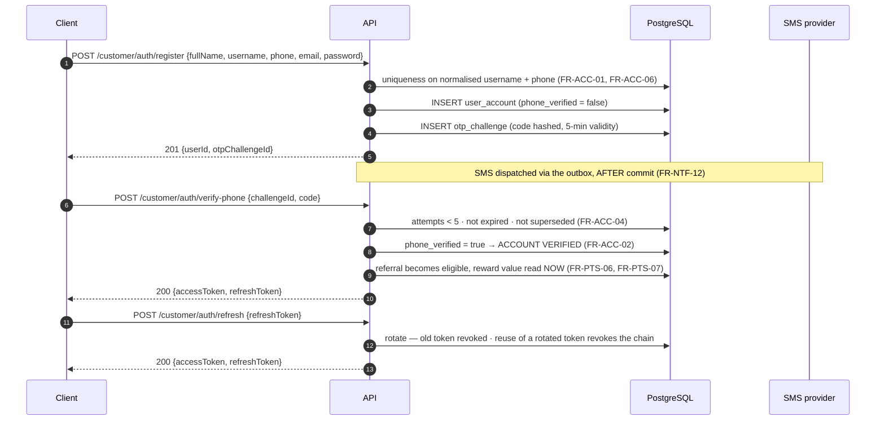

# E7GZ PS
# API ARCHITECTURE & CONTRACT MAP v1.1

**Updated:** 25 September 2026 — names and mechanics aligned to physical model v1.1.27 (`04`, `ADR-026`–`ADR-028`).
**Updated:** 2 October 2026 — Venue/Admin browser session in an HttpOnly cookie (`§2`, `ADR-029`); Sprint 1 contract decisions (E7-22): venue marketplace status actions, venue account creation, resource creation, Activities view-only, three new error codes (`§1.5`, `§4.2`, `§5`).

**Style.** REST + JSON over HTTPS, base `/api/v1`, OpenAPI 3.1 generated from code, typed TypeScript clients generated for all three surfaces (`ADR-012`).

---

# 1. CONVENTIONS

## 1.1 Three surface-scoped route groups

| Group | Principal | Notes |
|---|---|---|
| `/api/v1/customer/**` | Customer | capability decided by account state — Unverified / Verified / Banned (`FRS §2.11`) |
| `/api/v1/venue/**` | Venue Account | one shared account; `DISABLED` blocks every ordinary action (`FR-VEN-08`) |
| `/api/v1/admin/**` | Platform Admin | reserved actions per `FRS §2.10` |

**Separate DTOs per group, always.** A customer DTO and a venue DTO for the same booking are different Java types with different fields. This is how `NFR-18` (contact visibility) and `NFR-19` (neutral Late Confirm errors) become structural: the venue DTO has no field that could carry the customer's other commitments, so it cannot leak one.

## 1.2 Request rules

| Rule | Detail |
|---|---|
| Auth | `Authorization: Bearer <access JWT>` on everything except registration, login, OTP and public discovery |
| Idempotency | `Idempotency-Key: <uuid>` **required** on every commitment-strengthening, money- or points-moving write (`ADR-015`) |
| Correlation | `X-Correlation-Id` accepted; generated when absent; echoed on every response and written to every audit record (`NFR-32`) |
| Owner Password | supplied in the **request body** of the protected command, never a header, never a token (`ADR-011`) |
| Time | every instant is RFC 3339 UTC with `Z`. Clients never send "remaining seconds" and never receive them |
| Money | decimal string with 2 places plus `"currency": "EGP"` — never a float (`NFR-25`) |
| Paging | cursor-based: `?cursor=&limit=` with `nextCursor` in the response |
| Language | `Accept-Language` is accepted and **ignored for content** — the backend returns codes only (`ADR-021`) |

## 1.3 Response envelope

```jsonc
// success
{ "data": { ... }, "meta": { "correlationId": "018f…", "serverTime": "2026-09-19T17:04:11Z" } }

// failure
{ "error": {
    "code": "BOOKING_LEAD_TIME_TOO_SHORT",   // closed ApiErrorCode enum — never a reason code
    "field": "startAt",                       // when a specific input is at fault
    "details": { "minimumLeadMinutes": 15 }   // machine-readable, never prose
  },
  "meta": { "correlationId": "018f…", "serverTime": "…" } }
```

**No user-facing sentence ever appears in a response.** Each surface owns its message catalogue keyed by `code` (`ADR-021`, `NFR-33`, `NFR-34`).

## 1.4 Status codes

| Code | Used for |
|---|---|
| `200` / `201` | success |
| `400` | malformed request |
| `401` / `403` | unauthenticated / not permitted for this actor or account state |
| `404` | not found, or not visible to this principal |
| `409` | **the slot or commitment was taken between display and commit** — `FR-AVL-11`'s expected failure |
| `422` | a Product predicate refused the action — the large majority of domain failures |
| `423` | Owner Password required or invalid for a protected action |
| `429` | rate limited — OTP, Owner Password, login, general |
| `500` | unexpected; carries only a correlation ID |

`409` and `422` are deliberately distinct: `409` means *try another slot*, `422` means *this request can never succeed as written*.

## 1.5 The error code enum (`ADR-016`)

`ApiErrorCode` is a **third, separate** closed enum, distinct from `BookingTerminalReason` and `BookingEventType` (`FR-AUD-13`).

Representative members, each traced:

| Code | HTTP | Source |
|---|---|---|
| `PHONE_VERIFICATION_REQUIRED` | 403 | `FR-ACC-03` |
| `OTP_INVALID` · `OTP_EXPIRED` · `OTP_ATTEMPTS_EXCEEDED` · `OTP_RESEND_TOO_SOON` · `OTP_HOURLY_LIMIT_REACHED` | 422 / 429 | `FR-ACC-04` |
| `USERNAME_TAKEN` · `USERNAME_COOLDOWN_ACTIVE` | 422 | `FR-ACC-06`, `FR-ACC-07` |
| `PHONE_TAKEN` | 422 | `FR-ACC-01` — Phone is unique; Product Owner decision, 30 Sep 2026 (E7-13). Database: `uq_user_account_phone_e164` |
| `ACCOUNT_BANNED_FOR_THIS_ACTION` | 403 | `FR-ACC-17` |
| `BOOKING_LEAD_TIME_TOO_SHORT` | 422 | `FR-BOK-02` |
| `BOOKING_DURATION_INVALID` | 422 | `FR-BOK-01` |
| `COMMITMENT_LIMIT_REACHED` | 422 | `FR-BOK-03` |
| `OVERLAPPING_COMMITMENT` | 422 | `FR-BOK-04` |
| `INTERVAL_NOT_WITHIN_ONE_SESSION` | 422 | `FR-BOK-05` |
| `ONLINE_INTAKE_WINDOW_CLOSED` | 422 | `FR-BOK-09` |
| `VENUE_NOT_ELIGIBLE_FOR_NEW_ACTIVITY` | 422 | `FR-BOK-11`, category A |
| `RESOURCE_NOT_ELIGIBLE` | 422 | `FR-AVL-06` |
| `VENUE_SELLING_BLOCK_ACTIVE` · `RESOURCE_SELLING_BLOCK_ACTIVE` | 422 | `FR-AVL-07` |
| `SLOT_NO_LONGER_AVAILABLE` | **409** | `FR-AVL-11` |
| `DEADLINE_PASSED` | 422 | `FR-AVL-15` |
| `CUSTOMER_NOT_ELIGIBLE_FOR_LATE_CONFIRM` | 422 | **the neutral code** — `FR-LCF-05`, `NFR-19` |
| `LATE_CONFIRM_RESOURCE_CONFLICT` · `LATE_CONFIRM_CUSTOMER_CONFLICT` | 409 | `FR-LCF-16`, `FR-LCF-17` |
| `MANUAL_BOOKING_PRICING_CONFIGURATION_MISSING` | 422 | `FR-MAN-10` — **error code only**, never an event or reason |
| `MANUAL_BOOKING_BACKDATING_NOT_ALLOWED` | 422 | `FR-MAN-05` |
| `CHECK_IN_WINDOW_CLOSED` · `LATE_PRESENT_NOT_AVAILABLE` · `NO_SHOW_NOT_AVAILABLE` | 422 | `FR-ATT-02`…`FR-ATT-04` |
| `ATTENDANCE_REVERSAL_REQUIRES_ADMIN` | 403 | `FR-ATT-11` |
| `OWNER_PASSWORD_REQUIRED` · `OWNER_PASSWORD_INVALID` | 423 | `FR-VEN-02`, `FR-VEN-03` |
| `RESOURCE_HAS_BLOCKING_RESERVATIONS` | 422 | `FR-VEN-14` |
| `TOURNAMENT_CONFLICT_BLOCKS_SAVE` | 422 | `FR-VEN-27`, `FR-VEN-32` |
| `AFFECTED_SET_CHANGED_REFRESH_PREVIEW` | 409 | `FR-VEN-26` |
| `CLOSURE_OVERLAPS_ACTIVE_SESSION` | 422 | `FR-VEN-31` |
| `MAINTENANCE_OVERLAPS_RESERVATION` | 422 | `FR-OPS-02` |
| `EMERGENCY_EXPECTED_END_OUT_OF_SESSION` | 422 | `FR-OPS-07` |
| `EMERGENCY_CANNOT_END_RESOURCE_NOT_OPERATIONAL` | 422 | `FR-OPS-20`, `FR-OPS-21` |
| `CONVERSION_TARGET_NOT_ALLOWED` | 422 | `FR-OPS-23` |
| `OWNER_REVIEW_RESOLUTION_BLOCKED` | 422 | `FR-OPS-33`, `FR-OPS-43` |
| `TOURNAMENT_CREATION_CUTOFF_PASSED` | 422 | `FR-TRN-03` |
| `VERIFIED_PLAYER_REQUIRED` | 403 | `FR-TRN-02` |
| `PENDING_TOURNAMENT_REQUEST_EXISTS` · `TOURNAMENT_RETRY_COOLDOWN_ACTIVE` | 422 | `FR-TRN-11` |
| `TOURNAMENT_CAPACITY_REACHED` · `TOURNAMENT_JOIN_WINDOW_CLOSED` | 422 | `FR-TRN-12`, `FR-TRN-26` — capacity uses `capacityOccupiedCount(now)`, so a pre-start `INELIGIBLE/BAN` reserved slot still occupies capacity |
| `TOURNAMENT_RESOURCE_CONFLICT` | 409 | `FR-TRN-08` |
| `REVIEW_COOLDOWN_ACTIVE` | 422 | `FR-REV-07` |
| `REVIEW_REPORT_ALREADY_OPEN` | 422 | `FR-REV-11` — one unresolved report per reporter per Review |
| `AREA_HAS_ACTIVE_VENUES` · `AREA_INACTIVE` | 422 | `FR-VEN-47` |
| `AREA_NAME_TAKEN` | 422 | `FR-VEN-12` — another area already has this name, trimmed and case-insensitive. Database: `ux_area_name_normalized`. Product Owner decision, 2 Oct 2026 (E7-23) |
| `VENUE_LOGIN_IDENTIFIER_TAKEN` | 422 | `FR-VEN-01`, `FR-ADM-02` — Product Owner decision, 2 Oct 2026 (E7-22). Database: `ux_venue_login_normalized` |
| `VENUE_ACCOUNT_ALREADY_EXISTS` | 422 | `FR-VEN-01` — one shared account per venue; Product Owner decision, 2 Oct 2026 (E7-22). Database: `uq_venue_account_venue` |
| `MARKETPLACE_STATUS_CHANGE_NOT_ALLOWED` | 422 | `FR-VEN-07` — the venue's current status does not allow the change (e.g. completing onboarding twice, or moving to the status it already has); Product Owner decision, 2 Oct 2026 (E7-22) |
| `VENUE_ACTIVITY_IN_USE` | 422 | `FR-ADM-02` — an activity removed from a venue still has rooms, prices or availability. Database: `fk_resource_venue_activity`, `fk_default_price_venue_activity`, `fk_venue_activity_availability_venue_activity`. Product Owner decision, 2 Oct 2026 (E7-23) |
| `VENUE_IMAGE_NOT_ACCEPTED` | 422 | PCR-005 — the photo is not JPEG, PNG or WebP, or is larger than the configured maximum (5 MB); `error.field` names `contentType` or `sizeBytes`. Product Owner decision, 2 Oct 2026 |
| `VENUE_IMAGE_LIMIT_REACHED` | 422 | PCR-005 — the venue already has the configured maximum of visible photos (10). Product Owner decision, 2 Oct 2026 |
| `VENUE_IMAGE_NOT_UPLOADED` | 422 | PCR-005 — confirm was called before the file reached object storage, or the stored file does not match the declared type/size. Product Owner decision, 2 Oct 2026 |
| `ACCOUNT_DELETED` | 403 | `FR-ACC-10` — any command against an anonymised account |
| `REVIEW_ALREADY_EXISTS` | 422 | `FR-REV-03` |
| `REVIEW_REMOVED_NOT_RESTORABLE` | 422 | `FR-REV-04` |
| `IDEMPOTENCY_KEY_REUSED` | 422 | `ADR-015` |

**General codes** — Product Owner decision, 29 Sep 2026 (E7-12). Used only where no more specific code above applies:

| Code | HTTP | Used for |
|---|---|---|
| `VALIDATION_FAILED` | 400 | malformed or invalid request (unreadable body, bad parameter, failed validation, unsupported method or media type); `error.field` names the input when exactly one is at fault, otherwise `details.fields` lists them |
| `UNAUTHENTICATED` | 401 | missing, invalid or expired access token |
| `FORBIDDEN` | 403 | not permitted for this actor or account state |
| `NOT_FOUND` | 404 | not found, or not visible to this principal |
| `RATE_LIMITED` | 429 | a request rate limit of §6 other than the OTP limits, which keep their `OTP_*` codes |

There is **no public code for `500`**: its body is `{ "meta": { "correlationId", "serverTime" } }` only — no code, message, SQL or stack trace.

**Database guard exceptions** (`ADR-026`). The database re-asserts many of these rules. The API layer maps each guard exception to the matching code above (for example the Online intake guard → `ONLINE_INTAKE_WINDOW_CLOSED`, the username guard → `USERNAME_COOLDOWN_ACTIVE`, the OTP guard → the `OTP_*` codes, `ex_no_double_booking` → `SLOT_NO_LONGER_AVAILABLE`). A guard exception the application did not anticipate is a defect: it returns `500` with the correlation ID and raises a Sev-2 alert.

The mapping never reads message text. A Product guard raises SQLSTATE `P0001` with a stable identifier in the PostgreSQL diagnostic field `CONSTRAINT` (`gd_…`, physical model v1.1.28); an exclusion or unique constraint reports its own name with `23P01` / `23505`. The table from identifier to code is `ps.e7gz.common.error.DatabaseErrorCodes`; the full list is in the v1.1.28 section of the physical model change report. SQLSTATE `40001` is retried by the command runner; once its retries are exhausted it is an unexpected `500`, never a slot conflict.

---

# 2. AUTHENTICATION



**Email verification is a separate track** and never activates an account for marketplace actions (`FR-ACC-02`, `FR-ACC-05`).
**Password reset** uses verified phone OTP or email verification and does not require the old password (`FR-ACC-09`).
**Venue and admin** use the same token model; there is **no venue self-service forgot-password flow** (`FR-ADM-03`, `Out-of-Scope §3`).

**Venue Dashboard and Platform Admin run in a browser, so their refresh token travels in a cookie, never in a body** (`ADR-029`, Product Owner decision 2 Oct 2026). The Customer app is unchanged (the flow above).

| Operation | Request | Response |
|---|---|---|
| `POST /{venue\|admin}/auth/login` | `{loginIdentifier \| email, password}` | `200 {accessToken}` + `Set-Cookie` |
| `POST /{venue\|admin}/auth/refresh` | no body; the cookie + CSRF proof | `200 {accessToken}` + rotated `Set-Cookie`; any refusal `401 UNAUTHENTICATED` and the cookie is cleared |
| `POST /{venue\|admin}/auth/logout` | no body; the cookie + CSRF proof | `204`, session revoked, cookie cleared |

- Cookie `e7gz_venue_refresh` / `e7gz_admin_refresh`: `HttpOnly; Secure; SameSite=Strict; Path=/api/v1/{venue|admin}/auth; Max-Age` = the audience's refresh lifetime (Security `§2.3`).
- CSRF proof on refresh and logout: an `Origin` in the allowed list **and** `X-Requested-With: e7gz`. Either missing → `403 FORBIDDEN`, nothing changes.
- CORS only on `/venue/**` and `/admin/**`, only for the configured Dashboard and Admin origins (`E7GZ_CORS_ALLOWED_ORIGINS`, exact origins, no wildcard), with credentials. The customer routes have no CORS.
- The page keeps the access token in memory only and restores the session on load by calling refresh.

---

# 3. CUSTOMER API

## 3.1 Auth and profile

| Method | Path | Auth | FR |
|---|---|---|---|
| `POST` | `/customer/auth/register` | — | `FR-ACC-01`, `FR-ACC-06` |
| `POST` | `/customer/auth/otp/send` | — | `FR-ACC-04` |
| `POST` | `/customer/auth/verify-phone` | — | `FR-ACC-02`, `FR-ACC-04` |
| `POST` | `/customer/auth/login` · `/refresh` · `/logout` | mixed | — |
| `POST` | `/customer/auth/password-reset/request` · `/complete` | — | `FR-ACC-09` |
| `GET` `PATCH` | `/customer/profile` | customer | `FR-ACC-07` |
| `POST` | `/customer/profile/username` | customer | `FR-ACC-07` — 30-day cooldown |
| `POST` | `/customer/profile/phone` · `/email` | customer | `FR-ACC-07` — verification-gated |
| `POST` | `/customer/profile/email/verify` | customer | `FR-ACC-05` |
| `GET` | `/customer/account-standing` | customer | `FR-TRS-15`, `FR-ACC-11` |
| `POST` | `/customer/account/deletion-request` | customer | `FR-ACC-10` — create/reuse unresolved request; no hard delete |

`GET /customer/account-standing` returns **exactly one current ban** plus penalty stage, current consecutive count, current threshold, ban start, ban until and remaining time (`FR-TRS-15`), and Verified Player qualification progress and operational status as **two separate fields** (`FR-ACC-11`).

> Account deletion is initiated with `POST /customer/account/deletion-request`. It creates/reuses the durable request; it is **not** a destructive `DELETE /customer/account`. Completion remains the audited O19 Admin/Support anonymisation path (`FR-ACC-10`, PCR-002).

## 3.2 Discovery

| Method | Path | Notes | FR |
|---|---|---|---|
| `GET` | `/customer/areas` | active areas | `FR-VEN-12` |
| `GET` | `/customer/venues?areaId=&activity=&lat=&lng=&cursor=` | manual area is a **hard filter** even with location on | `FR-DIS-01`, `FR-DIS-02` |
| `GET` | `/customer/venues/map?bounds=&activity=` | markers under the **same eligibility rules as the list** | `FR-DIS-10` |
| `GET` | `/customer/venues/{id}?activity=` | details, incl. opening hours and *Closed Now / Opens at* state | `FR-DIS-06`, `FR-DIS-11` |
| `GET` | `/customer/venues/{id}/reviews` | current usernames only | `FR-REV-02` |
| `POST` | `/customer/reviews/{reviewId}/report` | signed-in customer; `{reason, details?}`; report only, no moderation side effect | `FR-REV-11` |
| `GET` | `/customer/find-available?areaId=&activity=&date=&startTime=&durationMinutes=` | whole-interval availability; **no price filter** | `FR-DIS-12` |

**Venue card payload** (`FR-DIS-03`): `image · name · area · distance · startingPrice · nearestAvailableAt · averageRating · reviewCount`. `nearestAvailableAt` comes from the projection and is explicitly a snapshot (`FR-AVL-11`).

Venues with marketplace `ONBOARDING`, `INACTIVE` or `SUSPENDED` are absent from the list; a **deep-linked venue page remains viewable with booking actions disabled** (`FR-DIS-08`) — so `GET /customer/venues/{id}` returns `200` with `"bookingEnabled": false` rather than `404`.

## 3.3 Bookings

| Method | Path | Idem. | FR |
|---|---|---|---|
| `POST` | `/customer/bookings` | **yes** | `FR-BOK-11` — the 20 conditions |
| `GET` | `/customer/bookings?bucket=upcoming\|completed\|cancelled` | — | `FR-BOK-19` |
| `GET` | `/customer/bookings/{id}` | — | `FR-BOK-20`, `FR-PTS-20` |
| `POST` | `/customer/bookings/{id}/cancel` | **yes** | `FR-BOK-31`, `FR-BOK-32` |
| `POST` | `/customer/bookings/{id}/late-confirm/accept` | **yes** | `FR-LCF-13`, `FR-LCF-14` |
| `POST` | `/customer/bookings/{id}/late-confirm/decline` | **yes** | `FR-LCF-13` — **works while paused** (`FR-OPS-41`) |

**Booking detail payload.**

```jsonc
{
  "bookingId": "018f…",
  "status": "AWAITING_CUSTOMER_CONFIRMATION",
  "displayBucket": "upcoming",                  // FR-BOK-19
  "terminalReason": null,                       // exactly one when terminal — NFR-26
  "venue": { "id": "…", "name": "…", "phone": "+2010…" },   // omitted when retention expired — FR-PTS-20
  "resource": { "name": "Room 3", "consoleType": "PS5", "playMode": "MULTIPLAYER" },
  "startAt": "2026-09-19T20:00:00Z",
  "endAt":   "2026-09-19T22:00:00Z",
  "nominalBookedMinutes": 120,
  "venuePriceTotal": { "amount": "160.00", "currency": "EGP" },
  "bookingFee":      { "amount": "0.00",   "currency": "EGP", "displayAsFree": true },  // FR-PTS-13
  "totalAmount":     { "amount": "160.00", "currency": "EGP" },
  "lateConfirm": {
    "expiresAt": "2026-09-19T19:31:00Z",        // an INSTANT, never a countdown — NFR-10
    "paused": false,                             // FR-OPS-41
    "pauseCauseCode": null
  },
  "attendanceResult": null,                      // independent field — FR-ATT-07
  "history": [ { "at": "…", "code": "BOOKING_CREATED" },
               { "at": "…", "code": "VENUE_RESPONSE_EXPIRED" },
               { "at": "…", "code": "LATE_CONFIRM_REQUESTED" } ]   // append-only — FR-AUD-05
}
```

`venue.phone` is **absent from the serialized payload** when the retention rule says it is no longer visible — not `null`, not masked (`NFR-18`, `FR-PTS-20`):

| Case | Visible until |
|---|---|
| terminal **before** start | `terminalAt + 2h` |
| terminal **at or after** start, including `NO_SHOW` | original `endAt + 2h` |
| `VENUE_RESPONSE_EXPIRED` | `venueResponseExpiredAt + 2h`, unless a Late Confirm reopens it |
| `AWAITING_CUSTOMER_CONFIRMATION` | reopened for the whole period; fully restored on Accept (`FR-LCF-18`) |

## 3.4 Tournaments, rewards, reviews, notifications

| Method | Path | FR |
|---|---|---|
| `GET` | `/customer/tournaments?areaId=&activity=` — public Discover only | `FR-TRN-06`, `FR-TRN-07` |
| `POST` | `/customer/tournaments/join-private {inviteCode}` | `FR-TRN-06` |
| `POST` | `/customer/tournaments` — player-hosted create | `FR-TRN-02`, `FR-TRN-03` |
| `POST` | `/customer/tournaments/{id}/join` · `/leave` — Join evaluates Tournament Capacity Occupancy, not checkpoint Active Participant count | `FR-TRN-12`, `FR-TRN-26` |
| `POST` | `/customer/tournaments/{id}/participants/{userId}/remove` — organizer | `FR-TRN-12` |

**Participant cause is not a new public status.** The alignment does not add a customer- or venue-facing status token. Domain logic and audit retain `BAN | ACCOUNT_DELETED` as the cause of `INELIGIBLE`; a surface must not invent a new enum member or response status to represent either cause.
| `POST` | `/customer/tournaments/{id}/cancel` — creator, before the checkpoint only | `FR-TRN-21` |
| `GET` | `/customer/points` · `/customer/referrals` | `FR-PTS-01`, `FR-PTS-06` |
| `GET` | `/customer/wallet` — balance + transactions, read-only | `FR-PTS-10`, `FR-PTS-11` as amended by PCR-004 |
| `POST` `PATCH` `DELETE` | `/customer/venues/{id}/review` | `FR-REV-01`…`FR-REV-07` |
| `GET` `POST` | `/customer/notifications` · `/{id}/read` · `/devices` | `FR-NTF-02` |

> The customer wallet is **read-only** at launch (PCR-004): no top-up, no pay-with-wallet, no withdrawal. `POST /admin/wallet/adjust` still does not exist (`FR-PTS-11`).

---

# 4. VENUE API

## 4.1 Requests, bookings, attendance

| Method | Path | Owner Pw | Idem. | FR |
|---|---|---|---|---|
| `GET` | `/venue/overview` | — | — | `FR-VEN-35` |
| `GET` | `/venue/requests/pending` | — | — | `FR-VEN-34` |
| `GET` | `/venue/requests/missed` | — | — | `FR-BOK-20`, `FR-VEN-34` |
| `POST` | `/venue/bookings/{id}/accept` | **no** | yes | `FR-BOK-14`, `FR-VEN-04` |
| `POST` | `/venue/bookings/{id}/reject` `{reasonText}` | **no** | yes | `FR-BOK-17` — reason text **mandatory** |
| `POST` | `/venue/bookings/{id}/reject-after-expiry` | **no** | yes | `FR-BOK-21` |
| `POST` | `/venue/bookings/{id}/late-confirm` | **no** | yes | `FR-LCF-06`, `FR-VEN-04` |
| `POST` | `/venue/bookings/{id}/cancel-confirmed` `{ownerPassword}` | **yes** | yes | `FR-VEN-03` |
| `POST` | `/venue/bookings` — manual | **no** | yes | `FR-MAN-02` |
| `POST` | `/venue/bookings/{id}/cancel-manual` | **no** | yes | `FR-MAN-08` |
| `POST` | `/venue/bookings/{id}/check-in` | **no** | yes | `FR-ATT-01`, `FR-ATT-02` |
| `POST` | `/venue/bookings/{id}/late-present` | **no** | yes | `FR-ATT-03` |
| `POST` | `/venue/bookings/{id}/no-show` | **no** | yes | `FR-ATT-04` |
| `GET` | `/venue/bookings?from=&to=&activity=&source=&resourceId=&status=&q=` | — | — | `FR-VEN-38` |
| `GET` | `/venue/availability?date=` | — | — | `FR-VEN-37` |
| `GET` | `/venue/revenue?from=&to=&breakdown=activity` | — | — | `FR-VEN-36`, `FR-AUD-08` |
| `GET` | `/venue/stream` — SSE | — | — | `ADR-014` |

**The neutral Late Confirm failure** (`NFR-19`, `FR-LCF-05`):

```jsonc
// 422 — the ONLY ineligibility code the venue surface ever returns for this action
{ "error": { "code": "CUSTOMER_NOT_ELIGIBLE_FOR_LATE_CONFIRM" } }
```

No `details`, no field, no hint. The real cause — the 4-commitment limit, a ban, a schedule conflict — is recorded internally as `LATE_CONFIRM_FAILED_BOOKING_LIMIT` and is never returned on this route. A contract test asserts that this endpoint can emit no other ineligibility code.

**Availability schedule payload** (`FR-VEN-37`) uses exactly these display states: `FREE · PENDING · AWAITING_CUSTOMER_CONFIRMATION · CONFIRMED · ACTIVE · MANUAL · TOURNAMENT_HOLD · MAINTENANCE · CLOSURE`.

**Revenue payload** (`FR-VEN-36`) aggregates online, manual and tournament revenue on `businessDate` with an optional activity breakdown, and carries **no payment method, no cash/card split and no reconciliation fields** — the Dashboard is explicitly not a POS or accounting system.

## 4.2 Configuration and operations

| Method | Path | Owner Pw | FR |
|---|---|---|---|
| `GET` | `/venue/resources` · `/{id}` | — | `FR-VEN-13` |
| `POST` | `/venue/resources` `{activity, consoleType?, ownerPassword}` — name assigned (Room *n* / Pool Table *n* / Table *n*) | **yes** | `FR-VEN-41`, `FRS §2.4` "protected resource configuration" — Product Owner decision, 2 Oct 2026 |
| `POST` | `/venue/resources/{id}/disable` · `/re-enable` · `/archive` · `/restore` | **yes** | `FR-VEN-03`, `FR-VEN-14` |
| `POST` | `/venue/resources/{id}/console` `{consoleType, ownerPassword}` | **yes** | `FR-VEN-15` — clears overrides |
| `GET` `PUT` | `/venue/pricing` | **yes** on write | `FR-VEN-03`, `FR-VEN-43`, `FR-VEN-44` |
| `PUT` `DELETE` | `/venue/resources/{id}/price-override` | **yes** | `FR-VEN-03`, `FR-VEN-43` |
| `GET` | `/venue/opening-hours` | — | `FR-VEN-17` |
| `POST` | `/venue/opening-hours/preview` → `{previewToken, affected[]}` | — | `FR-VEN-23` steps 1–5 |
| `POST` | `/venue/opening-hours/commit` `{proposal, previewToken, ownerPassword?}` | conditional | `FR-VEN-23` steps 6–9, `FR-VEN-25`, `FR-VEN-26` |
| `POST` `PATCH` `DELETE` | `/venue/closures` | conditional | `FR-VEN-30` |
| `POST` `PATCH` `DELETE` | `/venue/maintenance` | conditional | `FR-OPS-03`, `FR-OPS-04` |
| `POST` | `/venue/emergencies/venue-closure` `{reason, expectedEndAt}` | **no** | `FR-OPS-06`, `FR-OPS-07` |
| `POST` | `/venue/emergencies/resource-outage` `{resourceId, reason, expectedReturnAt}` | **no** | `FR-OPS-11` |
| `POST` | `/venue/emergencies/{id}/extend` · `/end` · `/convert` | **no** | `FR-OPS-19`…`FR-OPS-24` |
| `GET` | `/venue/owner-reviews` | — | `FR-OPS-43` |
| `POST` | `/venue/owner-reviews/{resourceId}/resolve` `{action, ownerPassword}` | **yes** | `FR-OPS-33` |
| `POST` | `/venue/owner-password` `{current, next}` | **yes** | `FR-VEN-46` |
| `GET` | `/venue/reviews` — **view only** | — | `FR-VEN-39` |
| `GET` `POST` | `/venue/tournaments` · `/{id}/approve` · `/reject` · `/cancel` · `/operational-termination` | conditional | `FR-TRN-21`, `FR-TRN-23`, `FR-TRN-24` |
| `GET` `PATCH` | `/venue/settings` — incl. language preference | — | `FR-VEN-40` |
| `GET` | `/venue/images` — visible photos in order, each with a signed GET URL | — | `FR-DIS-03`, PCR-005 |
| `POST` | `/venue/images` `{contentType, sizeBytes}` → `{image, uploadUrl, uploadExpiresAt}` — signed PUT; nothing is visible yet | — | PCR-005, arch 12 §2 |
| `POST` | `/venue/images/{id}/confirm` `{ownerPassword}` — the photo becomes visible | **yes** | PCR-005 |
| `PUT` | `/venue/images/order` `{imageIds, ownerPassword}` | **yes** | PCR-005 |
| `POST` | `/venue/images/{id}/remove` `{ownerPassword}` — hides it (`removed_at`); never hard-deleted | **yes** | PCR-005 |

**Venue photos** (PCR-005, Product Owner decision, 2 Oct 2026) use a two-step upload (arch 12 §2): the API validates type and size and returns a short-lived signed PUT; the client uploads the bytes directly; `confirm` checks the stored object and makes the photo visible. A photo that is never confirmed is never shown. The Platform Admin routes in §5 work the same way without the Owner Password.

There is **no `PATCH` on a resource** (Product Owner decision, 2 Oct 2026): names are fixed (`FR-VEN-41`), the activity is fixed per resource, and console and state each have their own protected action above.

**The two-phase opening-hours change** (`FR-VEN-23`, `FR-VEN-26`) is the only place in the API where a token binds two calls. `preview` returns a `previewToken` derived from a checksum of the exact affected set. `commit` recomputes the set; if it grew, it returns `409 AFFECTED_SET_CHANGED_REFRESH_PREVIEW` with the refreshed preview, and any Owner Password must be re-entered against it. **No booking outside the approved preview may be silently cancelled.**

**Owner-review resolution response** must include, when blocked, the list of blocking commitments (`FR-OPS-43`) — the Dashboard must not present an unavailable conversion as executable:

```jsonc
{ "error": { "code": "OWNER_REVIEW_RESOLUTION_BLOCKED",
             "details": { "blockingReservations": [ {"bookingId":"…","period":"…","kind":"BOOKING_CONFIRMED"} ] } } }
```

## 4.3 The Owner Password body convention

```jsonc
POST /api/v1/venue/pricing
Idempotency-Key: 018f…
{ "defaults": [ … ], "ownerPassword": "••••••" }
```

Rules (`ADR-011`): body, never header. Verified inside the action's transaction. Never returned, never logged, never echoed. Every attempt — success and failure — writes an audit record (`FR-VEN-05`). A wrong value returns `423 OWNER_PASSWORD_INVALID` and counts against the rate limit. **Two protected actions in a row each demand it separately** — there is no unlock of any duration.

---

# 5. ADMIN API

| Area | Endpoints | FR |
|---|---|---|
| Dashboard | `GET /admin/dashboard` | `FR-ADM-01` |
| Areas | `GET POST PATCH /admin/areas` · `POST /{id}/activate` · `/deactivate` | `FR-VEN-12`, `FR-VEN-47` |
| Venues & onboarding | `GET POST PATCH /admin/venues` · `GET /admin/venues/{id}` (with its venue account) · `POST /admin/venues/{id}/onboarding/complete` (ONBOARDING → INACTIVE) · `POST /{id}/activate` · `/deactivate` · `/suspend` `{reason}` — while a venue is ONBOARDING, completing onboarding is its only status action (Product Owner decision, 2 Oct 2026); `PATCH` with `activities` replaces the venue's list · `GET POST /admin/venues/{id}/resources` `{activity, consoleType?}` | `FR-ADM-02`, `FR-VEN-07`, `FR-VEN-41` — status actions and admin resource creation: Product Owner decision, 2 Oct 2026 |
| Venue photos | `GET POST /admin/venues/{id}/images` · `POST /admin/venues/{id}/images/{imageId}/confirm` · `PUT /admin/venues/{id}/images/order` `{imageIds}` · `POST /admin/venues/{id}/images/{imageId}/remove` — same two-step upload as §4.2, no Owner Password | `FR-ADM-02`, PCR-005 — Product Owner decision, 2 Oct 2026 |
| Venue accounts | `POST /admin/venues/{id}/venue-account` `{loginIdentifier, password, initialOwnerPassword, languagePreference?}` · `POST /admin/venue-accounts/{id}/disable` · `/enable` · `/reset-login-password` · `/reset-owner-password` | `FR-ADM-02`, `FR-ADM-03`, `FR-VEN-01` |
| Activities | `GET /admin/activities` — **view only**: the three activities and how many venues offer each; a venue's activities are set on the venue | `FR-ADM-01` — Product Owner decision, 2 Oct 2026 |
| Users | `GET /admin/users` · `/{id}` · `GET /account-deletion-requests` · `POST /{id}/anonymise` — anonymisation can complete a linked Customer request and executes O19, including Tournament `ACCOUNT_DELETED` precedence | `FR-ADM-04`, `FR-ACC-10`, `FR-TRN-26` |
| Verified Players | `GET /admin/verified-players` · `POST /{userId}/suspend` · `/revoke` · `/restore` | `FR-ADM-05`, `FR-ACC-15` |
| Reviews moderation | `GET /admin/reviews` · `POST /{id}/approve` · `/hide` · `/restore` · `/remove` · `GET /admin/review-reports` · `POST /admin/review-reports/{id}/resolve` | `FR-REV-08`, `FR-REV-11` |
| Global bookings | `GET /admin/bookings?…` · `/{id}` — **full lifecycle history** | `FR-ADM-06` |
| Booking remediation | `POST /admin/bookings/{id}/cancel` · `/terminate-active` · `/correct` | `FRS §2.10` |
| Attendance remediation | `POST /admin/bookings/{id}/attendance/reverse-check-in` · `/reverse-late-present` · `/reverse-no-show` · `/correct` | `FR-ATT-11`, `FR-ATT-13` |
| No-show records | `GET /admin/no-shows` | `FR-ADM-07` |
| Trust | `POST /admin/users/{id}/trust-adjustment` · `/bans/{banId}/lift` · `/shorten` · `/correct` | `FR-TRS-27` |
| Tournaments | `GET /admin/tournaments` · `POST /{id}/cancel` | `FR-ADM-08` |
| Wallet · Points · Referrals | `GET /admin/wallet` · `/points` · `POST /points/adjust` · `GET /referrals` · `POST /referrals/{id}/invalidate` | `FR-ADM-09`, `FR-PTS-09`, `FR-PTS-11` |
| Fees | `GET PUT /admin/fees` — global booking fee, tournament creation fee | `FR-ADM-10` |
| Global rules | `GET /admin/global-rules` — **read-only** for the no-show ladder | `FR-TRS-13`, `NFR-37` |
| Notifications | `GET /admin/notifications` · `/alerts` | `FR-NTF-10` |
| Global search | `GET /admin/search?q=` | `FR-ADM-01` |
| Settings | `GET PATCH /admin/settings` | `FR-ADM-01` |

**Rules that shape the admin surface:**

- **There is no admin booking-creation endpoint.** All customer booking creation uses the same online predicate; support may assist but cannot bypass validation (`FR-TRS-26`, `Out-of-Scope §5`).
- **`POST /admin/wallet/adjust` does not exist** at launch (`FR-PTS-11`). Points adjustment does, because points are active.
- Every remediation command requires a **mandatory reason** and writes an audit record with admin identity and timestamp (`FR-AUD-06`).
- Every material change to a ban, no-show, attendance result, points, booking status or referral reward emits a **customer notification** (`FR-NTF-11`).
- Attendance correction requires the **chosen outcome** — there is no generic "undo" (`FR-ATT-13`).
- The admin booking detail exposes Booking ID, user, venue, activity, resource, **console**, **play mode**, date, time, duration, venue price, **historical booking fee**, total, source, status and the **full lifecycle history** (`FR-ADM-06`, `FR-AUD-10`).
- Global fee changes affect **future events only** (`FR-ADM-11`); historical stored fees are untouched.

---

# 6. RATE LIMITS AT THE API EDGE

| Limit | Value | Status |
|---|---|---|
| OTP sends per destination per hour | **5** | frozen — `FR-ACC-04` |
| OTP attempts per code | **5** | frozen — `FR-ACC-04` |
| OTP resend delay | **60 s** | frozen — `FR-ACC-04` |
| Owner Password attempts | proposed **5 per venue account per 15 min**, then 15-min lockout | approved (`01 §14` A4) — `NFR-16` |
| Login attempts | proposed **10 per identity per 15 min** | approved (`01 §14` A4) |
| General per-IP | proposed **300 req/min** | approved (`01 §14` A4) |
| Booking creation per customer | proposed **20 per hour** | approved (`01 §14` A4) — abuse control only; the 4-commitment limit is the Product rule |

Full table and rationale in `10 §7`.

---

# 7. API TESTING OBLIGATIONS

| Test | Asserts | Source |
|---|---|---|
| **Enum disjointness** | `ApiErrorCode`, `BookingTerminalReason` and `BookingEventType` share no members | `FR-AUD-13`, `ADR-016` |
| **Removed tokens** | none of the five `FR-AUD-15` tokens appears in any enum | `FR-AUD-15` |
| **Neutral Late Confirm** | the venue endpoint can emit no ineligibility code other than `CUSTOMER_NOT_ELIGIBLE_FOR_LATE_CONFIRM` | `NFR-19` |
| **Contact redaction** | for every booking state × retention case, `venue.phone` and `customer.phone` are **absent** from the payload when the rule says hidden | `NFR-18` |
| **No prose** | no response body field contains a sentence in any language | `ADR-021` |
| **Idempotent replay** | a replayed key returns the stored response and creates nothing | `ADR-015` |
| **Deadline shape** | every timer field is an instant; no endpoint returns remaining seconds | `NFR-10` |
| **Money shape** | every money field is a 2-decimal string with a currency; no floats | `NFR-25` |
| **Capability matrix** | every endpoint × actor × account state matches `FRS §2.10` and `§2.11` exactly | `FR-ACC-17` |
| **Owner Password matrix** | every endpoint in `FRS §2.4`'s protected list requires it; every endpoint in the unprotected list does not | `FR-VEN-03`, `FR-VEN-04` |
| **Excluded endpoints** | no route exists for direct account hard-delete, wallet write/top-up, admin booking create, wallet adjust, auto-accept, back-dated manual booking, tournament brackets or scoring; Account Deletion initiation exists only through the durable request endpoint | `Out-of-Scope` |

---

*End of API Architecture & Contract Map v1.0. Continue to `10 — Security Architecture.md`.*
