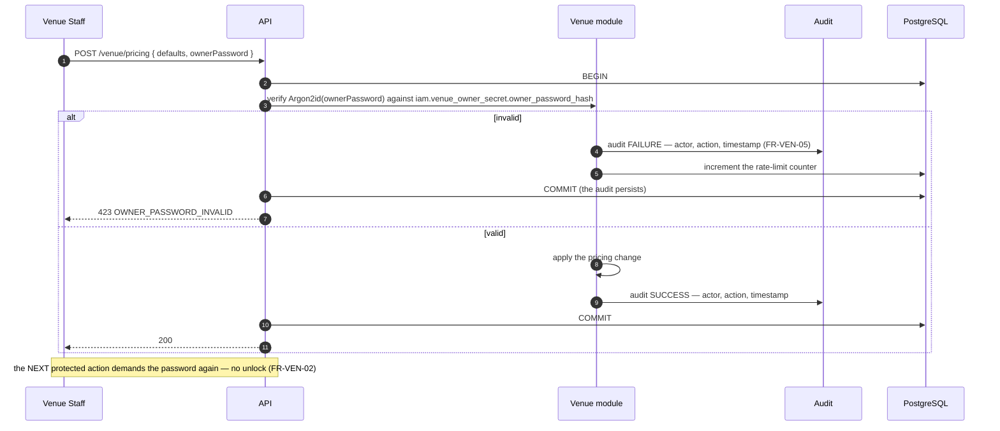
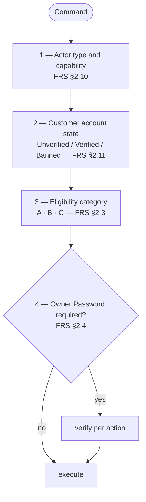

# E7GZ PS
# SECURITY ARCHITECTURE v1.1

**Updated:** 25 September 2026 — names and mechanics aligned to physical model v1.1.27 (`04`, `ADR-026`–`ADR-028`).

---

# 1. THREAT MODEL — WHAT THIS PRODUCT ACTUALLY RISKS

The Product collects no payments at launch, so classic payment fraud is out of scope. What it does hold is **inventory, contact data and a punitive trust record**. The threats that matter follow from that.

| # | Threat | Impact | Primary control |
|---|---|---|---|
| S1 | Venue staff change prices or archive rooms behind the owner's back | Owner loses control of their business | Owner Password per action, hashed, audited, rate-limited (`§3`) |
| S2 | A customer's phone number leaks to a venue that has no booking with them | Privacy breach, spam | Server-side contact-visibility resolver (`§5.1`) |
| S3 | A venue learns a customer's other bookings through a Late Confirm failure | Privacy breach across venues | Neutral error shaping (`§5.2`) |
| S4 | OTP brute force or SMS pumping | Account takeover, provider cost | OTP limits (`§7`), hashed codes, per-destination hourly cap |
| S5 | A banned or unverified user reaches a gated action through a client that hides nothing | Trust model bypassed | Backend capability checks (`§4`) |
| S6 | Token theft or replay | Account takeover | Short access tokens, rotating refresh, reuse detection (`§2.3`) |
| S7 | Credentials or the Owner Password reaching logs or audit payloads | Catastrophic and silent | Redaction allowlist, tested (`§6`) |
| S8 | An admin action taken without accountability | Undefendable dispute | Mandatory reason + actor + correlation on every remediation (`§8`) |
| S9 | An attacker enumerating bookings or users by ID | Data exposure | UUID v7 identifiers, per-principal authorization on every read |
| S10 | A venue declaring fake emergencies to dodge bookings or the Owner Password | Customer harm, owner circumvented | Mandatory reason, full audit, owner notification, rolling maintenance threshold escalating to owner review (`R4`) |

---

# 2. AUTHENTICATION

## 2.1 Three identity types (`FR-VEN-01`, `FRS §0.3`)

| Identity | Credential | Notes |
|---|---|---|
| **Customer** | username or phone + password; phone OTP for verification and reset | marketplace capability gated on `phone_verified` (`FR-ACC-02`) |
| **Venue Account** | **one shared account per venue** | `DISABLED` blocks login and therefore every ordinary Dashboard action (`FR-VEN-08`). No cashier, manager or separate owner accounts (`PRD §3.4`) |
| **Platform Admin** | admin credentials; second factor strongly recommended | reserved actions per `FRS §2.10` |

**The Owner Password is not an identity** and never appears in this table. See `§3`.

## 2.2 Password storage

| Secret | Algorithm | Notes |
|---|---|---|
| Customer password | **Argon2id** — m=64 MiB, t=3, p=1, 16-byte salt | tuned to ~250 ms on production hardware |
| Venue login password | Argon2id | |
| **Owner Password** | Argon2id, **separate table** `iam.venue_owner_secret` (never deleted; every change advances `changed_at` and `version`) | `FR-VEN-46` — a change takes effect immediately |
| Admin password | Argon2id | |
| OTP code | SHA-256 with a per-challenge salt | short-lived; never stored in clear (`FR-ACC-04`) |
| Refresh token | SHA-256 of a 256-bit random value | the raw token exists only in the client |

No password, Owner Password or OTP is ever logged, echoed in a response, or placed in an audit payload (`NFR-21`).

## 2.3 Tokens

| | Access token | Refresh token |
|---|---|---|
| Type | JWT, `HS512` or `RS256` | opaque 256-bit random |
| Lifetime | **15 minutes** | **30 days** (customer), **7 days** (venue), **12 hours** (admin) |
| Storage | client memory / secure storage | hashed in `auth_refresh_token` |
| Claims | `sub`, `typ` (`CUSTOMER`/`VENUE`/`ADMIN`), `jti`, `iat`, `exp`, `ver` | — |
| Rotation | — | **every use**; the old token is revoked |
| Reuse detection | — | using a rotated token **revokes the entire chain** and alerts |

The access token carries **no capability claims** beyond the identity type. Ban state, verification state and venue account status change between token issue and use, so they are read from the database on every request (`FR-ACC-17`, `FR-VEN-08`). A 15-minute token that still says "verified" cannot outlive a ban.

Venue account `DISABLED` invalidates active sessions immediately: the check runs per request, and the SSE stream is closed (`08 §5`).

## 2.4 OTP (`FR-ACC-04`)

Frozen and implemented exactly:

- valid **5 minutes**
- max **5 attempts** per code
- resend after **60 seconds**
- max **5 sends per hour per destination**
- **a new OTP invalidates the previous one**

Codes are 6 digits, generated with a CSPRNG, stored hashed, and compared in constant time. A 6th send in an hour returns `429 OTP_HOURLY_LIMIT_REACHED`. The database re-asserts every `FR-ACC-04` limit on `iam.otp_challenge` (`issued_at`; validity exactly 5 minutes; ≤ 5 attempts; resend ≥ 60 s; ≤ 5 sends per destination per hour; a new OTP supersedes the open one). Attempt counters live on `otp_challenge`, so limiting and audit share one row.

**Email verification is a separate track** and never activates an account for marketplace actions (`FR-ACC-02`, `FR-ACC-05`).

---

# 3. THE OWNER PASSWORD

`ADR-011`, invariant `I7`. This is the single most-specified security control in the Product, and the one most likely to be "helpfully" softened by an implementer.

## 3.1 The rule

> The Owner Password is required **per protected action**. There is no 15-minute unlock, no 30-minute unlock and no owner session mode; each action revalidates. — `FR-VEN-02`



## 3.2 What it protects, and what it does not (`FR-VEN-03`, `FR-VEN-04`)

| **Required** | **Not required** |
|---|---|
| Venue pricing changes | Accept · Reject · Reject After Expiry |
| Room price override set and reset | Late Confirm |
| Cancel a CONFIRMED online booking | Create a Manual Booking; cancel one **before start** |
| An opening-hours save that cancels protected customer bookings | An hours or closure edit with **no** protected cancellation |
| A normal-closure save that cancels protected customer bookings | Check-in · Mark Present — Late · No-show |
| Disable · Re-enable · Archive · Restore a resource | Maintenance **within** the rolling threshold |
| Console change | Emergency Closure · Resource Emergency Outage |
| Protected resource configuration | Cancel a `WAITING_FOR_PLAYERS` tournament |
| Maintenance **exceeding** the rolling threshold | Any system operational consequence cascade |
| Venue cancellation of a **CONFIRMED** tournament | |
| Tournament Operational Termination | |
| Resolving `OWNER_REVIEW_REQUIRED` | |

**All of the right-hand column is still audited** (`FR-VEN-04`).

## 3.3 How the two lists are kept from drifting

A single `@OwnerProtected` annotation on command handlers, and an **architecture test** that reads `FRS §2.4` as data and asserts:

1. every command in the protected list carries the annotation,
2. no command in the unprotected list carries it,
3. no new command exists in neither list.

Drift becomes a build failure instead of a production defect.

## 3.4 Handling rules

| Rule | Reason |
|---|---|
| Supplied in the **request body**, never a header | headers leak into access logs and proxies (`NFR-21`) |
| Never exchanged for a token, cookie, session flag or cache entry | `FR-VEN-02`, `Out-of-Scope §3` |
| Verified **inside** the action's transaction, immediately before the state change | a check that is not in the transaction is a race |
| Both success and failure audited with actor, action and timestamp | `FR-VEN-05` |
| Rate-limited per venue account | `NFR-16`, `§7` |
| A venue-initiated change takes effect **immediately**; the old value stops working at once | `FR-VEN-46` |
| An admin reset **notifies the venue** | `FR-ADM-03` |
| There is **no venue self-service forgot-password flow** | `Out-of-Scope §3` |

---

# 4. AUTHORIZATION

Backend authorization is authoritative. Frontend hiding is not a control (`FR-ACC-17`, `FR-VEN-08`, `D27`).

## 4.1 Three inputs to every decision



## 4.2 Customer capability matrix (`FRS §2.11`, `FR-ACC-17`)

| Capability | Unverified | Verified | **Banned** |
|---|---|---|---|
| Browse, view venues, view history, view standing | Yes | Yes | **Yes** |
| Create Online Booking | No | Yes | **No** |
| Accept Late Confirmation | No | Yes | **No** |
| **Decline** Late Confirmation | — | Yes | **Yes** |
| **Cancel** an existing future Booking | — | Yes | **Yes** |
| Write / edit / delete Reviews | No | Yes | **Yes** |
| Join Tournament | No | Yes | **No** |
| Create Tournament | No | **Verified Player only** | **No** |

The three bold "Yes" cells are why a ban can never be a blanket gate at the authentication layer. It is an input to a **per-capability** decision.

## 4.3 Eligibility category — a mandatory declaration (`ADR-022`)

| Category | Used for | Marketplace ACTIVE required? |
|---|---|---|
| **A — New-Activity Marketplace** | new online booking, new player-hosted tournament request, new venue-hosted tournament | **Yes** |
| **B — Existing-Commitment Operational** | Venue Accept, Late Confirm, tournament checkpoint, booking start, tournament start | **No** |
| **C — Internal Venue Operation** | manual booking, internal scheduling and resource management | **No** — ACTIVE, INACTIVE or SUSPENDED; **never ONBOARDING** |

The PRD names miscategorisation as the most common source of incorrect behaviour, so every command class **declares** its category and the venue check is generated from the declaration. An ArchUnit test fails the build on an undeclared command.

Consequences that follow directly: a SUSPENDED venue may still accept a PENDING booking (`FR-BOK-15`); Late Confirm is category B and therefore not restricted by the customer intake window (`FR-LCF-07`); a manual booking succeeds at a SUSPENDED venue and is refused at an ONBOARDING one (`FR-MAN-02`); marketplace SUSPENDED never fails a tournament checkpoint by itself (`FR-TRN-16`).

## 4.4 Platform Admin reserved actions (`FRS §2.10`)

Reverse check-in / Mark Present — Late / no-show · Attendance Correction · Trust adjustment · Ban lift, shortening, counter and stage correction · Points adjustment · Referral invalidation · Administrative cancellation or correction of a non-terminal booking · Exceptional termination of an ACTIVE booking · Cancellation of any non-completed tournament · Verified Player Suspend / Revoke / Restore · Review moderation · Venue account disable / enable and password resets · Global Booking Fee and Tournament Creation Fee configuration · Area activation / deactivation · Account deletion or anonymisation.

**The admin does not bypass Product invariants** (`FR-TRS-26`). There is no special admin booking-creation path; all customer booking creation uses the same online predicate. Support may assist but cannot bypass validation.

---

# 5. PRIVACY CONTROLS THAT ARE ARCHITECTURE

## 5.1 Counterpart phone visibility (`FR-DIS-09`, `FR-PTS-20`, `FR-PTS-21`, `NFR-18`)

**Enforced server-side by the retention rules — never merely hidden in the UI.**

| Phase | Visible |
|---|---|
| Before a booking exists | **no** — the venue phone is hidden entirely (`FR-DIS-09`) |
| Booking becomes `PENDING` | **yes, both directions** — venue sees the customer phone, customer sees the venue phone |
| Manual booking | **exempt** — the venue entered any contact data itself (`FR-DIS-09`) |
| Terminal **before** start | until `terminalAt + 2h` |
| `VENUE_RESPONSE_EXPIRED` | until `venueResponseExpiredAt + 2h`, unless a Late Confirm reopens it |
| `AWAITING_CUSTOMER_CONFIRMATION` | **reopened** for the whole period; fully restored on Accept (`FR-LCF-18`) |
| Terminal **at or after** start, including `NO_SHOW` | until original `endAt + 2h` |

**Implementation.** A `ContactVisibilityResolver` runs in the projection layer. When the rule says hidden, the field is **absent from the serialized payload** — not `null`, not masked, not present-and-empty. A contract test walks every booking state × retention case and asserts absence (`09 §7`).

Expiry of phone visibility after `VENUE_RESPONSE_EXPIRED` **never** makes that booking terminal; it remains revivable until `startAt` (`FR-PTS-21`).

**Admin and authorised support** may retain controlled access where operationally required — permission-controlled, and **every read is audited** (`FR-PTS-21`, `NFR-20`).

## 5.2 Neutral Late Confirm failure (`FR-LCF-05`, `FR-LCF-15`, `NFR-19`)

> A venue must never learn why a customer is ineligible for a Late Confirmation.

| Layer | Content |
|---|---|
| Venue API response | `422 { "code": "CUSTOMER_NOT_ELIGIBLE_FOR_LATE_CONFIRM" }` — no details, no field, no hint |
| Venue UI copy | *"Customer is not currently eligible for Late Confirmation"* |
| Internal booking event | `LATE_CONFIRM_FAILED_BOOKING_LIMIT` — the real cause, in append-only history |

The customer's schedule conflict is checked **only when the customer attempts to accept** (`FR-LCF-15`). The venue may freely send the request and is never told the customer has another booking. A conflicting accept records `LATE_CONFIRM_FAILED_CUSTOMER_CONFLICT` on the **customer's** side of the flow.

A contract test asserts the venue endpoint can emit no other ineligibility code.

## 5.3 Public identity (`FR-ACC-08`, `FR-REV-02`)

Public reviews display the **current username only**. Full name is exposed on the **Admin surface alone**. Because the review projection joins the live username, a username change is reflected everywhere immediately, while historical entities keep referencing the immutable User ID.

## 5.3a Review reporting privacy and authorization (`FR-REV-11`)

Only an authenticated Customer may submit a Review Report, and the target Review must be visible to that Customer at authoritative submission time. The report carries a reason and optional details; these fields are treated as untrusted user-generated text and follow the same length/sanitisation/log-redaction rules as Review comments. Report submission cannot call the moderation writer and cannot change Review state.

Platform Admin may read and resolve reports. Venues receive no reporting/moderation capability. A linked moderation event is accepted only when it belongs to the same Review and was produced by the existing Admin moderation command.

## 5.4 Deletion and anonymisation (`FR-ACC-10`, `FR-TRN-26`, PCR-002)

The Customer Mobile App exposes an authenticated **Delete Account initiation** command. It writes only `account_deletion_request` and the corresponding audit fact; it cannot directly blank PII, revoke retained history or invoke destructive table deletion. At most one unresolved request exists per User.

The existing Admin/Support anonymisation path remains the completion authority and is the database producer `iam.anonymise_user` (O19): it writes `iam.account_anonymisation`, blanks name, email and password hash and tombstones the phone as `anonymised:<id>` while keeping the immutable `id`, revokes every Customer refresh token (login disabled), preserves booking/financial/audit history, removes the User's Reviews from public display (status `REMOVED`, rating projection refreshed) and completes the open request by linking it to the anonymisation. A deferred database check refuses to commit an anonymisation that leaves a public Review, an open request or a live token, and an anonymised account is immutable. Every initiation and completion is audited.

The anonymisation completion command is O19 and is **transactional across the participant consequence**. For every non-terminal pre-start Tournament in which the user is still `JOINED` or `INELIGIBLE/BAN`, the row ends as `INELIGIBLE/ACCOUNT_DELETED` in the same transaction. This immediately releases any BAN-only reserved capacity slot and permanently disables automatic restoration. If a Ban activation races with deletion, account deletion has precedence; the final cause may never be downgraded back to `BAN`.

This is a data-integrity/security consequence only. It does not create a new authentication role, capability, public Participant Status or customer-facing error code. **The existing JWT, refresh-token, capability, Owner Password and rate-limit architecture is intentionally unchanged.**

## 5.5 Database privileges (`04 §5`, `ADR-026`)

- Runtime roles are `e7gz_app_runtime` (API and worker) and `e7gz_admin_runtime` (Platform Admin); migrations run as `e7gz_migrator`.
- **No `SECURITY DEFINER` function is executable by `PUBLIC`.** Callable producers are granted explicitly: Customer producers to `e7gz_app_runtime`, Admin producers (`iam.anonymise_user`, `iam.complete_account_deletion_request`, `review.resolve_report`, `config.change_configuration`, …) to `e7gz_admin_runtime`.
- Producer-only tables (`iam.account_deletion_request`, `iam.account_anonymisation`, `iam.username_change`, `review.review_report`, configuration, ledgers) have direct `INSERT/UPDATE/DELETE/TRUNCATE` revoked from both runtime roles.
- Every `SECURITY DEFINER` function pins `search_path = pg_catalog, pg_temp`.
- Grants are applied by `docs/04-erd/physical/E7GZ-PS-security-baseline-v1.1.27.sql` after the baseline migration and re-run after every later migration (idempotent). It is verified by `test_privileges_v127.sh`.

---

# 6. LOGGING AND SECRETS

| Rule | Mechanism | Source |
|---|---|---|
| Credentials are never logged | a **field redaction allowlist** on the structured logger and on `audit_event.payload`; a unit test asserts that no field named like a credential survives serialization | `NFR-21` |
| Audit records never contain secrets | the same allowlist plus a schema review on every new audit action | `NFR-21` |
| Phone numbers are masked in logs | last 3 digits only | `NFR-18` spirit |
| OTP codes never appear anywhere but the SMS body | stored hashed; the send payload is not logged | `FR-ACC-04` |
| Secrets come from the platform secret store | injected as environment variables; never in the image, never in the repository; **separate per environment** | `12 §3` |
| Rotation | database password and JWT signing key rotate quarterly; provider keys on compromise | — |
| TLS | 1.2+ everywhere; HSTS on both web surfaces; certificate pinning considered for the mobile app | — |
| Database | not publicly routable; access only from the application subnet | — |

---

# 7. RATE LIMITING

**Closes `PRD §27.3` open item 6.** OTP values are taken verbatim from `FR-ACC-04` and are **not** proposals. Everything else was approved by the Product Owner on 26 September 2026 (`01 §14` A4).

| Limit | Scope | Value | Status | Source |
|---|---|---|---|---|
| OTP sends | per destination, rolling hour | **5** | **frozen** | `FR-ACC-04` |
| OTP resend delay | per destination | **60 s** | **frozen** | `FR-ACC-04` |
| OTP attempts | per code | **5** | **frozen** | `FR-ACC-04` |
| OTP validity | per code | **5 min** | **frozen** | `FR-ACC-04` |
| Username change | per user | **30 days** | **frozen** | `FR-ACC-07` |
| Review after admin removal | per user per venue | **30 days** | **frozen** | `FR-REV-07` |
| Tournament retry after rejection or approval expiry | per creator | **5 min** | **frozen** | `FR-TRN-11` |
| **Owner Password attempts** | per venue account | proposed **5 per 15 min**, then a 15-min lockout | approved | `NFR-16` |
| **Login attempts** | per identity | proposed **10 per 15 min** | approved | — |
| **Password reset requests** | per identity | proposed **3 per hour** | approved | — |
| **General API** | per IP | proposed **300 req/min** | approved | — |
| **Booking creation** | per customer | proposed **20 per hour** | approved | abuse control only — the 4-commitment limit is the Product rule (`FR-BOK-03`) |
| **Emergency declarations** | per venue | **none** | **frozen** | `FR-OPS-13` — *"no hard venue-wide emergency rate limit, because such a limit could block a genuine emergency"* |

`FR-OPS-13` is a deliberate non-control and must not be "hardened" later: abuse is handled by the mandatory reason, full audit, owner notification, the rolling maintenance threshold escalating to owner review, and the tournament-cancellation alert of `FR-OPS-14` (`R4`).

Counters live in PostgreSQL at launch (`ADR-005`), colocated with the audit they must produce. Edge limits (per-IP) are applied at the load balancer.

---

# 8. AUDIT

## 8.1 What must be audited (`FR-AUD-03`, `FRS §2.13`)

| Area | Audited |
|---|---|
| Booking lifecycle | append-only booking history; terminal reason and event history; reservation planned/actual intervals and release reason |
| Attendance | check-in, Late Present, no-show record and reversal; attendance correction with mandatory reason and admin identity |
| Venue operations | maintenance create/edit/delete; emergency declaration/extension/end/conversion; resource state changes; console change; opening-hours and closure affected set |
| **Owner authorization** | **successful and failed** Owner Password attempts, with the protected action and actor |
| Operational interruption | ACTIVE booking, ACTIVE manual booking and ACTIVE tournament interruptions with cause, time, attendance evidence and refund where applicable |
| Platform / integrity | venue account disable/enable; PENDING response interruption; ACTIVE attendance-access restriction; protection evaluation and event; `SYSTEM_RESOURCE_STATE_INTEGRITY_ERROR`; owner-review entry and resolution |
| Trust / enforcement | immutable trust input events; replay ordering; `BAN_EXTENDED`; admin trust adjustment; correction chains; Verified Player transition IDs |
| Ledgers | points and wallet append-only transactions and compensating entries; referral invalidation; booking fee refund corrections |
| Moderation | review moderation action, reason, date, previous status and new status |
| Historical snapshots | booking, tournament, referral, reservation, operational interruption, emergency pause, account access restriction and owner review snapshot sets |

## 8.2 Record shape (`FR-AUD-06`, `NFR-32`)

Every record carries **actor identity** (venue account, admin or system), a **timestamp**, and — where the action requires one — the **mandatory reason**. Every record carries a `correlation_id`, so a whole cascade is traceable end to end by one query.

```sql
SELECT * FROM audit.audit_event WHERE correlation_id = :cid ORDER BY occurred_at;
```

## 8.3 Immutability

`audit_event` is append-only, enforced at the data layer (`ADR-008`): a `BEFORE UPDATE OR DELETE` trigger raises, and the application role has `UPDATE`/`DELETE` revoked. An audit record cannot be edited by any application path, including an admin one.

---

# 9. SECURITY TESTING OBLIGATIONS

| Test | Asserts | Source |
|---|---|---|
| **Owner Password matrix** | every protected action demands it; every unprotected action does not; two in a row each demand it separately | `FR-VEN-02`, `FR-VEN-03`, `FR-VEN-04` |
| **No unlock window** | a protected action immediately after a successful one still returns `423` without the password | `FR-VEN-02` |
| **Immediate invalidation** | after an owner-initiated change, the old value fails at once | `FR-VEN-46` |
| **Owner Password audit** | both success and failure produce a record; neither contains the value | `FR-VEN-05`, `NFR-21` |
| **Contact redaction** | every booking state × retention case omits the field rather than masking it | `NFR-18` |
| **Neutral error** | the venue Late Confirm endpoint emits only the neutral code | `NFR-19` |
| **Capability matrix** | every endpoint × actor × account state matches `FRS §2.10`/`§2.11` | `FR-ACC-17` |
| **Banned-user capabilities** | a banned user can still cancel a future booking, decline a Late Confirmation and manage reviews | `FR-ACC-17` |
| **Category declaration** | every venue-touching command declares A, B or C | `ADR-022` |
| **Token rotation** | reusing a rotated refresh token revokes the chain | `§2.3` |
| **OTP limits** | a 6th send in an hour is refused; a 6th attempt on a code is refused; a new OTP invalidates the old | `FR-ACC-04` |
| **Redaction** | no field named like a credential survives log or audit serialization | `NFR-21` |
| **Disabled venue** | a `DISABLED` account cannot accept, reject, late-confirm, check in, mark late present or mark no-show | `FR-VEN-08` |
| **Deletion precedence in Tournaments** | anonymising a JOINED or `INELIGIBLE/BAN` participant produces `INELIGIBLE/ACCOUNT_DELETED` in the same transaction, releases any BAN-only reserved slot and can never be auto-restored | `FR-ACC-10`, `FR-TRN-26`, `ADR-023` |
| **No emergency rate limit** | repeated emergency declarations are never refused by a rate limit | `FR-OPS-13` |

---

*End of Security Architecture v1.0. Continue to `11 — Non-Functional & Observability Architecture.md`.*
