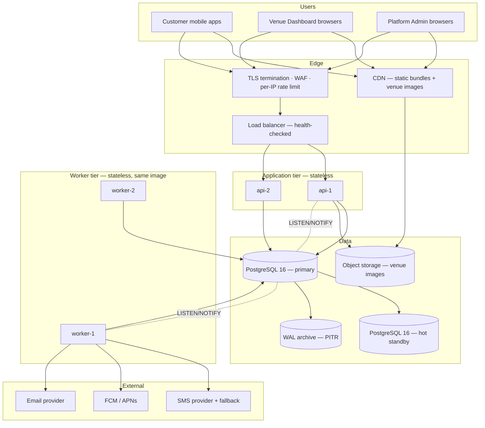
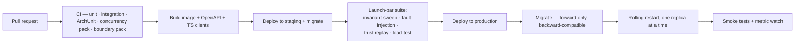

# E7GZ PS
# DEPLOYMENT, ENVIRONMENTS & OPERATIONS v1.1

**Updated:** 25 September 2026 — names and mechanics aligned to physical model v1.1.27 (`04`, `ADR-026`–`ADR-028`).

---

# 1. DEPLOYMENT TOPOLOGY

## 1.1 Production

## 1.2 Why this shape, and not more

`D22` — one launch city, a manually onboarded venue set, `NFR-15` asking for 10× headroom rather than elasticity. Two API containers and two worker containers behind a managed PostgreSQL carry that with room to spare, and every scaling step is "add a replica" or "resize the database", not "change the architecture".

No Redis, no broker, no service mesh, no orchestration platform at launch (`ADR-004`, `ADR-005`, `ADR-001`). Each was considered and each is recorded with an adoption trigger.

## 1.3 Containers

| Image | Command | Replicas | Notes |
|---|---|---|---|
| `e7gz-backend` | `--spring.profiles.active=api` | 2+ | HTTP + SSE; no schedulers start |
| `e7gz-backend` | `--spring.profiles.active=worker` | 2 | deadline worker, outbox dispatcher, projection worker, session generator |
| `e7gz-backend` | `--spring.profiles.active=migrate` | run-once | Flyway, as `e7gz_migrator` |

**One image, three roles.** There is no second codebase, so there is no contract drift between API and workers (`01 §5.3`).

| Setting | Value |
|---|---|
| Base image | `eclipse-temurin:21-jre-alpine` |
| User | non-root |
| Filesystem | read-only except `/tmp` |
| Health | `/actuator/health/liveness`, `/actuator/health/readiness` |
| Readiness | database reachable **and** migrations at the expected version |
| Graceful shutdown | 30 s; in-flight requests drain; worker leases expire naturally |
| JVM | container-aware heap, `-XX:MaxRAMPercentage=70` |

## 1.4 Connection pooling

HikariCP, sized so that **(api replicas × pool) + (worker replicas × pool) + headroom ≤ `max_connections`**. Starting point: API pool 10, worker pool 5, `max_connections` 100. The worker pool is small deliberately: `SKIP LOCKED` polling is cheap and a large worker pool only increases contention.

---

# 2. OBJECT STORAGE

**Closes `PRD §27.3` open item 7.**

| Aspect | Decision |
|---|---|
| Use | **venue images only** (`FR-ADM-02`); nothing transactional |
| Provider | any S3-compatible bucket, behind the `ObjectStore` port |
| Upload | signed `PUT` issued by the API after validating content type and size; the client uploads directly, then calls `confirm`, which checks the stored object and sets `uploaded_at` (PCR-005, arch 09 §4.2 / §5). Unconfirmed photos are never shown |
| Download | signed `GET` with a short TTL, served through the CDN |
| Keys | `venues/{venueId}/{imageId}.{ext}` — opaque, non-enumerable |
| Metadata | `venue_image` rows in PostgreSQL; the bucket holds bytes only |
| Retention | originals retained; removing a photo (Platform Admin, or the venue with the Owner Password — PCR-005) sets `removed_at` and hides it; it is audited and never hard-deleted |
| Backup | versioning enabled; cross-region replication where the provider offers it |

Images **persist through onboarding, venue details, edit and navigation** (`FR-ADM-02`) because the metadata row is created at upload and is never tied to a wizard step. Limits (PCR-005, configuration): JPEG, PNG or WebP; at most 5 MB each; at most 10 visible photos per venue.

---

# 3. ENVIRONMENTS

Three environments, fully separated — **separate databases, separate secrets, separate buckets, separate provider accounts, separate API configuration**.

| | Development | Staging | Production |
|---|---|---|---|
| Purpose | local build and test | release validation, load and fault injection | live |
| Runtime | Docker Compose | 1 api + 1 worker | 2 api + 2 worker |
| PostgreSQL | container | managed, small | managed, HA + standby |
| Object storage | SeaweedFS container | dedicated bucket | dedicated bucket + versioning |
| SMS | **stub** — code written to a log the tests read | provider sandbox | live provider + fallback |
| Push | stub | FCM test project | FCM production |
| Email | Mailpit | provider sandbox | live provider |
| Data | seeded fixtures | **anonymised** copy or synthetic | real |
| Payments | none | none | none — deferred (`ADR-018`) |

**Local tools (Product Owner decision, 27 Sep 2026).** Development uses SeaweedFS (S3-compatible) instead of MinIO, whose free Docker images are no longer published, and Mailpit instead of the unmaintained MailHog. Production storage is still any S3-compatible bucket behind the `ObjectStore` port.

**Rules.** No production credential exists outside the production secret store. No real customer phone number or email reaches a non-production environment — staging data is anonymised, which matters because the SMS provider is live-adjacent. Migrations run against staging before production, always.

## 3.1 Configuration

| Layer | Holds |
|---|---|
| Environment variables | database URL, provider keys, JWT signing key, bucket name — from the platform secret store |
| `config` schema | Product-configurable values: registry `configuration_key`, append-only `configuration_version` with `effective_from`, current `system_configuration` (`NFR-37`, `ADR-028`) |
| Java constants | Product rules that are **not** configuration — the no-show ladder, the 10-minute response window, the 5-minute Late Confirm window, the 15-minute lead time and check-in window, the 4-commitment limit, the 24h/48h maintenance threshold, the Verified Player requirement (`FR-TRS-13`, `11 §7`); the database re-asserts them as invariants (`ADR-026`) |

---

# 4. RELEASE PROCESS

**Migration discipline.** Every migration must be safe against the **previous** application version, because a rolling restart runs both for a few minutes. Additive first: add a column nullable, deploy code that writes it, backfill, then add the constraint in a later release. Never rename or drop in the same release that stops using a column.

**Database release order.** The launch database is created by Flyway from `V1__e7gz_ps_baseline_v1_1_27.sql` (exported from the physical model), then `E7GZ-PS-security-baseline-v1.1.27.sql` is applied. Every later release adds a forward-only `V2__…` migration and re-runs the security baseline. The additive-first rule applies from the first production release onward.

**Rollback.** The application image rolls back freely. The **database does not roll back** — forward-only migrations plus the backward-compatibility rule are what make an application rollback safe. A migration that cannot be made backward-compatible is split across two releases.

---

# 5. BACKUP AND RECOVERY

| Aspect | Decision |
|---|---|
| Base backup | nightly, automated, encrypted |
| WAL archiving | continuous → **point-in-time recovery** |
| RPO | **≤ 5 minutes** |
| RTO | **≤ 2 hours** |
| Retention | 30 days PITR, 12 monthly archives |
| Standby | streaming hot standby, promotable |
| Object storage | versioning + lifecycle; deletion is soft |
| **Restore drill** | **quarterly, timed, into a scratch environment — and one drill is a launch-bar item** |

**Why PITR matters more here than usual.** The system of record holds append-only history that the trust model depends on (`I6`). A logical corruption — a bad migration, a bad backfill — cannot be repaired by replaying business events, because the events *are* the data. Point-in-time recovery is the only real answer, so it is tested rather than assumed.

## 5.1 Recovery procedure

1. Stop the worker tier first — no new scheduled transitions fire while the database is in an unknown state.
2. Stop the API tier.
3. Restore the base backup and replay WAL to the chosen instant.
4. Verify: run the **integrity sweep** (`11 §4`) — overlapping reservations, unreasoned terminal bookings, trust projection divergence, sellable gaps.
5. Rebuild projections: `venue_activity_availability`, `venue_rating_stats`, revenue aggregates, and re-replay `trust_projection`. All are rebuildable by design (`08 §7`).
6. Reconcile the outbox: rows in `PENDING` from before the restore point will be re-dispatched; per-channel idempotency (`uq_notification_delivery`) prevents visible duplicates.
7. Reconcile deadlines: transitions whose `due_at` has passed fire on the next tick and apply the boundary rule, so late firing produces correct outcomes (`NFR-14`).
8. Start the API tier, then the worker tier.
9. Notify Platform Admin of the window and of any booking whose scheduled transition fired late.

Steps 5–7 are the reason the architecture insists that every projection is rebuildable and every scheduled transition is boundary-ruled rather than time-of-fire-ruled.

---

# 6. RUNBOOKS

## 6.1 Sev-1 — overlapping active reservations detected (`NFR-28`)

1. Capture the offending rows and their `correlation_id`s.
2. Identify which booking is newer by `created_at`.
3. **Do not delete anything.** Cancel the newer booking through the normal admin path with a reason, so history is preserved (`I6`).
4. Notify the affected customer and venue.
5. Root cause: which code path inserted without the guard. The exclusion constraint should have prevented it, so a violation means either the constraint was dropped by a migration or a row reached the table with `occupied_period IS NULL` and was later populated. Both are schema defects.
6. Add a regression test before the fix ships.

## 6.2 Sev-1 — `SYSTEM_RESOURCE_STATE_INTEGRITY_ERROR` (`FR-BOK-28`, `NFR-29`)

The alert carries booking ID, resource ID, the unexpected state, `startAt`, detection time, the conflicting source where known, and a correlation ID. The customer has already been cancelled with **no penalty and a full future-fee refund**, and Platform Admin has already been alerted — the Product handles the user impact. The engineering job is to find how a resource base-state anomaly survived to `startAt`, because that path should not exist.

## 6.3 Sev-2 — outbox dead-letter

1. Inspect `outbox_event` in `DEAD_LETTER` and the matching `notification_delivery` errors.
2. Provider outage → wait, then requeue in bulk by resetting state to `PENDING`.
3. Permanent per-recipient failure (invalid push token) → revoke the `device_token` / `venue_push_subscription` row (set `revoked_at`); no requeue.
4. A code defect in an adapter → fix, deploy, requeue.
5. **Check whether any Late Confirm notification was affected** — a 60-second window with a missed push is a real customer harm (`R9`), and those customers should be identified by query.

## 6.4 Sev-2 — deadline worker lag

1. Check worker liveness and lease counts.
2. Check the `PENDING` depth and the oldest `due_at`.
3. Scale the worker tier — it is stateless and lease-safe, so adding a replica is immediate.
4. Confirm outcomes are still correct: **late firing is not a correctness problem** (`NFR-14`), so the priority is customer experience, not data integrity.

## 6.5 SMS provider failure (`R8`, blocking)

1. Switch the `SmsSender` adapter to the configured fallback provider.
2. Failed OTP sends are retried by the outbox; the per-destination hourly limit (`FR-ACC-04`) still applies and must not be relaxed.
3. If both providers fail, **registration and verification stop** — this is the one genuinely blocking dependency (`PRD §27.1`). Post a status message on the sign-up surface; do not attempt to bypass phone verification, which would break `FR-ACC-02`.

## 6.6 Venue reports a wrong availability

1. Query the live predicate for that resource and interval — `PredicateResult` returns the failing check index (`05 §2.2`).
2. If the live predicate disagrees with what the Dashboard showed, the **projection** is stale: check projection lag and rebuild.
3. If the live predicate agrees, the behaviour is correct and the explanation is the failing check — most often a selling block that is still active because an emergency is unresolved (`FR-OPS-18`), which is by design and must not be "fixed".

---

# 7. OPERATIONAL CALENDAR

| Cadence | Task |
|---|---|
| Continuous | metric and alert watch |
| Nightly | integrity sweep (`11 §4`) · operating-session horizon extension (`ADR-009`) · outbox and idempotency-record archival |
| Weekly | review of Sev-3 operational notifications — emergencies stuck in `AWAITING_CONFIRMATION`, resources under owner review (`NFR-30`) |
| Monthly | archive completed `scheduled_job` rows · review abuse-signal alerts (`NFR-31`) · dependency and CVE review |
| Quarterly | **restore drill** · secret rotation · load test at 10× projected peak · review the adoption triggers in `ADR-004` and `ADR-005` |

---

# 8. WHAT WOULD CHANGE AT 10×

Recorded so that growth does not become a rewrite, and so nobody adopts these early.

| Pressure | First response | ADR |
|---|---|---|
| Discovery latency above `NFR-11` | more aggressive projection refresh, then Redis | `ADR-005` |
| Database write saturation | larger instance, then read replicas for discovery and admin reporting | `ADR-002` |
| Outbox backlog above 30 s p95 | more dispatcher replicas, then a broker | `ADR-004` |
| Deadline firing lag | more worker replicas — stateless and lease-safe | `ADR-006` |
| Trust replay above 50 ms p95 | snapshot-plus-delta, pre-specified | `ADR-007` |
| Many more venues and cities | multi-timezone support — a **Product** change, not just an architecture one (`Out-of-Scope §8`) | — |
| A second consumer group for events | broker adoption | `ADR-004` |

Kubernetes becomes worthwhile when the replica count and deployment cadence justify it; the containers are already shaped for it (`D22`).

---

*End of Deployment, Environments & Operations v1.0. Continue to `13 — Traceability Matrix.md`.*
