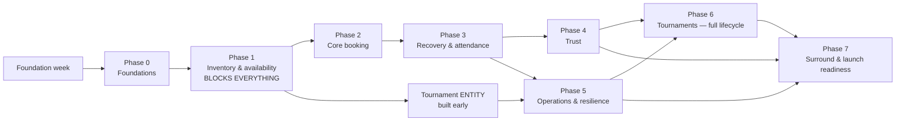

# E7GZ PS
# IMPLEMENTATION ROADMAP v1.0

**Basis.** The phase structure is the PRD's own build-and-validation sequence (`PRD §26`), which is authored by the PRD and may change without a Product Change Request. What this document adds is the **architecture work** inside each phase and the **architecture exit criteria** that make the phase's exit provable.

**This is a build sequence, not a staged public release.** Every `M` requirement is in the launch (`PRD §26`).

---

# 0. BEFORE PHASE 0 — FOUNDATION WEEK

Not a Product phase. One short block of work that everything else depends on.

| Task | Output |
|---|---|
| Repository, module skeleton, ArchUnit boundary rules | `ps.e7gz.*` packages with enforced dependency direction (`03 §2.1`) |
| Docker Compose: PostgreSQL 16 + `btree_gist` + `postgis`, MinIO, MailHog | a developer can run everything locally |
| Flyway wiring; `e7gz_app` and `e7gz_migrator` roles | migration discipline from commit one (`04 §8`) |
| Injected `Clock`; `Instant.now()` banned by test | boundary tests become possible (`08 §8`) |
| `BigDecimal`/`NUMERIC` money type; floats banned by test | `NFR-25` |
| OpenAPI generation + TypeScript client generation in CI | three surfaces share one contract (`ADR-012`) |
| CI: unit · integration (Testcontainers) · ArchUnit · boundary pack scaffold | the quality gate exists before the code does |
| Three client app skeletons from the supplied prototypes, incl. RTL scaffolding | `FR-VEN-40`, `NFR-33` |

---

# 1. PHASE 0 — FOUNDATIONS

**Product scope** (`PRD §26`): timezone and operating-session engine · resource model with both status domains · pricing and money rounding · audit and append-only infrastructure · the closed enums with write-time validation.

**Architecture work**

| # | Work | Doc |
|---|---|---|
| 0.1 | All Product enum types created as PostgreSQL enums; three separate Java enum types for reason codes, booking events and API errors | 04 §4.2, ADR-016 |
| 0.2 | Append-only triggers + revoked privileges on all 11 append-only tables | 04 §4.3, ADR-008 |
| 0.3 | `audit_event` with actor, reason, `correlation_id`, redaction allowlist | 10 §8 |
| 0.4 | `venue_operating_session` generator with DST handling + `ex_session_no_overlap` | ADR-009 |
| 0.5 | `resource` with both independent status columns and `ck_console_iff_playstation` | 04 §5.4 |
| 0.6 | Pricing model with `ck_price_dimensions` and half-up rounding | 04 §5.4 |
| 0.7 | Identity: registration, OTP with the frozen limits, tokens with rotation | 10 §2 |
| 0.8 | Correlation-ID propagation end to end | NFR-32 |

**Exit criteria**

| From the PRD | Architecture proof |
|---|---|
| Operating sessions validate cyclically across a week **including DST transitions** | the exclusion constraint rejects an overlapping session; DST cases in the suite (non-existent start, ambiguous repeat, 23/25-hour day) |
| Money rounds correctly | property test over the `hourly × minutes ÷ 60` formula, half-up per line item |
| Enum writes reject unknown values | a raw-SQL insert of an unknown enum value fails |
| — | append-only: a direct `UPDATE` on each of the 11 tables raises |
| — | the three enum types share no members; the five removed tokens appear in none |

---

# 2. PHASE 1 — INVENTORY AND AVAILABILITY

> **Phase 1 blocks everything.** (`PRD §26` dependency note)

**Product scope:** the canonical availability predicate · reservation model with release history · `businessDate` · Nearest Availability.

**Architecture work**

| # | Work | Doc |
|---|---|---|
| 1.1 | `resource_reservation` with `ex_no_double_booking` and the `planned`/`occupied` split | 05 §3 |
| 1.2 | Layer 2 blocking windows and selling-block **states** | ADR-010 |
| 1.3 | `AvailabilityQuery.isFree` — the eight ordered checks, one implementation | 05 §2 |
| 1.4 | `PredicateResult` with the failing-check index | 05 §2.2 |
| 1.5 | `23P01` → typed domain failure translation | ADR-003 |
| 1.6 | `business_date` computation for both session and out-of-hours cases | 04 §5.7 |
| 1.7 | Nearest Availability algorithm + `venue_activity_availability` projection + rebuild command | 05 §5 |
| 1.8 | PostGIS coordinates and KNN distance ordering | ADR-019 |
| 1.9 | **Concurrency harness** and the nightly invariant sweep | 11 §4 |

**Exit criteria**

| From the PRD | Architecture proof |
|---|---|
| The concurrency test passes | N threads → exactly 1 success, N−1 clean failures, 0 partial reservations, 0 overlapping rows |
| **No path to a slot bypasses the predicate** | predicate-singularity test: only one call site constructs the eight checks |
| — | `EC-AVAI-002`: ACTIVE + OWNER_REVIEW_REQUIRED rejected by all six flows |
| — | `EC-AVAI-004`: no-show at 8:16 then book 8:20 succeeds; both records survive |
| — | `NFR-11` p95 < 1 s on seeded data with the projection in place |

---

# 3. PHASE 2 — CORE BOOKING

**Product scope:** registration and OTP · discovery · **map view** · online booking creation through the 20-condition predicate · venue accept, reject and expiry · manual booking · customer cancellation · the customer-facing projection.

**Architecture work**

| # | Work | Doc |
|---|---|---|
| 2.1 | `booking` with `ck_terminal_reason`, `ck_duration`, `commitment_period` and `ex_customer_no_overlap` | 04 §5.7 |
| 2.2 | **O1** creation orchestration — the 20 named conditions, count asserted | 06 §1.3 |
| 2.3 | **O2** accept / reject / reject-after-expiry, incl. `FR-BOK-16` operational-cause branch | 06 §2.1 |
| 2.4 | **O4** manual booking with its own 15-condition predicate | 06 §1.4 |
| 2.5 | `scheduled_transition` + deadline worker; T1, T4, T5, T6 | ADR-006 |
| 2.6 | Transactional outbox + dispatcher + `pg_notify` wake | ADR-004 |
| 2.7 | Idempotency records on every write in scope | ADR-015 |
| 2.8 | SSE endpoint + `LISTEN/NOTIFY` fan-out | ADR-014 |
| 2.9 | Contact-visibility resolver | 10 §5.1 |
| 2.10 | Customer projection buckets | 06 §1.5 |

**Exit criteria**

| From the PRD | Architecture proof |
|---|---|
| **J1** (find and book) and **J8** (walk-in) complete end to end | end-to-end tests on both journeys |
| Every terminal booking carries **one** reason code | integrity sweep clean on a seeded run |
| — | boundary tests: submit at `startAt − 15:00` succeeds, `−14:59` refused; `sessionEnd − 11 min` succeeds, `−9 min` refused |
| — | accept at `expiresAt − 1 s` succeeds; at the boundary expiry wins |
| — | contact redaction: field **absent**, not masked, in every retention case |
| — | a SUSPENDED venue can still accept a PENDING booking created before suspension |
| — | a manual booking at 3 AM for a venue closing at 2 AM succeeds and carries a `businessDate` |

---

# 4. PHASE 3 — RECOVERY AND ATTENDANCE

**Product scope:** `VENUE_RESPONSE_EXPIRED` handling and start-time resolution priority · Late Confirm in full · check-in, Mark Present — Late and no-show · attendance results · start-time revalidation.

**Architecture work**

| # | Work | Doc |
|---|---|---|
| 3.1 | `late_confirmation` with `ux_lc_open`; **O3** initiation, accept, decline, timeout | 06 §2.2 |
| 3.2 | T2 and T3; the warning row created **only** when the window > 60 s | 08 §2.6 |
| 3.3 | Neutral Late Confirm failure shaping + internal events | 10 §5.2 |
| 3.4 | `attendance_record` + `ck_late_present_blocks_noshow`; **O13** | 07 §7 |
| 3.5 | Reservation truncation on no-show | 05 §3.2 |
| 3.6 | **O11** start-time revalidation + the seven-level reason priority | 05 §7 |
| 3.7 | `SYSTEM_RESOURCE_STATE_INTEGRITY_ERROR` with the full alert payload | 12 §6.2 |
| 3.8 | **O12** completion + the eight attendance-default rules | 07 §7.3 |

**Exit criteria**

| From the PRD | Architecture proof |
|---|---|
| **J2, J3, J4, J5** complete | end-to-end tests |
| **Boundary tests at ±1 second pass on all four timers** | boundary pack green |
| — | 7:59 PM initiation → exactly 60 s and **no** warning notification; 7:50 PM → 5 min and one warning |
| — | a customer at 4 commitments: initiation blocked, **no hold created**, venue message reveals nothing |
| — | check-in at `+14:59` succeeds, `+15:00` refused and Late Present becomes available |
| — | a Late-Present booking cannot be marked no-show and completes as ATTENDANCE_UNCONFIRMED with no points |
| — | forcing a resource to DISABLED behind the predicate produces `SYSTEM_RESOURCE_STATE_INTEGRITY_ERROR` + admin alert |

---

# 5. PHASE 4 — TRUST

**Product scope:** the trust event stream · replay with as-of queries · attendance corrections and chains · the penalty ladder · ban qualification versus ban instance · the ban cascade · Verified Player qualification and operational status · points and referrals.

**Architecture work**

| # | Work | Doc |
|---|---|---|
| 4.1 | `trust_input_event` append-only + `ix_trust_replay` + `ux_one_protection_per_booking` | 04 §5.11 |
| 4.2 | Pure `replay` and `resolveEffectiveOutcomes` | 07 §3 |
| 4.3 | Reconciler with the three idempotency keys | 07 §4 |
| 4.4 | `ban_qualification` / `ban_instance` split + `ux_one_active_ban` + the MAX extension | 07 §5 |
| 4.5 | **O14** ban cascade, once only | 07 §5.4 |
| 4.6 | Verified Player qualification, operational status, transitions, admin protection | 07 §6 |
| 4.7 | Points and wallet ledgers + `ux_points_*` + the MIN compensation rule | 04 §5.12 |
| 4.8 | Referral lifecycle with value read **at OTP verification** | 03 §16 |
| 4.9 | Fee treatment as an exhaustive switch with **no default branch** | 03 §16 |

**Exit criteria**

| From the PRD | Architecture proof |
|---|---|
| **J12** completes | end-to-end test |
| **Replay reproduces a seeded history exactly** | seeded-replay and as-of tests |
| **No double reward or double penalty is reachable** | double-replay test; unique indexes on both reward causes |
| — | reversing a Monday no-show on Friday changes the **Monday** position |
| — | three chained corrections → exactly one effective outcome |
| — | a second qualification during an active ban → one instance, advanced stage, reset counter, `BAN_EXTENDED` |
| — | trust-correction revoke then re-qualify → VERIFIED with no admin action and two transition IDs |
| — | reversing a +1,000 referral at 300 points → balance 0 and a 700 unrecovered amount |
| — | `replay` performs no writes, proven with a read-only connection |

---

# 6. PHASE 5 — OPERATIONS AND RESILIENCE

The hardest phase. 44 requirements and every cascade.

**Product scope:** maintenance with the rolling threshold · closures · venue and resource emergencies · the emergency status lifecycle including conversion · operational selling blocks · owner review and its cascade · timer pauses and caps · venue account disable and Platform Attendance Protection.

**Architecture work**

| # | Work | Doc |
|---|---|---|
| 5.1 | `maintenance_window` inside Layer 1 + the `range_agg` rolling threshold | 04 §5.6 |
| 5.2 | `venue_closure` in Layer 2 | ADR-010 |
| 5.3 | `emergency` + `ck_conversion_target` + the status lifecycle | 04 §5.6 |
| 5.4 | Selling blocks as states with a single active row per subject | 05 §3.1 |
| 5.5 | **O7 / O8** emergency cascades, all-or-nothing | 06 §2.5 |
| 5.6 | **O9** owner-review cascade with no Owner Password anywhere | 06 §2.7 |
| 5.7 | Pause / resume with the two 30-minute counters | 08 §2.5 |
| 5.8 | Optimistic feasibility test | 08 §2.5 |
| 5.9 | **O10** venue account disable with all five per-state effects | 06 §2.8 |
| 5.10 | `account_access_restriction_interval` + Platform Attendance Protection | 07 §7.5 |
| 5.11 | Fault-injection harness for every cascade | 12 §4 |
| 5.12 | Sellable-gap detector in the integrity sweep | 11 §4 |

**Exit criteria**

| From the PRD | Architecture proof |
|---|---|
| **J6, J7, J11** complete | end-to-end tests |
| **Fault injection produces no partial cascade and no sellable gap** | injection at every step of O7, O8, O9 |
| **All three interrupted-by-emergency reason codes are reachable** | seeded end-to-end run |
| **The optimistic feasibility test produces the same decision on repeated evaluation of identical state** | determinism test |
| — | splitting a 30-hour maintenance into two windows with a one-minute gap still demands the Owner Password |
| — | 12 min venue pause + 19 min resource pause → cancels at 30 min under the **resource** reason |
| — | ending an emergency while the venue is closed does not restart the timer |
| — | two disable/re-enable cycles in one session → **one** protection event and **one** reset |
| — | a resource emergency does not block bookings on the venue's other resources |
| — | `END EMERGENCY` on an over-threshold resource leaves it unsellable under owner review |

---

# 7. PHASE 6 — TOURNAMENTS

**Product scope:** the tournament entity · player and venue hosted creation · approval · holds · join and leave · the checkpoint · lifecycle and cancellation authority · resource loss handling · cost snapshots and revenue.

> **Dependency note from the PRD:** Phase 5's owner-review cascade depends on Phase 6's tournament entity for its full cascade, so tournaments and operations overlap in practice. **Build the tournament entity early enough that the owner-review cascade can be tested against it.** In practice: create `tournament`, `tournament_resource` and the hold kinds during Phase 5, and complete the lifecycle here.

**Architecture work**

| # | Work | Doc |
|---|---|---|
| 6.1 | `tournament*` tables + `ux_one_pending_request` + `ck_t_terminal` + `ck_checkpoint` | 04 §5.10 |
| 6.2 | Approval Hold → Tournament Hold transition in the ledger | 05 §3.2 |
| 6.3 | **O16** create / approve / checkpoint / start / cancel | 06 §3.4 |
| 6.4 | T7, T8, T9 scheduled transitions | 08 §1 |
| 6.5 | **O15** Verified Player cascade, once per transition ID | 06 §3.6 |
| 6.6 | Resource-loss handling, before and during | 06 §3.5 |
| 6.7 | Cost snapshot at request creation / creation | 03 §7 |
| 6.8 | Owner Password matrix for tournaments | 10 §3.2 |

**Exit criteria**

| From the PRD | Architecture proof |
|---|---|
| **J10** completes | end-to-end test |
| **Every tournament reason is reachable and prioritised correctly** | exhaustive enum reachability test + priority test |
| — | creation at `startAt − 1h59m` refused, at exactly `−2h` succeeds |
| — | a player request against a resource holding a confirmed booking fails, and the booking is untouched |
| — | a creator with one pending request cannot open a second anywhere on the platform |
| — | 7 participants at the checkpoint → cancelled and resources released **in the same transaction** |
| — | a tournament at a venue suspended after creation still passes its checkpoint |
| — | disabling the account during PENDING_VENUE_APPROVAL frees the creator's slot with **no** cooldown |
| — | losing 3 of 4 resources continues and notifies; losing the 4th cancels; the stored cost is unchanged |

---

# 8. PHASE 7 — SURROUND AND LAUNCH READINESS

**Product scope:** reviews and moderation · Platform Admin modules · the notification catalogue across all channels · Arabic RTL Dashboard · reporting and metric instrumentation · abuse signals.

**Architecture work**

| # | Work | Doc |
|---|---|---|
| 7.1 | Reviews + `ux_review_current` + cooldown + rating projection | 04 §5.13 |
| 7.2 | The full notification catalogue and copy-rule tests | 08 §4.5 |
| 7.3 | All 20 Platform Admin modules | 09 §5 |
| 7.4 | Arabic RTL across every Dashboard module | 11 §6 |
| 7.5 | Every metric in `PRD §4.2` instrumented | 11 §5.2 |
| 7.6 | Abuse-signal pipeline with **no** write path into Trust, Venue or Booking | 11 §5.6 |
| 7.7 | Alert rules Sev-1 to Sev-3 | 11 §5.4 |
| 7.8 | Backup, PITR and the timed restore drill | 12 §5 |
| 7.9 | Load test at 10× projected peak with the invariant sweep running | 11 §3 |

**Exit criteria — the launch readiness bar (`PRD §4.3`)**

| # | Criterion |
|---|---|
| 1 | Every **M** requirement Done per `PRD §0.4`; `13 — Traceability Matrix` shows no unassigned FR |
| 2 | **Zero known double-booking paths** |
| 3 | Every terminal booking reason **and** every tournament reason reachable and mapped to a fee treatment |
| 4 | Trust replay reproduces current state and as-of state at arbitrary past points |
| 5 | The full emergency cascade is atomic under fault injection |
| 6 | Every metric in `PRD §4.2` instrumented |
| 7 | All three interrupted-by-emergency reason codes reachable |
| 8 | The optimistic feasibility test is deterministic |
| 9 | Boundary tests at ±1 second pass on every timer |
| 10 | A restore from backup has been drilled and timed |

---

# 9. DEPENDENCY GRAPH

---

# 10. WHAT TO BUILD FIRST ON DAY ONE

For a small team, the order inside Phase 1 matters more than any other ordering decision in the project.

1. **`resource_reservation` with the exclusion constraint**, and a test that proves two overlapping inserts cannot both commit. Everything else is negotiable; this is not.
2. **`isFree` with the eight checks in order**, returning the failing check index.
3. **The concurrency harness.** Write it before the booking endpoint exists, so it runs against every change from then on.
4. **`venue_operating_session` generation**, because four later phases query it and DST bugs found late are expensive.
5. **The deadline table and worker**, because the 10-minute response window is the product's heartbeat and every later phase adds transitions to it.

Only then the booking endpoint.

---

# 11. RISKS TO THE PLAN

| # | Risk | Mitigation |
|---|---|---|
| I1 | Phase 5 is far larger than the others — 44 requirements and every cascade | build the tournament entity early (`§7`); start the fault-injection harness in Phase 2, not Phase 5 |
| I2 | The 20-condition predicate drifts from `FR-BOK-11` as code is refactored | one ordered named list in one class, each entry citing its source, with a count assertion (`06 §1.3`) |
| I3 | The Owner Password protected/unprotected lists drift | `@OwnerProtected` + an architecture test that reads `FRS §2.4` as data (`10 §3.3`) |
| I4 | An implementer resolves an ambiguity against an old v4.x document (`R12`) | this pack states in `00 §0.2` that v4.x is not an input; every statement here cites v5.0 / PRD v1.1 / FRS v1.1 |
| I5 | Eligibility category miscategorised — the PRD's named most-common error | mandatory declaration on every command + build-time check (`ADR-022`) |
| I6 | Scope pressure to add payments before launch (`R11`) | the port exists with no caller; an architecture test enforces it (`ADR-018`) |
| I7 | The `[OPEN]` rate-limit values are still unapproved at Phase 7 | they gate only hardening, not build; raise them at the Phase 0 review |
| I8 | Arabic RTL is left to the end and reveals layout debt | RTL scaffolding in the foundation week; every Dashboard module reviewed in both directions as it ships |

---

# 12. IMMEDIATE NEXT STEPS

1. **Product Owner** rules on `[ASSUMPTION] A1`, `A2`, `A5`, `A6` and approves the `[OPEN] A4` rate-limit table (`01 §14`).
2. **Technical lead** signs off the ADR log, or raises a superseding ADR before any code is written.
3. Run the **foundation week**.
4. Start Phase 0, with the Phase 0 exit criteria already written as failing tests.

---

*End of Implementation Roadmap v1.0. End of the E7GZ PS Technical Architecture pack.*
